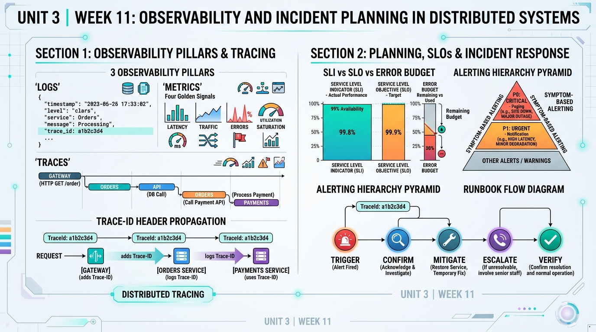

<!-- HU-STATUS TEMPLATE - do NOT remove the <!-- ... --> markers or the table headers.
     Your weekly grade is read AUTOMATICALLY from this file:
       11-week/hu-status/README.md  (inside YOUR fork). English. -->

# Weekly Status - Week 11

<!-- CONFIG-START - must match your profile repo (username/username) CONFIG -->
- FULL_NAME: Daniel Felipe Cerquera Idrobo
- GITHUB_USER: Pipecerquera
- TEAM: Barbersaas
- SPRINT_GOAL: Close corte 2 in public — deliver release 2.0.0 (`c2-release`, the sprints and the demo video) and defend it in the final presentation with a live demo of the saga failing and compensating — and start observability in distributed systems: audit what BarberSaaS already logs and propagates, and define its SLOs, error-budget policy, a symptom-based alert with owner and runbook, and the observability stories with testable acceptance criteria.
<!-- CONFIG-END -->

## 1. User stories worked this week
| HU ID | Title | Status (todo/doing/done) | Evidence (PR or commit URL) |
|---|---|---|---|
| HU-000-047 | As the team, we want corte 2 delivered on Moodle: release 2.0.0 with every repository's tag, the team, the sprints and a demo video of the app (tracking DOCS [#109](https://github.com/code-corhuila/barber-saas-docs/issues/109)) | **done — uploaded 2026-10-13** | `c2-release.zip` (inner zip of the 31 `v2.0.0` source archives, `release-tags-v2.0.0.md` with the link, Release ID, tag and commit of each repository, `team.txt`, the 98-second [demo video](https://drive.google.com/file/d/1kLBrQx8tr_nIw05Jc0EfdV_R_W2pfuvb/view?usp=sharing)) · `sprints-c2.zip` (hu-status 06–10, equal to WEEKLY [`d32d49e`](https://github.com/Pipecerquera/sistemas-distribuidos-2026-b-g2-daniel-cerquera/commit/d32d49e)) · video linked in DOCS [#113](https://github.com/code-corhuila/barber-saas-docs/pull/113) (merged 2026-10-13) |
| HU-000-048 | As the team, we want to defend the architecture in the final presentation (7 min + 3 min of questions) with a live demo of a service failing, so the evaluator sees the distributed behaviour, not slides only | **done — presented 2026-10-15** | [`Sustentacion-BarberSaaS.pdf`](Sustentacion-BarberSaaS.pdf) — 11-slide deck (problem → architecture → orchestration: gateway, workflow and worker → front in Docker → two live demos → closing) with a script per speaker; my part: service orchestration, the owner-onboarding saga and its compensation, and the **workflow demo**: a sign-up `COMPLETED`, then `docker stop identity-auth-api` and a second sign-up ending `COMPENSATED` / `STEP_UNAVAILABLE` with the barbershop removed, shown in `workflow.saga`. Rehearsed the same morning on the `v2.0.0` stack; closes week 10's risk "live demo with an injected failure not rehearsed" |
| HU-000-049 | As an operator, I want structured logs with a trace id propagated across services, so one request can be followed through every log (week 11, session 1) | **done for the synchronous path — audited this week; built in earlier weeks** | gateway creates or reuses `X-Correlation-Id` ([`10-security.conf`](https://github.com/code-corhuila/barber-saas-api-gateway/blob/v2.0.0/nginx/conf.d/10-security.conf)) and logs one JSON line per request ([`nginx.conf`](https://github.com/code-corhuila/barber-saas-api-gateway/blob/v2.0.0/nginx/nginx.conf)) · Java services log ECS JSON with `correlationId` in the MDC (e.g. workflow [`CorrelationFilter.java`](https://github.com/code-corhuila/barber-saas-workflow/blob/v2.0.0/workflow-adapters/src/main/java/co/edu/corhuila/barbersaas/workflow/adapter/in/http/CorrelationFilter.java)) · the saga forwards it to each step ([`ParticipantClient.java`](https://github.com/code-corhuila/barber-saas-workflow/blob/v2.0.0/workflow-adapters/src/main/java/co/edu/corhuila/barbersaas/workflow/adapter/out/http/ParticipantClient.java)). Two gaps found and turned into stories: `durationMs` holds seconds (OBS-01) and the worker sends its run id instead of the event's `correlationId` (OBS-04) — [`observability-plan.md`](observability-plan.md) §1 |
| HU-000-050 | As an operator, I want rate, errors and latency metrics of every HTTP service and the outbox lag, so the SLOs can be measured (stories OBS-02, OBS-05) | todo | Collector, Prometheus and Grafana already in `infra-postgres` under the `observability` profile ([`e7cea59`](https://github.com/code-corhuila/barber-saas-infra-postgres/commit/e7cea59d8a34222b4f273d5b7919c4436bc5f5ad)); no service exports OTLP yet. Acceptance criteria in [`observability-plan.md`](observability-plan.md) §5 |
| HU-000-051 | As an operator, I want one distributed trace across the owner-onboarding saga (gateway → workflow → barbershop → platform-admin → identity-auth), so I see which step was slow or failed (story OBS-03) | todo | Today the request is followed by its `correlationId` across the logs of the five services; there are no spans and the collector's traces pipeline only goes to `debug`. Acceptance criteria in [`observability-plan.md`](observability-plan.md) §5 |
| HU-000-052 | As the team, we want SLOs, an error-budget policy, a symptom-based alert with owner and runbook, and the observability work sliced in stories (week 11, session 2) | **done** | [`observability-plan.md`](observability-plan.md): SLO-1 availability 99.5 % (no 5xx at the gateway), SLO-2 latency 95 % (GET < 300 ms, booking < 800 ms), SLO-3 freshness 99 % (outbox event published < 60 s), all on 28 rolling days; error-budget policy (50 % / 100 % / 20 %-incident rules); alert `EventsNotDelivered` (owner Daniel, multi-window burn rate 14.4×); runbook RB-01 "domain events are not being delivered"; stories OBS-01…OBS-06 |
| HU-000-053 | As an operator, I want the booking journey (`POST /api/v1/appointments` in `appointment-api` → barbershop-api, loyalty-api, schedule-api → `appointment` schema → worker → loyalty-api) observable end to end, so one `trace_id` follows a booking across services, the outbox and the logs (week 11 workshop, delivery 1: CP0–CP5) | **done — delivery 1** | [`workshop/`](workshop/README.md): journey and span tree ([`01-journey.md`](workshop/01-journey.md), `<COMMIT_URL_CP1>`) · log contract ([`02-log-contract.md`](workshop/02-log-contract.md), `<COMMIT_URL_CP2>`) · Java 21 / Spring Boot instrumentation of `appointment-api` with a W3C `traceparent` filter, JSON logger, propagation to `schedule-api`, `/metrics` and a passing test ([`03-instrumentation/`](workshop/03-instrumentation/HOW-TO-RUN.md), `<COMMIT_URL_CP3A>`, `<COMMIT_URL_CP3B>`) · golden signals ([`04-metrics.md`](workshop/04-metrics.md), `<COMMIT_URL_CP4>`) |
| HU-000-017 | Carried over — hardened config (`.env.example`, fail-fast, secret scan, a feature flag) | doing (unchanged) | No change this week; the new observability stories keep config in environment variables (OTLP endpoint) |

## 2. My individual contribution
- **Delivered corte 2 on Moodle (2026-10-13).** Built `c2-release.zip` the way the assignment asked: the inner zip of the 31 `v2.0.0` source archives, the `.md` with link, Release ID, tag object and commit of every repository, the `.txt` with the team and the demo video at the root; checked every rebuilt entry byte-identical against the previous one. Built `sprints-c2.zip` from the hu-status of weeks 06–10, identical to WEEKLY `main` at [`d32d49e`](https://github.com/Pipecerquera/sistemas-distribuidos-2026-b-g2-daniel-cerquera/commit/d32d49e).
- **Recorded the release demo video** (98 s, no cuts): owner, barbers and client on the Android emulator, with the team as users, on a clean copy of the `v2.0.0` platform; linked it in the delivery and in DOCS [#113](https://github.com/code-corhuila/barber-saas-docs/pull/113).
- **Prepared and gave the final presentation (2026-10-15)** with Carolay, Carlos and Juan Pablo, following the teacher's agenda (problem → architecture → service orchestration → front in Docker with services switched off and on → workflow demo). Wrote the 11-slide deck with the speaker script and timings for each of us and a study guide for the questions.
- **Built the local demo environment**: a Compose file with the shell and the 8 domain portals published on ports 4200 and 4301–4308 (the repositories only `expose`, norm 5.6.1, so this file stays out of every repository), built from a clean `v2.0.0` copy, plus a step-by-step demo script with a fallback for each failure (expired 24-hour service tokens give 401 in the saga → `dev-keys.sh`; backend down → video). Tested both demos that morning: `docker stop bs-portal-loyalty` shows "Fidelidad no está disponible…" while the rest of the app keeps working, and "Intentar de nuevo" brings it back; the saga ends `COMPLETED`, then `COMPENSATED` / `STEP_UNAVAILABLE` with `identity-auth-api` stopped.
- **Presented my part**: how services coordinate without sharing a database (gateway, workflow, worker), why a saga (no transaction spans three databases), its three steps with an `Idempotency-Key` per step and the state saved after each one, the compensation (`COMPENSATED` with a reason the app understands, `FAILED` for a person to review), and ran the workflow demo live.
- **Audited the observability of the 30 repositories at `v2.0.0`** (session 1): the trace id is created at the gateway and reaches every synchronous call and every log line, and each outbox row keeps it; metrics and spans are not produced yet although the collector, Prometheus and Grafana are already in `infra-postgres`. Found two defects: the gateway's `durationMs` carries nginx's `$request_time`, which is in seconds, and the worker sends its run id instead of each event's `correlationId`, so a booking and the notice it causes do not share one id.
- **Defined the SLOs and the incident response** (session 2): three SLOs measured at the edge and on the outbox tables, an error-budget policy, a symptom-based alert with burn-rate windows, the runbook for undelivered events written against the real tables (`outbox_event`, `published_at`, `failed_at`, `last_error`) and containers, and six stories with acceptance criteria that can be executed as tests.
- **Made the booking journey observable (workshop, delivery 1).** Mapped the 12 hops of `POST /api/v1/appointments` and how the trace context crosses the outbox (no broker, ADR-016: the `traceparent` rides in `outbox_event` and the worker sends it back); wrote the log contract (11 required fields, 9 domain fields, a never-log list with masking, 7 example lines with a timeout to `schedule-api` and a `422` double-booking rejection); instrumented `appointment-api` in its own stack (W3C filter, JSON logger, child `traceparent` to `schedule-api`, `appointment_book_requests_total{outcome}` and `appointment_book_duration_seconds` on `/metrics`) with a test that proves the `trace_id` reaches `schedule-api`; and defined the four golden signals of the five services of the journey with bounded labels and buckets set on the 800 ms booking SLO.
- After the presentation, removed the demo containers and images (`docker compose -p bs-portales down --rmi local`), keeping the demo files to rebuild them.

## 3. Blockers and risks
- **No metrics and no spans yet**: SLO-1 and SLO-2 can only be computed from the gateway's access log, and SLO-2 only after OBS-01 fixes the latency unit. Instrumenting the 8 APIs touches Carlos's and Juan Pablo's repositories too, so OBS-02 needs the same work split as release 2.0.0.
- **No trace backend and no Alertmanager**: the collector sends traces to `debug` and nothing routes alerts; OBS-03 and OBS-06 add them under the `observability` profile, which raises the memory the full platform needs on a laptop.
- **The worker's correlation gap (OBS-04) touches the event contract**: the change belongs in DOCS first (ADR-016 / the envelope contract) before code.
- **48 review findings of release 2.0.0 remain MVP 3 backlog** (DOCS [#111](https://github.com/code-corhuila/barber-saas-docs/issues/111)), three critical; SMTP credentials and the Firebase project (push, F-4) are still pending.

## 4. Plan for next week
- Specify in DOCS the SLOs, the alert and the correlation change of the outbox (a decision record), then build OBS-01 (latency unit at the gateway) and OBS-04 (the worker forwards each event's `correlationId`) in small pull requests to `develop`.
- OBS-05 in the worker (`outbox_oldest_unpublished_seconds`) and OBS-06 (`observability/rules.yml` with `EventsNotDelivered`, `promtool check rules` in CI) in `infra-postgres`, and test RB-01 by stopping loyalty-api for 6 minutes.
- Agree with the team how OBS-02 (RED metrics) and OBS-03 (the saga trace) are split across the 8 APIs.

## 5. Compliance self-check
- [x] Conventional Commits - `type(scope): summary` — DOCS [#113](https://github.com/code-corhuila/barber-saas-docs/pull/113) `docs(project-control): link the release 2.0.0 demo video`, WEEKLY `docs(week-10): …`.
- [x] Per-environment HU branch + PR to that environment (hu-xxx-dev -> develop, ...) — DOCS #113 went through a child branch and a PR to `main` (DOCS has no environments); no code repository changed this week. The observability stories are planned as PRs to `develop`.
- [x] Testable acceptance criteria — each story OBS-01…OBS-06 states an executable check (e.g. stop loyalty-api 6 min → `EventsNotDelivered` fires; a request with `X-Correlation-Id: corr-test` appears with that id in notifications-api's log).
- [x] Tests added/updated (unit / integration) — `TracePropagationTest` (Spring Boot, random port, stub of `schedule-api`) checks that the incoming `trace_id` is the one sent downstream and that `/metrics` counts the booking; real output in [`HOW-TO-RUN.md`](workshop/03-instrumentation/HOW-TO-RUN.md).
- [x] DDD / hexagonal boundaries respected (domain has no I/O) — the plan keeps instrumentation in the adapters (HTTP filters, OTLP exporter, worker scheduler); the domain modules stay without I/O.
- [x] No secrets; config via environment variables — the demo environment and its test accounts were local only and never committed; the runbook uses only environment-provided credentials (`$POSTGRES_USER`).

## 6. Evidence links
- Repo: https://github.com/Pipecerquera/sistemas-distribuidos-2026-b-g2-daniel-cerquera.git
- This week's infographic: `11-week/hu-status/Week-11.jpg` (in this same folder)
- Final presentation (2026-10-15), "BarberSaaS — Cómo se coordinan 31 repositorios: el workflow y el worker": [`11-week/hu-status/Sustentacion-BarberSaaS.pdf`](Sustentacion-BarberSaaS.pdf)
- Observability workshop, delivery 1 (CP0–CP5): [`11-week/hu-status/workshop/`](workshop/README.md) — commits `<COMMIT_URL_CP0>` · `<COMMIT_URL_CP1>` · `<COMMIT_URL_CP2>` · `<COMMIT_URL_CP3A>` · `<COMMIT_URL_CP3B>` · `<COMMIT_URL_CP4>` · `<COMMIT_URL_CP5>`
- Observability plan — audit, SLOs, error-budget policy, alerts, stories and runbook RB-01: [`11-week/hu-status/observability-plan.md`](observability-plan.md)
- Release 2.0.0 demo video (98 s): https://drive.google.com/file/d/1kLBrQx8tr_nIw05Jc0EfdV_R_W2pfuvb/view?usp=sharing
- DOCS, demo video linked in the release 2.0.0 closure (merged): https://github.com/code-corhuila/barber-saas-docs/pull/113
- Trace id and structured logs at `v2.0.0`: https://github.com/code-corhuila/barber-saas-api-gateway/blob/v2.0.0/nginx/nginx.conf · https://github.com/code-corhuila/barber-saas-workflow/blob/v2.0.0/workflow-adapters/src/main/java/co/edu/corhuila/barbersaas/workflow/adapter/in/http/CorrelationFilter.java · https://github.com/code-corhuila/barber-saas-worker/blob/v2.0.0/src/worker/adapter/outbound/http/client.py
- Observability stack in infra-postgres: https://github.com/code-corhuila/barber-saas-infra-postgres/blob/v2.0.0/observability/otel-collector.yaml
- **Complete record of my individual work this week** (2026-10-12 to 2026-10-18, Bogotá time; generated from git and GitHub across the 30 code repositories, DOCS and WEEKLY):
  - Pull requests: **1** (1 merged).
    - `barber-saas-docs`: [#113](https://github.com/code-corhuila/barber-saas-docs/pull/113) docs(project-control): link the release 2.0.0 demo video — merged 2026-10-13 (also cited in week 10 as part of the `c2-release` delivery)
  - Commits: **3**.
    - `barber-saas-docs`: [`5ecc03e`](https://github.com/code-corhuila/barber-saas-docs/commit/5ecc03e57b45bd8c48eaa86bdefa5098cb7d7145) docs(project-control): link the release 2.0.0 demo video — 2026-10-13
    - `sistemas-distribuidos-2026-b-g2-daniel-cerquera`: [`96964e9`](https://github.com/Pipecerquera/sistemas-distribuidos-2026-b-g2-daniel-cerquera/commit/96964e9) docs(week-10): add the c2-release delivery and the demo video — 2026-10-13
    - `sistemas-distribuidos-2026-b-g2-daniel-cerquera`: [`d32d49e`](https://github.com/Pipecerquera/sistemas-distribuidos-2026-b-g2-daniel-cerquera/commit/d32d49e) docs(week-10): list the hu-status commits of 2026-10-09 and 2026-10-13 — 2026-10-13
  - Issues opened: 0 · comments: 0 · tags and releases: 0.
  - Off-GitHub work of the week: the Moodle delivery of corte 2 (2026-10-13), the final presentation and its live demos (2026-10-15), and the observability plan in this folder.
- *End of the complete record.*

