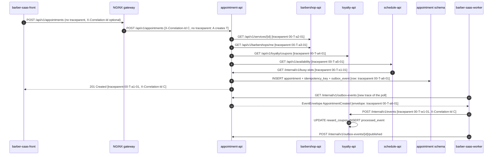

# CP1 - Critical Journey: Book an Appointment

**Journey:** a `CLIENT` books an appointment with a barber (HU-APPT-001-A, FR-008).
**Central service:** `appointment-api`. **Entry:** `POST /api/v1/appointments`.
**Edge hop:** the NGINX gateway (`barber-saas-api-gateway`) is only the edge; instrumentation starts
at `appointment-api`.

Sources in `barber-saas-docs`: `07-api/contracts/openapi/appointment-service.yaml`,
`09-microservices/communication-patterns.md` §3, `09-microservices/event-catalog.md`,
`06-data/models.md` §5, §6 and §10, ADR-015, ADR-016. The order of steps 3 to 6 is the order of
`ManageAppointments.book` in `appointment-api`.

## 1. Hop table

| Step | Caller | Callee | Protocol | Operation | Sync/Async | Data |
|---|---|---|---|---|---|---|
| 1 | `barber-saas-front` | NGINX gateway | HTTPS | `POST /api/v1/appointments` | Sync | JWT (RS256), `Idempotency-Key`, `barberId`, `serviceId`, `date`, `startTime`, `notes` |
| 2 | NGINX gateway | `appointment-api` | HTTP | `POST /api/v1/appointments` | Sync | Same request + `X-Correlation-Id`; `traceparent` passed through untouched |
| 3 | `appointment-api` | `barbershop-api` | HTTP | `GET /api/v1/services/{id}` | Sync | `durationMinutes`, `priceCents` |
| 4 | `appointment-api` | `barbershop-api` | HTTP | `GET /api/v1/barbershops/me` | Sync | Time zone, cancellation window |
| 5 | `appointment-api` | `loyalty-api` | HTTP | `GET /api/v1/loyalty/coupons?clientId=&status=ACTIVE&limit=1` | Sync | `couponId` of the client's `ACTIVE` `reward_coupon` |
| 6 | `appointment-api` | `schedule-api` | HTTP | `GET /api/v1/availability?barberId=&serviceId=&date=` | Sync | Free `slots` of the day |
| 7 | `schedule-api` | `appointment-api` | HTTP | `GET /internal/v1/busy-slots` | Sync | `startTime` / `endTime` only (DEC-APPT-05) |
| 8 | `appointment-api` | PostgreSQL, schema `appointment` | SQL | One transaction: `INSERT` into `appointment`, `idempotency_key`, `outbox_event` | Sync | Appointment row, `priceAtBookingCents`, `AppointmentCreated` (v2) with `correlation_id` and `traceparent` |
| 9 | `barber-saas-worker` | `appointment-api` | HTTP | `GET /internal/v1/outbox-events?limit=50` | Async (poll every 5 s) | Pending `EventEnvelope` rows |
| 10 | `barber-saas-worker` | `loyalty-api` | HTTP | `POST /internal/v1/events` | Async | `EventEnvelope` of `AppointmentCreated` with `couponId` |
| 11 | `loyalty-api` | PostgreSQL, schema `loyalty` | SQL | `UPDATE reward_coupon` to `USED`, `INSERT` into `processed_event` | Async | `couponId`, envelope `id` (DEC-LOY-06) |
| 12 | `barber-saas-worker` | `appointment-api` | HTTP | `POST /internal/v1/outbox-events/{id}/published` | Async | Outbox row `id` |

The synchronous dependency simulated as slow in CP9 is step 6, `schedule-api`: `appointment-api`
waits at most 3 s per request with one retry, then answers `503` instead of booking an unchecked
slot (`communication-patterns.md` §3).

## 2. Trace context propagation

No message broker is used (ADR-016). The asynchronous boundary is the `outbox_event` row:
`appointment-api` stores the W3C `traceparent` of the booking span next to `correlation_id`, the
`EventEnvelope` carries it, and `barber-saas-worker` sends it back as the `traceparent` HTTP header
of `POST /internal/v1/events`. The trace therefore keeps one `trace_id` across the gap.

`T` is the same 32-hex `trace_id` on every arrow of the booking; each segment after it is the
`parent-id` (span id) of the span that made the call.

## 3. Span tree

All spans share `trace_id = T`. Parent-child links follow the `traceparent` of each call.

- `POST /api/v1/appointments` - server span, `appointment-api` (root, `a1`)
  - `GET barbershop-api /api/v1/services/{id}` - client span (`a2`)
    - `GET /api/v1/services/{id}` - server span, `barbershop-api`
  - `GET barbershop-api /api/v1/barbershops/me` - client span (`a3`)
    - `GET /api/v1/barbershops/me` - server span, `barbershop-api`
  - `GET loyalty-api /api/v1/loyalty/coupons` - client span (`a4`)
    - `GET /api/v1/loyalty/coupons` - server span, `loyalty-api`
  - `GET schedule-api /api/v1/availability` - client span (`a5`)
    - `GET /api/v1/availability` - server span, `schedule-api`
      - `GET appointment-api /internal/v1/busy-slots` - client span (`s1`)
        - `GET /internal/v1/busy-slots` - server span, `appointment-api`
  - `INSERT appointment, idempotency_key, outbox_event` - DB span, `appointment` schema (`a6`)
    - `deliver AppointmentCreated` - producer span, `barber-saas-worker` (`w1`, async boundary:
      parent is `a6`, read from `outbox_event.traceparent`; starts up to 5 s after `a1` ends)
      - `POST /internal/v1/events` - consumer span, `loyalty-api`
        - `UPDATE reward_coupon, INSERT processed_event` - DB span, `loyalty` schema

The NGINX gateway only forwards `traceparent` and `X-Correlation-Id`; it opens no span.

Steps 9 and 12 (outbox poll and confirmation) belong to the worker's own poll trace, not to the
booking trace: one poll serves many bookings.
