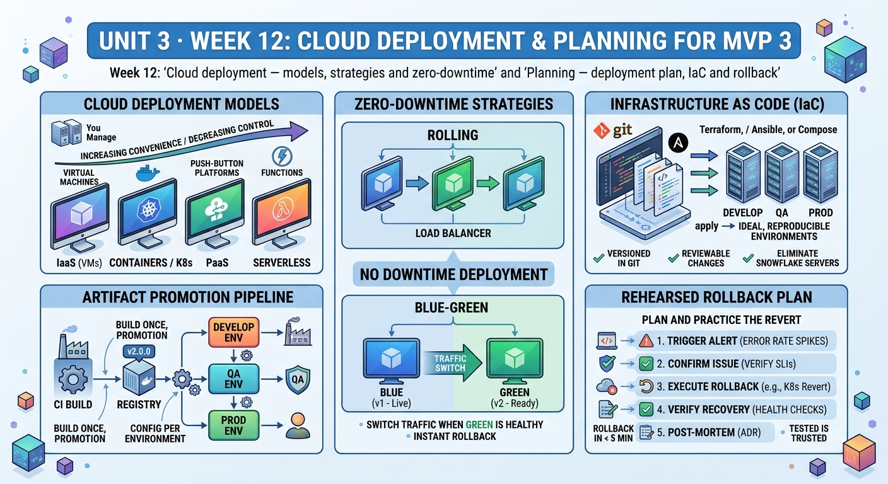

<!-- HU-STATUS TEMPLATE - do NOT remove the <!-- ... --> markers or the table headers.
     Your weekly grade is read AUTOMATICALLY from this file:
       12-week/hu-status/README.md  (inside YOUR fork). English. -->

# Weekly Status - Week 12

<!-- CONFIG-START - must match your profile repo (username/username) CONFIG -->
- FULL_NAME: Daniel Felipe Cerquera Idrobo
- GITHUB_USER: Pipecerquera
- TEAM: Barbersaas
- SPRINT_GOAL: Finish the week 11 observability workshop (deliveries 1 and 2) and start deployment: audit how BarberSaaS is deployed today (images, environments, health checks) and write the MVP 3 deployment plan — artifact promotion, infrastructure as code, a zero-downtime rolling strategy, a timed rollback and the deployment stories with testable acceptance criteria.
<!-- CONFIG-END -->

## 1. User stories worked this week
| HU ID | Title | Status (todo/doing/done) | Evidence (PR or commit URL) |
|---|---|---|---|
| HU-000-053 | Week 11 workshop, delivery 1 (CP0–CP5): the booking journey observable end to end | **done — 2026-10-19, in class** | Reported in [week 11](../../11-week/hu-status/README.md); commits dated this week, listed in the record of §6 |
| HU-000-054 | Week 11 workshop, delivery 2 (CP6–CP10): SLOs, burn-rate alerts, runbook and incident drill | **done — 2026-10-19** | Reported in [week 11](../../11-week/hu-status/README.md); the teacher's feedback of 2026-10-22 uses four of its examples (traffic estimate, outbox freshness SLO, budget policy, real mitigations) |
| HU-000-055 | As the team, we want BarberSaaS deployed to a cloud or production-like host from a tagged image, with a zero-downtime strategy and health checks (week 12, session 1) | **doing — audited, not deployed** | [`deployment-plan.md`](deployment-plan.md) §1: the 12 back-end services already have a Docker `healthcheck` on `GET /health` (e.g. [`appointment-api/deploy/compose.yml`](https://github.com/code-corhuila/barber-saas-appointment-api/blob/v2.0.0/deploy/compose.yml)) and `up.sh` waits on them; the gateway re-resolves services every 10 s ([`00-resolver.conf`](https://github.com/code-corhuila/barber-saas-api-gateway/blob/v2.0.0/nginx/conf.d/00-resolver.conf)). Missing: images are built on the host (no registry, no image tag) and there is no host outside the laptops |
| HU-000-056 | As the team, we want the MVP 3 deployment plan: artifact promotion, IaC for the environments, the zero-downtime strategy and a rollback, sliced into stories (week 12, session 2) | **done** | [`deployment-plan.md`](deployment-plan.md): build once on the version tag and promote the GHCR digest (§3), host, runtime and configuration as versioned files in `infra-postgres` (§4), rolling update per service with `--scale` and expand/contract migrations, chosen over blue-green (§5), rollback by pinning the previous image (§6), stories DEP-01…DEP-07 (§7) |
| HU-000-057 | As the operator, I want a rehearsed and timed rollback, so a bad release is undone in under 2 minutes with no failed request (story DEP-05) | todo | Procedure and target in [`deployment-plan.md`](deployment-plan.md) §6; the rehearsal needs two tagged images (DEP-01) and is not done yet |
| HU-000-017 | Carried over — hardened config (`.env.example`, fail-fast, secret scan, a feature flag) | doing (unchanged) | No change this week; the plan keeps every image version and secret in `env/<environment>.env`, out of git |

## 2. My individual contribution
- **Closed the week 11 observability workshop on 2026-10-19**: delivery 1 (CP0–CP5) in class and delivery 2 (CP6–CP10) the same day, 21 commits in this repository (listed in §6). The teacher's feedback (2026-10-22) shows four parts of it as examples for the group.
- **Reviewed the workshop feedback against the team's forks**: no AI trailers and everything on `main` in the three forks (Daniel, Carlos, Juan Pablo); flagged what each one should not repeat (commit size over 150 lines, CPs pushed in the same minute, the `promtool` check and the reflection link).
- **Audited how the platform is deployed at `v2.0.0`** (session 1): read the root composition of `infra-postgres`, `up.sh`, the `deploy/compose.yml` of the 28 repositories that have one and the gateway's resolver. Found that the health checks are liveness only (they never touch the database), that every host rebuilds the images so `qa` and `main` may not run the same bits, and that DOCS still describes Railway, MySQL and Vault for availability and environments.
- **Wrote the MVP 3 deployment plan** (session 2): why one production-like host and not Kubernetes, the promotion of the image digest, the infrastructure files to version, the rolling update step by step with its health gate and its expand/contract rule for migrations, why not blue-green with one PostgreSQL and one MongoDB, the rollback with a 2-minute target, and seven stories with acceptance criteria that can be run as tests.

## 3. Blockers and risks
- **No host and no budget decided**: the platform has never run outside a laptop; the free tiers we know are too small for the about 16 GB the full platform needs, so "cloud" depends on the team choosing a VM.
- **No image registry yet**: until DEP-01 publishes images to GHCR, there is no tagged image to deploy or to roll back to, so the rollback cannot be rehearsed this week.
- **Liveness, not readiness**: a container reports `healthy` while its database is down; a rolling update gated on that check could send traffic to a container that cannot serve (DEP-03).
- **DOCS drift**: NFR-002, NFR-008 and `10-devops/environments.md` describe the first prototype (Railway, MySQL, Vault, "no health checks"); the deployment decision must go to DOCS as an ADR before the code (DEP-07).
- **Open from week 11**: the observability stories OBS-01…OBS-09 are not built yet, and 48 review findings of release 2.0.0 remain MVP 3 backlog (DOCS [#111](https://github.com/code-corhuila/barber-saas-docs/issues/111)).

## 4. Plan for next week
- Record the deployment decision in DOCS (ADR: one host, rolling per service, digest promotion) and fix NFR-002 / NFR-008 / `environments.md` (DEP-07), in a PR to `main`.
- DEP-01 in one pilot service (`appointment-api`): build and push to GHCR on the version tag; then DEP-02 (`compose.release.yml`) and DEP-03 (readiness) in PRs to `develop`.
- Rehearse and time the rollback in `dev` with two tagged images and record the time and the failed requests (DEP-04, DEP-05).
- Agree with the team the host for the cloud deployment and split DEP-01 across the repositories each one owns; next topics are security and then CI/CD.

## 5. Compliance self-check
- [x] Conventional Commits - `type(scope): summary` — this week's commits follow it (`docs(w11): …`, `feat(w11): …`, `test(w11): …`, §6).
- [ ] Per-environment HU branch + PR to that environment (hu-xxx-dev -> develop, ...) — no code repository changed this week; the DEP stories are planned as PRs to `develop` and the ADR as a PR to DOCS `main`.
- [x] Testable acceptance criteria — each story DEP-01…DEP-07 has an executable check (e.g. a loop of 1 request per second through the gateway shows 0 5xx during `deploy.sh`; with PostgreSQL stopped, `/health/ready` answers 503).
- [ ] Tests added/updated (unit / integration) — no tests this week; the workshop's `TracePropagationTest` and the `promtool` checks are from 2026-10-19 and are counted in week 11.
- [x] DDD / hexagonal boundaries respected (domain has no I/O) — the readiness check (DEP-03) is planned as an inbound HTTP adapter and the deploy scripts live in `infra-postgres`; no domain module changes.
- [x] No secrets; config via environment variables — image versions and credentials go in `env/<environment>.env`, which git ignores; only `*.env.example` with names is versioned.

## 6. Evidence links
- Repo: https://github.com/Pipecerquera/sistemas-distribuidos-2026-b-g2-daniel-cerquera.git
- This week's infographic: `12-week/hu-status/Week-12.jpg` (in this same folder)
- MVP 3 deployment plan — current deployment, promotion, IaC, rolling strategy, rollback, stories DEP-01…DEP-07 and risks: [`12-week/hu-status/deployment-plan.md`](deployment-plan.md)
- Deployment at `v2.0.0`: root composition https://github.com/code-corhuila/barber-saas-infra-postgres/blob/v2.0.0/compose.yml · start script https://github.com/code-corhuila/barber-saas-infra-postgres/blob/v2.0.0/scripts/up.sh · a service's health check https://github.com/code-corhuila/barber-saas-appointment-api/blob/v2.0.0/deploy/compose.yml · gateway resolver https://github.com/code-corhuila/barber-saas-api-gateway/blob/v2.0.0/nginx/conf.d/00-resolver.conf
- Observability workshop (week 11 folder): [`11-week/workshop/`](../../11-week/workshop/README.md)
- **Complete record of my individual work this week** (2026-10-19 to 2026-10-22, Bogotá time; from git and GitHub across the 30 code repositories, DOCS and WEEKLY):
  - Pull requests: **0**.
  - Commits: **21**, all in `sistemas-distribuidos-2026-b-g2-daniel-cerquera` on 2026-10-19 (the week 11 workshop):
    [`b046ecc`](https://github.com/Pipecerquera/sistemas-distribuidos-2026-b-g2-daniel-cerquera/commit/b046ecc) docs(w11): start observability workshop ·
    [`3e6fb2d`](https://github.com/Pipecerquera/sistemas-distribuidos-2026-b-g2-daniel-cerquera/commit/3e6fb2d) docs(w11): map critical journey and trace propagation ·
    [`09304f4`](https://github.com/Pipecerquera/sistemas-distribuidos-2026-b-g2-daniel-cerquera/commit/09304f4) docs(w11): define structured log contract ·
    [`521acfa`](https://github.com/Pipecerquera/sistemas-distribuidos-2026-b-g2-daniel-cerquera/commit/521acfa) docs(w11): move workshop under hu-status ·
    [`75101c6`](https://github.com/Pipecerquera/sistemas-distribuidos-2026-b-g2-daniel-cerquera/commit/75101c6) feat(w11): add trace-context middleware ·
    [`490df6f`](https://github.com/Pipecerquera/sistemas-distribuidos-2026-b-g2-daniel-cerquera/commit/490df6f) feat(w11): add structured logger with trace fields ·
    [`f9de697`](https://github.com/Pipecerquera/sistemas-distribuidos-2026-b-g2-daniel-cerquera/commit/f9de697) feat(w11): propagate trace context to schedule-api ·
    [`1e2827a`](https://github.com/Pipecerquera/sistemas-distribuidos-2026-b-g2-daniel-cerquera/commit/1e2827a) feat(w11): expose booking metrics on /metrics ·
    [`4c3e37a`](https://github.com/Pipecerquera/sistemas-distribuidos-2026-b-g2-daniel-cerquera/commit/4c3e37a) test(w11): verify trace id reaches schedule-api ·
    [`45a158b`](https://github.com/Pipecerquera/sistemas-distribuidos-2026-b-g2-daniel-cerquera/commit/45a158b) docs(w11): add how-to-run for the instrumentation ·
    [`2fd5789`](https://github.com/Pipecerquera/sistemas-distribuidos-2026-b-g2-daniel-cerquera/commit/2fd5789) docs(w11): define golden signals and metric catalog ·
    [`2d55ae8`](https://github.com/Pipecerquera/sistemas-distribuidos-2026-b-g2-daniel-cerquera/commit/2d55ae8) docs(w11): update hu-status for delivery 1 ·
    [`c090e4a`](https://github.com/Pipecerquera/sistemas-distribuidos-2026-b-g2-daniel-cerquera/commit/c090e4a) docs(w11): move workshop back to the week folder and link the reflection doc ·
    [`3c5c65e`](https://github.com/Pipecerquera/sistemas-distribuidos-2026-b-g2-daniel-cerquera/commit/3c5c65e) docs(w11): link the workshop commits in hu-status ·
    [`6de3881`](https://github.com/Pipecerquera/sistemas-distribuidos-2026-b-g2-daniel-cerquera/commit/6de3881) docs(w11): define SLOs and error budget ·
    [`3d29043`](https://github.com/Pipecerquera/sistemas-distribuidos-2026-b-g2-daniel-cerquera/commit/3d29043) feat(w11): add burn-rate alerting rules ·
    [`d4025bd`](https://github.com/Pipecerquera/sistemas-distribuidos-2026-b-g2-daniel-cerquera/commit/d4025bd) docs(w11): write runbook for fast-burn alert ·
    [`4789402`](https://github.com/Pipecerquera/sistemas-distribuidos-2026-b-g2-daniel-cerquera/commit/4789402) docs(w11): run incident drill ·
    [`892d0d8`](https://github.com/Pipecerquera/sistemas-distribuidos-2026-b-g2-daniel-cerquera/commit/892d0d8) docs(w11): write blameless postmortem for the drill ·
    [`81e1df3`](https://github.com/Pipecerquera/sistemas-distribuidos-2026-b-g2-daniel-cerquera/commit/81e1df3) docs(w11): update hu-status for delivery 2 ·
    [`0b55f65`](https://github.com/Pipecerquera/sistemas-distribuidos-2026-b-g2-daniel-cerquera/commit/0b55f65) docs(w11): link the delivery 2 commits in hu-status
  - Issues opened: 0 · comments: 0 · tags and releases: 0.
  - Off-GitHub work of the week: the review of the workshop feedback against the team's forks, and the deployment audit and plan in this folder.
- *End of the complete record.*

