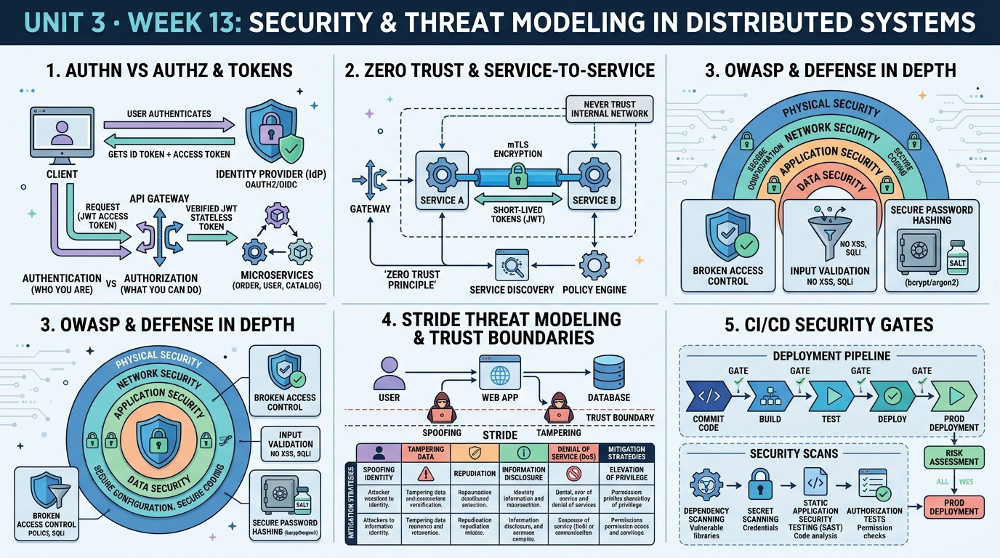

<!-- HU-STATUS TEMPLATE - do NOT remove the <!-- ... --> markers or the table headers.
     Your weekly grade is read AUTOMATICALLY from this file:
       13-week/hu-status/README.md  (inside YOUR fork). English. -->

# Weekly Status - Week 13

<!-- CONFIG-START - must match your profile repo (username/username) CONFIG -->
- FULL_NAME: Daniel Felipe Cerquera Idrobo
- GITHUB_USER: Pipecerquera
- TEAM: Barbersaas
- SPRINT_GOAL: Secure BarberSaaS and build it for MVP 3: map how the system authenticates at the edge, validates tokens and authorizes in each service, secures service-to-service calls, hashes secrets and validates inputs; build the threat model (data flow, trust boundaries, STRIDE) and turn it into a prioritized security backlog with testable criteria and the CI security gates — while delivering my MVP 3 code (e-mail verification, refresh and logout, profile, plan payments) to `develop`.
<!-- CONFIG-END -->

## 1. User stories worked this week
| HU ID | Title | Status (todo/doing/done) | Evidence (PR or commit URL) |
|---|---|---|---|
| HU-000-058 | As the team, we want to know how BarberSaaS is secured today: edge authentication, token validation and authorization in each service, service-to-service calls, hashed secrets and input validation (week 13, session 1) | **done** | [`threat-model.md`](threat-model.md) §1: nine practices, each with the file or PR where it lives (e.g. RS256-only validation in every service, one service token per caller, BCrypt for passwords and codes, constant-time Wompi checksum) |
| HU-000-059 | As the team, we want a threat model of the platform: data flow, trust boundaries and STRIDE (week 13, session 2) | **done** | [`threat-model.md`](threat-model.md) §2 (data-flow diagram, boundaries TB1–TB5), §3 (11 STRIDE threats with control and gap), §4 (likelihood × impact) |
| HU-000-060 | As the team, we want the findings as a prioritized security backlog for MVP 3 with testable acceptance criteria | **done** | [`threat-model.md`](threat-model.md) §5: SEC-01…SEC-09, each with a test as acceptance criterion; the three P1 items are real findings in the code and were fixed the same week (next row) |
| HU-000-061 | As the team, we want security gates in CI: secret scan, dependency audit and authorization tests | **doing — designed, not running** | [`threat-model.md`](threat-model.md) §6: order of the gates and their failing conditions; GitHub Actions of the organization is locked by billing (seen on [worker #18](https://github.com/code-corhuila/barber-saas-worker/pull/18)), so no job can run yet |
| HU-000-062 | As the operator, I want the three P1 security findings fixed before the public deployment: the rate limit counts the real client behind Caddy (SEC-01), the simulated checkout opens only when the environment asks for it (SEC-02), and a code stops working after 5 wrong attempts (SEC-03) | **done — merged in `develop` 2026-10-27** | [api-gateway #20](https://github.com/code-corhuila/barber-saas-api-gateway/pull/20) · [platform-admin-api #20](https://github.com/code-corhuila/barber-saas-platform-admin-api/pull/20) · [infra-postgres #37](https://github.com/code-corhuila/barber-saas-infra-postgres/pull/37) · [identity-auth-db #13](https://github.com/code-corhuila/barber-saas-identity-auth-db/pull/13) · [identity-auth-api #26](https://github.com/code-corhuila/barber-saas-identity-auth-api/pull/26); verification in [`threat-model.md`](threat-model.md) §7 |
| HU-AUTH-004 | Verify my e-mail before my first sign-in ([#123](https://github.com/code-corhuila/barber-saas-docs/issues/123)) | **done in `develop`** | [identity-auth-db #12](https://github.com/code-corhuila/barber-saas-identity-auth-db/pull/12) · [identity-auth-api #25](https://github.com/code-corhuila/barber-saas-identity-auth-api/pull/25) · [identity-auth-app #14](https://github.com/code-corhuila/barber-saas-identity-auth-app/pull/14) · [infra-postgres #35](https://github.com/code-corhuila/barber-saas-infra-postgres/pull/35) |
| HU-AUTH-005 | Stay signed in and sign out for real ([#124](https://github.com/code-corhuila/barber-saas-docs/issues/124)) | **done in `develop`** | [identity-auth-api #25](https://github.com/code-corhuila/barber-saas-identity-auth-api/pull/25) (rotating refresh token, logout revokes it) · [front #24](https://github.com/code-corhuila/barber-saas-front/pull/24) · [api-gateway #17](https://github.com/code-corhuila/barber-saas-api-gateway/pull/17) |
| HU-AUTH-006 | Edit my profile and change my password ([#125](https://github.com/code-corhuila/barber-saas-docs/issues/125)) | **done in `develop`** | [identity-auth-api #25](https://github.com/code-corhuila/barber-saas-identity-auth-api/pull/25) · [front #25](https://github.com/code-corhuila/barber-saas-front/pull/25) |
| HU-SADMIN-003 | Pay my plan inside the app ([#127](https://github.com/code-corhuila/barber-saas-docs/issues/127)) | **done in `develop`** | [platform-admin-db #8](https://github.com/code-corhuila/barber-saas-platform-admin-db/pull/8) · [platform-admin-api #14](https://github.com/code-corhuila/barber-saas-platform-admin-api/pull/14), [#15](https://github.com/code-corhuila/barber-saas-platform-admin-api/pull/15), [#16](https://github.com/code-corhuila/barber-saas-platform-admin-api/pull/16), [#19](https://github.com/code-corhuila/barber-saas-platform-admin-api/pull/19) · [front #26](https://github.com/code-corhuila/barber-saas-front/pull/26), [#27](https://github.com/code-corhuila/barber-saas-front/pull/27) · [platform-admin-app #12](https://github.com/code-corhuila/barber-saas-platform-admin-app/pull/12) · [DOCS #141](https://github.com/code-corhuila/barber-saas-docs/pull/141) |
| HU-SADMIN-004 | Warn the owner before the trial or the paid month ends ([#128](https://github.com/code-corhuila/barber-saas-docs/issues/128)) | **done in `develop`** (my part) | [platform-admin-api #17](https://github.com/code-corhuila/barber-saas-platform-admin-api/pull/17), [#18](https://github.com/code-corhuila/barber-saas-platform-admin-api/pull/18) · [worker #17](https://github.com/code-corhuila/barber-saas-worker/pull/17) · [identity-auth-api #24](https://github.com/code-corhuila/barber-saas-identity-auth-api/pull/24) |
| HU-NOTIF-005 | Remind the client one hour before, by push and e-mail ([#131](https://github.com/code-corhuila/barber-saas-docs/issues/131)) | **done in `develop`** (my part) | [worker #16](https://github.com/code-corhuila/barber-saas-worker/pull/16) (route and job) · [worker #18](https://github.com/code-corhuila/barber-saas-worker/pull/18) (turned on every 300 s) · [infra-postgres #34](https://github.com/code-corhuila/barber-saas-infra-postgres/pull/34) (service tokens) |

## 2. My individual contribution
- **Security audit of the platform (session 1)**: read the gateway configuration, the token validation and authorization of the services, the service tokens, how passwords, codes and refresh tokens are stored, the Wompi signature check and the error envelope, and wrote each control with the file that holds it ([`threat-model.md`](threat-model.md) §1).
- **Threat model and security backlog (session 2)**: data-flow diagram with five trust boundaries, 11 STRIDE threats, a risk ranking and nine stories SEC-01…SEC-09 with a test as acceptance criterion. Found two problems that must be fixed before the public deployment: the rate limit behind Caddy counts every user as one client, and the simulated checkout has no guard for `main`. Also found that the 6-digit codes had no limit of wrong attempts.
- **Fixed the three P1 findings the same day** (5 PRs, merged): `real_ip` behind Caddy in the gateway, the simulated checkout only with `PAYMENTS_SIMULATOR=true` (503 otherwise), and codes retired after 5 wrong attempts with a limit on reset requests (new changeset `ddl-alter-004`). Each fix has a test that fails without it; on the running platform the security script passed 11/11 and the MVP 3 end-to-end script 19/19 ([`threat-model.md`](threat-model.md) §7).
- **MVP 3 phase 0 in DOCS**: ADR-017 to ADR-019, the identity, plan, payment, booking and reminder stories, and the contracts of five services ([DOCS #132–#140](https://github.com/code-corhuila/barber-saas-docs/pulls?q=is%3Apr+author%3APipecerquera+created%3A2026-10-26)), plus DEC-PLAT-08 for the payment simulator ([#141](https://github.com/code-corhuila/barber-saas-docs/pull/141)); handoffs for Carlos and Juan Pablo.
- **MVP 3 code, my repositories**: e-mail verification with a 6-digit code, refresh and logout, profile and password change, plan payments with Wompi and a simulator, subscription jobs and notices with an outbox, the worker routes and jobs, the gateway routes, and the Oracle deployment files — 31 merged PRs in 10 code repositories, plus 10 in DOCS (list in §6).
- **End-to-end test** against the real platform (13 containers): 19/19 steps (sign-up → 403 → code → session, refresh/logout, profile, password, owner saga, 60-day trial, signed Wompi payment → plan ACTIVE, forged event → 401).
- **Team follow-up**: verified that Carlos and Juan Pablo merged their MVP 3 tasks; found the cause of the `WriteError` in notifications (the `processed_event` validator accepts only `PasswordResetRequested`) and wrote them the next steps.

## 3. Blockers and risks
- **GitHub Actions locked by billing**: every job of the organization fails before starting ("account is locked due to a billing issue"), so the CI security gates of HU-000-061 cannot run; tests run locally and their output goes in each PR. Needs an owner of `code-corhuila`.
- **The P1 security gaps are closed** (SEC-01…SEC-03, merged 2026-10-27); the open security work is SEC-04…SEC-09, mainly the CI scans, which depend on the billing issue above.
- **Simulated payments on `main` are a deliberate risk**: until the team has a Wompi account, `PAYMENTS_SIMULATOR=true` on the public host lets an owner activate a plan without paying (sandbox, no real money); it goes to `false` or is overridden by the Wompi key as soon as there is one. Teammates must add `PAYMENTS_SIMULATOR=true` to their local `env/dev.env` to test payments.
- **No host yet**: the Oracle Cloud account is planned for the week of 2026-11-02; capacity of the free ARM VM is not guaranteed.
- **notifications-db** rejects `EmailVerificationRequested` in `processed_event` (needs a new `collMod` changeset by Carlos); until then a redelivered event can send the code twice.

## 4. Plan for next week
- Run the gates of [`threat-model.md`](threat-model.md) §6 locally on my repositories (gitleaks, dependency audit: SEC-04, SEC-05) and record the findings; SEC-09 (the threat model in DOCS) by PR.
- MVP 3 close: review Carlos's two fixes (validator, event log), end-to-end test on 2026-11-03, deploy on Oracle on 2026-11-04, release 3.0.0 on 2026-11-05. Next course topic: CI/CD end to end.

## 5. Compliance self-check
- [x] Conventional Commits - `type(scope): summary` — all 41 PRs and their commits (e.g. `feat(auth): e-mail verification, refresh and logout, and the profile`, `chore(deploy): turn on the one-hour reminder every 300 seconds`).
- [x] Per-environment HU branch + PR to that environment (hu-xxx-dev -> develop, ...) — every code change went by branch → PR → `develop` with rebase, and every DOCS change by PR → `main`; nothing pushed directly.
- [x] Testable acceptance criteria — the MVP 3 stories in DOCS #133/#134, and each SEC item of [`threat-model.md`](threat-model.md) §5 is written as a test (e.g. client A at 30 r/s gets 429 while client B gets 200).
- [x] Tests added/updated (unit / integration) — identity-auth-api 95 tests, platform-admin-api 72, worker 32, gateway smoke 23; the security fixes each add a test that fails without them; plus the 19-step end-to-end script and an 11-step security script.
- [x] DDD / hexagonal boundaries respected (domain has no I/O) — Wompi, the simulator and SMTP are outbound adapters; the payment and subscription rules live in `platform-admin-core`; `lint-imports` keeps the worker's 3 contracts.
- [x] No secrets; config via environment variables — Wompi keys, SMTP and service tokens only in `env/<environment>.env` (ignored); `.env.example` with names; `dev-keys.sh` generates keys on each host.

## 6. Evidence links
- Repo: https://github.com/Pipecerquera/sistemas-distribuidos-2026-b-g2-daniel-cerquera.git
- This week's infographic: `13-week/hu-status/Week-13.jpg` (in this same folder)
- Threat model, STRIDE, risk ranking, security backlog SEC-01…SEC-09 and CI gates: [`13-week/hu-status/threat-model.md`](threat-model.md)
- Security controls in code: gateway filter https://github.com/code-corhuila/barber-saas-api-gateway/blob/develop/nginx/conf.d/10-security.conf · token validation and service tokens https://github.com/code-corhuila/barber-saas-docs/blob/main/07-api/authentication.md · public host https://github.com/code-corhuila/barber-saas-infra-postgres/blob/develop/compose.public.yml
- **Complete record of my individual work this week** (2026-10-23 to 2026-10-27, Bogotá time; from git and GitHub across the 30 code repositories, DOCS and WEEKLY):
  - Pull requests: **41** opened and merged.
    - DOCS: [#132](https://github.com/code-corhuila/barber-saas-docs/pull/132) ADR-017 to ADR-019 · [#133](https://github.com/code-corhuila/barber-saas-docs/pull/133) identity stories · [#134](https://github.com/code-corhuila/barber-saas-docs/pull/134) plan, payment, booking and reminder stories · [#135](https://github.com/code-corhuila/barber-saas-docs/pull/135) auth-service 3.0.0 · [#136](https://github.com/code-corhuila/barber-saas-docs/pull/136) subscription and Wompi payments · [#137](https://github.com/code-corhuila/barber-saas-docs/pull/137) subscription jobs and plan events · [#138](https://github.com/code-corhuila/barber-saas-docs/pull/138) reviews, suspension, one-hour reminder · [#139](https://github.com/code-corhuila/barber-saas-docs/pull/139) barber limit · [#140](https://github.com/code-corhuila/barber-saas-docs/pull/140) notices and e-mail · [#141](https://github.com/code-corhuila/barber-saas-docs/pull/141) simulated checkout
    - identity-auth: [db #12](https://github.com/code-corhuila/barber-saas-identity-auth-db/pull/12) · [api #24](https://github.com/code-corhuila/barber-saas-identity-auth-api/pull/24) · [api #25](https://github.com/code-corhuila/barber-saas-identity-auth-api/pull/25) · [api #26](https://github.com/code-corhuila/barber-saas-identity-auth-api/pull/26) (SEC-03) · [db #13](https://github.com/code-corhuila/barber-saas-identity-auth-db/pull/13) (SEC-03) · [app #14](https://github.com/code-corhuila/barber-saas-identity-auth-app/pull/14)
    - platform-admin: [db #8](https://github.com/code-corhuila/barber-saas-platform-admin-db/pull/8) · [api #13](https://github.com/code-corhuila/barber-saas-platform-admin-api/pull/13) · [#14](https://github.com/code-corhuila/barber-saas-platform-admin-api/pull/14) · [#15](https://github.com/code-corhuila/barber-saas-platform-admin-api/pull/15) · [#16](https://github.com/code-corhuila/barber-saas-platform-admin-api/pull/16) · [#17](https://github.com/code-corhuila/barber-saas-platform-admin-api/pull/17) · [#18](https://github.com/code-corhuila/barber-saas-platform-admin-api/pull/18) · [#19](https://github.com/code-corhuila/barber-saas-platform-admin-api/pull/19) · [#20](https://github.com/code-corhuila/barber-saas-platform-admin-api/pull/20) (SEC-02) · [app #12](https://github.com/code-corhuila/barber-saas-platform-admin-app/pull/12)
    - front: [#24](https://github.com/code-corhuila/barber-saas-front/pull/24) · [#25](https://github.com/code-corhuila/barber-saas-front/pull/25) · [#26](https://github.com/code-corhuila/barber-saas-front/pull/26) · [#27](https://github.com/code-corhuila/barber-saas-front/pull/27)
    - worker: [#15](https://github.com/code-corhuila/barber-saas-worker/pull/15) · [#16](https://github.com/code-corhuila/barber-saas-worker/pull/16) · [#17](https://github.com/code-corhuila/barber-saas-worker/pull/17) · [#18](https://github.com/code-corhuila/barber-saas-worker/pull/18)
    - api-gateway: [#17](https://github.com/code-corhuila/barber-saas-api-gateway/pull/17) · [#19](https://github.com/code-corhuila/barber-saas-api-gateway/pull/19) · [#20](https://github.com/code-corhuila/barber-saas-api-gateway/pull/20) (SEC-01)
    - infra-postgres: [#34](https://github.com/code-corhuila/barber-saas-infra-postgres/pull/34) · [#35](https://github.com/code-corhuila/barber-saas-infra-postgres/pull/35) · [#36](https://github.com/code-corhuila/barber-saas-infra-postgres/pull/36) · [#37](https://github.com/code-corhuila/barber-saas-infra-postgres/pull/37) (SEC-02)
  - Commits on the main branches: **108** — barber-saas-docs 26, platform-admin-api 24, identity-auth-api 12, front 10, worker 8, infra-postgres 7, api-gateway 5, identity-auth-db 5, platform-admin-db 5, identity-auth-app 3, platform-admin-app 2, and in this repository the fork sync of 2026-10-26 (`9e8bab7`) that brought the certification templates (plus the commits of this delivery).
  - Issues opened: **10**, in DOCS on 2026-10-26 — the MVP 3 epic [#122](https://github.com/code-corhuila/barber-saas-docs/issues/122) and its stories [#123](https://github.com/code-corhuila/barber-saas-docs/issues/123)–[#131](https://github.com/code-corhuila/barber-saas-docs/issues/131), all on the team board · tags and releases: 0 (release 3.0.0 is planned for 2026-11-05).
  - Off-GitHub work of the week: the security audit and threat model in this folder, the 19-step end-to-end run and the 11-step security run against the platform, and the review of Carlos's and Juan Pablo's MVP 3 work.
- *End of the complete record.*

## 7. Threat modeling workshop (2026-10-29, in class)

Boundary **TB1 Internet -> edge (Caddy + `api-gateway`)**, claimed in [#150](https://github.com/code-corhuila/barber-saas-docs/issues/150). Work in
[`13-week/workshop/`](../workshop/); library book: Nilsson, *Inteligencia artificial: una nueva
síntesis*, call number 006.3 N347 (record 08:20).

| Checkpoint | Result | Evidence |
|---|---|---|
| CP0 | Claim issue and workshop CONFIG | [#150](https://github.com/code-corhuila/barber-saas-docs/issues/150) · [`3e89a01`](https://github.com/Pipecerquera/sistemas-distribuidos-2026-b-g2-daniel-cerquera/commit/3e89a01) |
| CP1 | Data flow with TB1-TB5, 7 assets, entry points of TB1 | [`dd75d47`](https://github.com/Pipecerquera/sistemas-distribuidos-2026-b-g2-daniel-cerquera/commit/dd75d47) |
| CP2 | STRIDE of TB1, risk ranking, residual risk, [B] row D | [PR #153](https://github.com/code-corhuila/barber-saas-docs/pull/153) (`af96937`, `d26c922`) |
| CP3 | Stories D (P0), S (P1), E (P2) on the team board | [#155](https://github.com/code-corhuila/barber-saas-docs/issues/155) · [#156](https://github.com/code-corhuila/barber-saas-docs/issues/156) · [#157](https://github.com/code-corhuila/barber-saas-docs/issues/157) · [`5ca13c5`](https://github.com/Pipecerquera/sistemas-distribuidos-2026-b-g2-daniel-cerquera/commit/5ca13c5) |
| CP4 | `security.yml` (gitleaks, dependency-check, authz tests) and the negative test of #156 | [`d83061c`](https://github.com/Pipecerquera/sistemas-distribuidos-2026-b-g2-daniel-cerquera/commit/d83061c) · [`82b33c5`](https://github.com/Pipecerquera/sistemas-distribuidos-2026-b-g2-daniel-cerquera/commit/82b33c5) |
| CP5 | Review of Juan Pablo's STRIDE (worker -> `/internal`): row D needs the cap on the callee, row S needs a token lifetime | [PR #154](https://github.com/code-corhuila/barber-saas-docs/pull/154) review comment |
