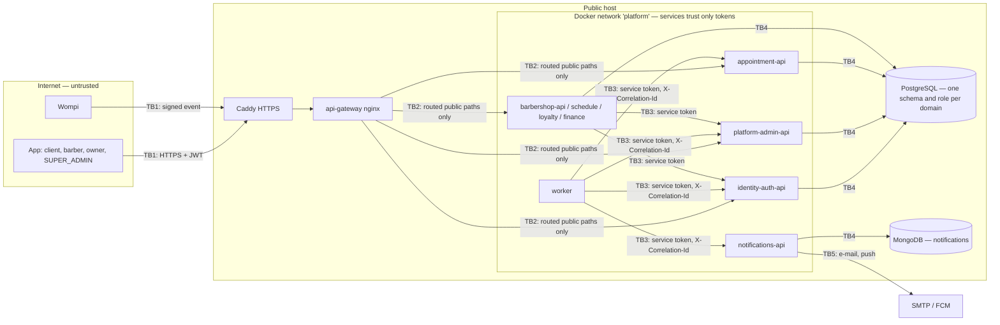

# BarberSaaS threat model and MVP 3 security backlog (week 13)

Scope: the platform as it is on `develop` on 2026-10-27, the code that becomes release 3.0.0 on
2026-11-05 and is deployed on one public host (ADR-019, `infra-postgres/compose.public.yml`). Every
control below names the file or PR where it lives; every gap becomes a backlog item in §5. The three P1
items were fixed and merged the same day (§5, §7).

## 1. Session 1 — how the system is secured today

| Practice | What BarberSaaS does | Where |
|---|---|---|
| Authenticate at the edge | The gateway rejects a protected route with no `Authorization` header before it reaches a service, limits each client to 10 req/s (burst 20; 5 on the auth routes), caps bodies at 2 MB and answers CORS only for the app's own origins, never `*` | `api-gateway/nginx/conf.d/10-security.conf`, `nginx.conf`, `routes/*.conf` |
| Validate tokens in each service | JWT **RS256** only (`none`, `HS256` → 401); identity-auth holds the only private key, every service checks signature, `exp` and `sub` itself, because internal calls do not pass through the gateway | DOCS `07-api/authentication.md` §Validation; `Rs256Verifier` + `AuthFilter` in each Java service |
| Authorize in each service | The role is checked per operation (403); the tenant (`barbershopId`) comes **only from the token**, never from the body or query (the public reviews list is the one documented exception) | DOCS `07-api/authentication.md` §Multi-tenancy; 403 tests in 9 services |
| Secure service-to-service calls | `/internal/v1/**` is not routed by the gateway (default `location /` answers 404); callers use **one service token per service** (`role: SERVICE`, `sub` = caller) and an operation checks which `sub` may call it; a user token there answers 403 | `api-gateway/nginx/conf.d/20-server.conf`; `infra-postgres/scripts/dev-keys.sh` (#34 added the appointment and notifications tokens) |
| Hash secrets | Passwords with **BCrypt**; the 6-digit verification and reset codes are stored only as BCrypt hashes; refresh tokens are opaque, single use and stored hashed; a code is never written to `processed_event` or to a log | `BCryptPasswordHasher`, `PasswordResetService`, `AuthService` (identity-auth-api #25); notifications `DEC-NOTIF-01` |
| Verify third parties | A Wompi event is accepted only if its SHA-256 checksum, built with the events secret, matches, compared in constant time (`MessageDigest.isEqual`); a forged event answers 401 (e2e of 2026-10-26) | `platform-admin-api` `WompiSignature` (#16) |
| Validate inputs | Each service validates commands in its application layer and answers `400 VALIDATION_ERROR` with the standard envelope; errors never return a stack trace, only a `traceId` | `ErrorHandler`/`ApiError` in 8 repositories; norm 5.3.5 |
| Keep secrets out of git | Credentials only in `env/<environment>.env` (ignored); `.env.example` with names only; the 30 public repositories were audited on 2026-10-08 | `infra-postgres/env/*.env.example` |
| Encrypt in transit | On the public host Caddy terminates HTTPS (Let's Encrypt) and only ports 80/443 are open; the gateway's 8000 stays closed | `infra-postgres/compose.public.yml`, `deploy/oracle/README.md` (#36) |

## 2. Data flow and trust boundaries

| Boundary | Crossing | What must hold |
|---|---|---|
| TB1 Internet → host | App requests, Wompi events, the simulated checkout page | Only 80/443; TLS; rate limit per real client; signed events |
| TB2 Gateway → services | Public `/api/v1/**` routes | Internal routes never routed; every service re-validates the JWT |
| TB3 Service → service | Worker jobs, outbox relay, sagas, internal reads | One token per caller, `sub` checked; correlation id carried |
| TB4 Service → database | SQL / Mongo | Own schema and role per domain; parameterized queries |
| TB5 Platform → providers | SMTP, FCM | Credentials only in the host's env file |

## 3. STRIDE

| # | STRIDE | Element | Threat | Control today | Gap → backlog |
|---|---|---|---|---|---|
| S1 | Spoofing | identity-auth | Guess the 6-digit verification or reset code (10⁶ values, valid 15 min) | Code stored hashed; gateway burst of 5 on auth routes | No limit of wrong attempts per code: at 10 req/s one client tried ~9 000 codes in 15 min (~0.9 %), many clients more → **SEC-03, fixed**: 5 wrong attempts retire the code, at most 5 reset codes an hour |
| S2 | Spoofing | every service | Forge or reuse a JWT | RS256 only, per-service validation | Access token lives **24 h** and cannot be revoked; the app now refreshes on its own (front #24) → **SEC-07** |
| S3 | Spoofing | platform-admin | Forge a Wompi "APPROVED" event | Checksum with events secret, constant-time compare | Replay of a valid event must not activate twice → test in **SEC-06** |
| S4 | Spoofing | internal routes | A user or a foreign service calls `/internal/v1/**` | Not routed by the gateway; `sub` checked; 403 tests | Service tokens last one year on `main` (`dev-keys.sh main 525600`); rotation is manual → accepted, noted in `deploy/oracle/README.md` §5 |
| T1 | Tampering | domain services | Send another barbershop's id to read or change its data | Tenant only from the token | Not a CI gate in every service → **SEC-06** |
| T2 | Tampering | platform-admin | Approve a plan in the **simulated checkout** without paying (anonymous page, DEC-PLAT-08) | Active only while no Wompi key is set | The reference is a random UUID only the owner knows, but on a host without Wompi keys the simulator opened by itself, so an owner could activate Pro without paying → **SEC-02, fixed**: it opens only with `PAYMENTS_SIMULATOR=true`, set on `main` on purpose until there is a Wompi account |
| R1 | Repudiation | worker → notifications | "The e-mail was never sent" with no trace | `X-Correlation-Id` from the gateway to every service and the worker (worker #15); payment history in `payment` (platform-admin-db #8) | notifications-api logs nothing for a handled event, so its correlation id never appears → **SEC-08** |
| I1 | Information disclosure | all | Stack traces, secrets or codes leak | Error envelope with `traceId` only; codes never stored or logged; secrets audited 2026-10-08 | No secret scan runs on each PR → **SEC-04** |
| I2 | Information disclosure | dependencies | A vulnerable library (Spring, nginx, npm, pip) | Pinned versions | No dependency audit → **SEC-05** |
| D1 | Denial of service | gateway behind Caddy | One client exhausts the platform | `limit_req` 10 r/s per `$binary_remote_addr`, 2 MB bodies | Behind Caddy nginx sees **Caddy's IP** for everyone (no `real_ip` set): the whole internet shared one 10 r/s bucket and logs lost the client IP → **SEC-01, fixed**: `05-real-ip.conf` |
| E1 | Elevation of privilege | owner / SUPER_ADMIN routes | A client or barber calls an owner or platform operation | Role checked per operation (403); SUPER_ADMIN created by hand on `main` | Covered by tests in 9 services; keep as a required gate in **SEC-06** |

## 4. Risk ranking

Likelihood × impact on the public host of 2026-11-04 (1–3 each), as found — D1, T2 and S1 were then
fixed (§7), so the highest open risk is now the missing CI scans (I1/I2):

| Threat | L | I | Score | Why |
|---|---|---|---|---|
| D1 shared rate limit | 3 | 3 | 9 | Happens on day one with normal traffic, not only under attack |
| T2 free plan via simulator | 2 | 3 | 6 | The host goes live without a Wompi account (the simulator exists for that reason) |
| S1 code guessing | 2 | 3 | 6 | Account takeover through reset |
| I1 / I2 no CI scans | 2 | 2 | 4 | Public repositories; GitHub Actions currently blocked by billing |
| T1 / E1 not gated | 1 | 3 | 3 | Controls exist and are tested, only not enforced as a gate |
| S2 24 h token | 1 | 2 | 2 | Needs a stolen token first |
| R1 missing log line | 2 | 1 | 2 | Debugging, not data loss |

## 5. Security backlog for MVP 3 (prioritized, testable)

| ID | Priority | Story | Repository | Acceptance criterion (a test) |
|---|---|---|---|---|
| SEC-01 | P1 — **done 2026-10-27**, [api-gateway #20](https://github.com/code-corhuila/barber-saas-api-gateway/pull/20) | As the operator, I want the gateway to rate-limit the real client behind Caddy | api-gateway | `set_real_ip_from` the platform network + `real_ip_header X-Forwarded-For`; through Caddy, client A at 30 r/s gets 429 while client B in parallel gets 200; the access log shows each client's IP |
| SEC-02 | P1 — **done 2026-10-27**, [platform-admin-api #20](https://github.com/code-corhuila/barber-saas-platform-admin-api/pull/20), [infra-postgres #37](https://github.com/code-corhuila/barber-saas-infra-postgres/pull/37) | As the SUPER_ADMIN, I want the simulated checkout impossible on `main` | platform-admin-api | With no Wompi key and `PAYMENTS_SIMULATOR` unset or false, `POST /api/v1/payments` answers 503 storing nothing and the simulator 404; with `true` it works as before; a Wompi key always wins |
| SEC-03 | P1 — **done 2026-10-27**, [identity-auth-db #13](https://github.com/code-corhuila/barber-saas-identity-auth-db/pull/13), [identity-auth-api #26](https://github.com/code-corhuila/barber-saas-identity-auth-api/pull/26) | As a user, I want my code to stop working after 5 wrong attempts | identity-auth-db, identity-auth-api | New changeset with an attempts counter; 5 wrong codes → the 6th attempt with the **right** code answers 422 and a new code must be requested; a reset code at most once a minute and 5 times an hour; tests for verification and reset |
| SEC-04 | P2 | As the team, I want a secret scan on every PR | workflow (reusable CI) + 30 repos | `gitleaks detect` job; a PR adding a fake key fails, a clean PR passes; `.env.example` allowed |
| SEC-05 | P2 | As the team, I want vulnerable dependencies to block the PR | workflow + 30 repos | Java: OWASP `dependency-check` fails on CVSS ≥ 7; npm: `npm audit --audit-level=high`; Python: `pip-audit`; a known vulnerable version makes the job fail |
| SEC-06 | P2 | As the team, I want authorization tests as a required gate | each domain service | Per service: shop A's owner token on shop B's resource → 404/403; a user token on `/internal/v1/**` → 403; a replayed Wompi event does not extend the plan twice |
| SEC-07 | P3 | As a user, I want a stolen token to be useless soon | identity-auth-api, DOCS | Access token 15 min; a 16-minute-old token → 401 while the app keeps the session through `/auth/refresh` |
| SEC-08 | P3 | As the operator, I want each handled event logged with its correlation id | notifications-api (Carlos, in progress) | One INFO line per event with `eventId`, `type`, outcome and the worker's correlation id; never the code or the payload |
| SEC-09 | P3 | As the team, I want this threat model in DOCS | barber-saas-docs | `05-architecture/security-threat-model.md` (planned by `05-architecture/README.md`, still missing) added by PR to `main` |

## 6. Security gates in CI

Today every repository's CI only builds and tests (`.github/workflows/ci.yml`, e.g. `mvn -B verify`);
there is no security job. The gates to add, in the order a PR meets them:

1. **Secrets** (SEC-04) — fastest, runs first, blocks on any finding.
2. **Dependencies** (SEC-05) — per stack, blocks on high/critical only, so the noise stays low.
3. **Build + unit tests** — as today.
4. **Authorization tests** (SEC-06) — part of the test suite, marked so a missing one is visible.
5. **Release gate** — `qa` → `main` only with the four green; the risk table of §4 reviewed.

**Constraint:** GitHub Actions of the organization is locked by a billing issue ("The job was not
started because your account is locked due to a billing issue", worker #18 on 2026-10-27). Until
an owner fixes it, the same commands run locally before each PR and their output is pasted in it.

## 7. Fixes of 2026-10-27 and how they were verified

| Item | Change | Verification |
|---|---|---|
| SEC-01 | `nginx/conf.d/05-real-ip.conf`: `set_real_ip_from` the Docker networks, `real_ip_header X-Forwarded-For`; the access log records `client` | `tests/smoke.sh` 23/23; the new check (12 parallel requests from client A and one from client B through the same proxy) fails on the previous config — B gets 429 — and passes with the fix, 3 runs of 3 |
| SEC-02 | `PaymentProvider.available()`, `NoCheckout`; the simulator only with `PAYMENTS_SIMULATOR=true`; `env/*.env.example` set it, `main` on purpose | 72 tests; on the running platform: no key and no flag → paying 503, simulator 404; with the flag → approve → plan ACTIVE Pro; with a Wompi key → simulator 404 |
| SEC-03 | changeset `ddl-alter-004` (`failed_attempts`); a wrong code counts in one `UPDATE` and retires the code at 5; reset requests limited like the verification resend | 95 tests; database CI (apply, re-apply 0, roll back, apply) and on an existing database; on the running platform: 5 wrong → the right code is 422 and the row shows 5 attempts; 4 wrong → the right reset code works; a second reset in the minute sends nothing |

The MVP 3 end-to-end script passed 19/19 on the platform with the three fixes.
