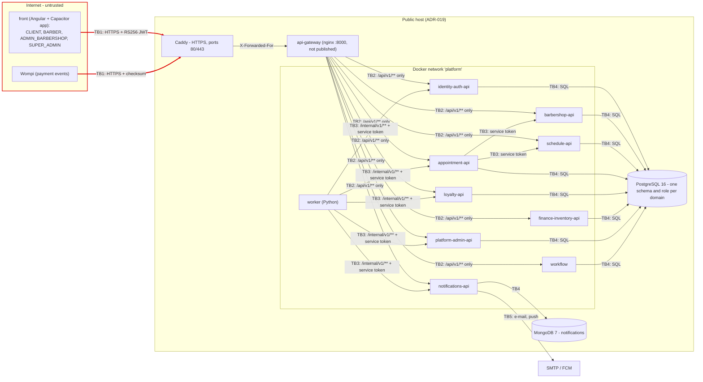

# CP1 - Attack surface map of BarberSaaS

Sources in `barber-saas-docs`: `09-microservices/service-catalog.md` (services and "How services
talk"), `07-api/authentication.md` (RS256 tokens, tenant from the token), ADR-017 (Wompi plan
payments) and ADR-019 (one public host behind Caddy). My boundary is **TB1**, drawn in red.

## Data flow

| Boundary | From -> to | Owner in this workshop |
|---|---|---|
| **TB1** | Internet -> Caddy -> `api-gateway` | **Pipecerquera (this file, issue #150)** |
| TB2 | `api-gateway` -> each `-api` | free |
| TB3 | service -> service (`worker` relay, appointment snapshots) | JUANDAX233 (issue #149, worker -> `/internal`) |
| TB4 | each `-api` -> its schema in PostgreSQL / MongoDB | free |
| TB5 | `notifications-api` -> SMTP / FCM | free |

## Asset inventory

| Asset | Where it lives | In transit through TB1 | Classification |
|---|---|---|---|
| Password and 6-digit verification / reset codes | `identity_auth` schema, only as BCrypt hashes | `POST /api/v1/auth/*` body | Restricted |
| Access token (RS256, 24 h) and refresh token | App storage; refresh hashed in `identity_auth.refresh_token` | `Authorization` header, `/auth/refresh` body | Restricted |
| Wompi events secret and plan payment state | `platform-admin-api` env file; `payment` table | Signed body of `POST /api/v1/payments/wompi/events` | Restricted |
| Client data (name, e-mail, phone) | `identity_auth` and `appointment.appointment` | Responses of `/auth/me`, `/appointments` | Confidential |
| Barbershop finances and inventory | `finance_inventory` schema | `/api/v1/finance/`, `/api/v1/inventory/` | Confidential |
| Barbershop catalog, services, barbers, reviews | `barbershop` schema | Anonymous `GET /api/v1/barbershops`, `/reviews` | Public |
| Plan catalog | `platform_admin` schema | Anonymous `GET /api/v1/plans` | Public |

## Entry points of TB1

Everything enters through Caddy on 443 (80 only redirects). The gateway's 8000 is reachable only
from the Docker networks; the default `location /` answers 404, so `/internal/v1/**` never crosses.

| Entry point | Caller | Authentication today | Gateway control |
|---|---|---|---|
| `POST /api/v1/auth/login`, `/register`, `/refresh`, `/password-reset` | Anonymous app user | None (they issue the token) | `burst=5` per client |
| `GET /api/v1/auth/jwks` | Anyone | None (public key) | `burst=5` |
| `/api/v1/auth/me`, `/auth/logout` | Signed-in user | Bearer JWT, validated in `identity-auth-api` | 401 if no header, `burst=20` |
| `GET /api/v1/barbershops`, `/barbershops/{id}/services`, `/reviews`, `/plans` | Anonymous | None | `burst=20` |
| `/api/v1/appointments`, `/availability`, `/barber-schedules/`, `/loyalty/`, `/notifications` | CLIENT, BARBER | Bearer JWT; tenant from the token | 401 if no header |
| `/api/v1/finance/`, `/inventory/`, `/subscription`, `POST /api/v1/payments` | ADMIN_BARBERSHOP | Bearer JWT + role check in the service | 401 if no header |
| `/api/v1/platform/` | SUPER_ADMIN | Bearer JWT + role check | 401 if no header |
| `POST /api/v1/payments/wompi/events` | Wompi | No token: SHA-256 checksum with the events secret | `burst=20` |
| `/api/v1/payments/simulator/` | Owner's browser | No token; open only with `PAYMENTS_SIMULATOR=true` | `burst=20` |

Shared controls of the edge: TLS by Caddy (Let's Encrypt), `limit_req` 10 r/s per real client
(`05-real-ip.conf`, SEC-01), 2 MB body limit, CORS only for the app origins, and an
`X-Correlation-Id` added to every request and access-log line.
