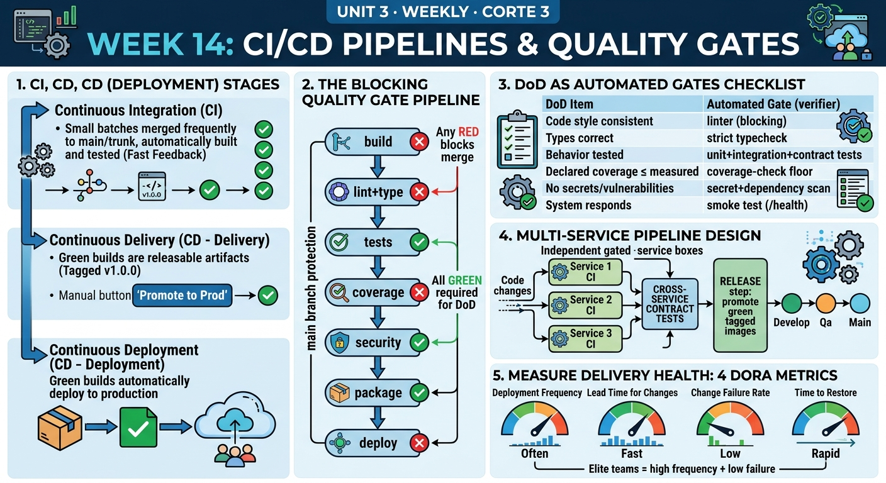

<!-- HU-STATUS TEMPLATE - do NOT remove the <!-- ... --> markers or the table headers.
     Your weekly grade is read AUTOMATICALLY from this file:
       14-week/hu-status/README.md  (inside YOUR fork). English. -->

# Weekly Status - Week 14

<!-- CONFIG-START - must match your profile repo (username/username) CONFIG -->
- FULL_NAME: Daniel Felipe Cerquera Idrobo
- GITHUB_USER: Pipecerquera
- TEAM: Barbersaas
- SPRINT_GOAL: Close MVP 3 for release 3.0.0: run `develop` of the 30 repositories end to end, fix the real security findings of the week 13 workshop before the public deployment, promote my repositories to `qa` with `git cherry-pick -x`, record the 3.0.0 changelog, deploy the platform on a public host and rehearse its rollback, and map the Definition of Done to CI/CD gates with the stories that close the gap.
<!-- CONFIG-END -->

## 1. User stories worked this week
| HU ID | Title | Status (todo/doing/done) | Evidence (PR or commit URL) |
|---|---|---|---|
| HU-000-066 | As the team, we want `develop` of the 30 repositories tested together before promoting it, so `qa` only receives a platform that works end to end | **done — 2026-11-03** | Dev platform with 13 containers, migrations on an existing volume: MVP 3 script 19/19, security script 11/11, journey of every role 34/34 (owner saga, catalog, barber week, booking, complete, review, tenant isolation, suspension and reactivation, events delivered), and the probes of the week 13 workshop stories (9 of 10 safe; the tenth, [#165](https://github.com/code-corhuila/barber-saas-docs/issues/165), belongs to Carlos and he fixed it on 2026-11-04 in [barbershop-api #26](https://github.com/code-corhuila/barber-saas-barbershop-api/pull/26)) |
| HU-000-067 | As the operator, I want the security findings of my trust boundary (TB1) fixed before the public deployment: a stolen access token dies within 15 minutes ([#156](https://github.com/code-corhuila/barber-saas-docs/issues/156)), sign-in locks after repeated failures and a malformed correlation id cannot break the error body ([#155](https://github.com/code-corhuila/barber-saas-docs/issues/155)), and sign-up does not reveal which e-mails exist ([#167](https://github.com/code-corhuila/barber-saas-docs/issues/167)) | **done — first part merged 2026-11-03, #155 completed 2026-11-06 (HU-000-076)** | [identity-auth-api #27](https://github.com/code-corhuila/barber-saas-identity-auth-api/pull/27) (10 failures in 15 min → 429, also for unknown e-mails; access token 900 s; a taken e-mail on public sign-up answers the same 201 without saving or sending a code; 104 tests; **this last part was reversed on 2026-11-06, see HU-000-070**) · [api-gateway #21](https://github.com/code-corhuila/barber-saas-api-gateway/pull/21) (`X-Correlation-Id` kept only when it is a UUID or 32 hex characters; smoke +4 checks) · [DOCS #169](https://github.com/code-corhuila/barber-saas-docs/pull/169) (`authentication.md`, `auth-service.yaml`) |
| HU-000-068 | As the team, we want MVP 3 promoted from `develop` to `qa` in my 10 repositories with the trail of every commit | **done — 2026-11-03 and 2026-11-05** | 95 commits re-applied with `git cherry-pick -x`, one PR per repository: [identity-auth-db #14](https://github.com/code-corhuila/barber-saas-identity-auth-db/pull/14) · [identity-auth-api #28](https://github.com/code-corhuila/barber-saas-identity-auth-api/pull/28) · [identity-auth-app #16](https://github.com/code-corhuila/barber-saas-identity-auth-app/pull/16) · [platform-admin-db #9](https://github.com/code-corhuila/barber-saas-platform-admin-db/pull/9) · [platform-admin-api #23](https://github.com/code-corhuila/barber-saas-platform-admin-api/pull/23) · [platform-admin-app #14](https://github.com/code-corhuila/barber-saas-platform-admin-app/pull/14) · [api-gateway #22](https://github.com/code-corhuila/barber-saas-api-gateway/pull/22) · [worker #20](https://github.com/code-corhuila/barber-saas-worker/pull/20) · [infra-postgres #38](https://github.com/code-corhuila/barber-saas-infra-postgres/pull/38) · [front #29](https://github.com/code-corhuila/barber-saas-front/pull/29); the tree of `qa` equals `develop` in my 12 repositories and `main` stays on v2.0.0 |
| HU-000-069 | As the team, we want the `[3.0.0]` section of `CHANGELOG.md` in every repository that changed since 2.0.0, so the release notes come from real commits | **done — 2026-11-05** | Generated from `git log` since the last commit released in 2.0.0, grouped by commit type, with the stories of each repository. To `develop`: [identity-auth-db #15](https://github.com/code-corhuila/barber-saas-identity-auth-db/pull/15) · [identity-auth-api #29](https://github.com/code-corhuila/barber-saas-identity-auth-api/pull/29) · [identity-auth-app #17](https://github.com/code-corhuila/barber-saas-identity-auth-app/pull/17) · [platform-admin-db #10](https://github.com/code-corhuila/barber-saas-platform-admin-db/pull/10) · [platform-admin-api #24](https://github.com/code-corhuila/barber-saas-platform-admin-api/pull/24) · [platform-admin-app #15](https://github.com/code-corhuila/barber-saas-platform-admin-app/pull/15) · [front #30](https://github.com/code-corhuila/barber-saas-front/pull/30) · [worker #21](https://github.com/code-corhuila/barber-saas-worker/pull/21) · [api-gateway #23](https://github.com/code-corhuila/barber-saas-api-gateway/pull/23) · [infra-postgres #40](https://github.com/code-corhuila/barber-saas-infra-postgres/pull/40); to `qa`: [identity-auth-db #16](https://github.com/code-corhuila/barber-saas-identity-auth-db/pull/16) · [identity-auth-api #30](https://github.com/code-corhuila/barber-saas-identity-auth-api/pull/30) · [identity-auth-app #18](https://github.com/code-corhuila/barber-saas-identity-auth-app/pull/18) · [platform-admin-db #11](https://github.com/code-corhuila/barber-saas-platform-admin-db/pull/11) · [platform-admin-api #25](https://github.com/code-corhuila/barber-saas-platform-admin-api/pull/25) · [platform-admin-app #16](https://github.com/code-corhuila/barber-saas-platform-admin-app/pull/16) · [front #31](https://github.com/code-corhuila/barber-saas-front/pull/31) · [worker #22](https://github.com/code-corhuila/barber-saas-worker/pull/22) · [api-gateway #24](https://github.com/code-corhuila/barber-saas-api-gateway/pull/24) · [infra-postgres #41](https://github.com/code-corhuila/barber-saas-infra-postgres/pull/41) |
| HU-000-055 | As the team, we want BarberSaaS deployed to a cloud host from the release candidate, with HTTPS and health checks (from week 12) | **done — live on Azure since 2026-11-06, on `qa` until the release** | https://barbersaas.chilecentral.cloudapp.azure.com on an Azure for Students VM (`Standard_B2as_v2`, 2 vCPU, 8 GB, Chile Central): 14 containers, a valid Let's Encrypt certificate, HTTP redirects to HTTPS, `/health` 200, sign-in 200, a protected route without token 401, the gateway's 8000 closed from outside. A real reboot answered `/health` in 45 s. The decision is [ADR-020](https://github.com/code-corhuila/barber-saas-docs/pull/175), which supersedes ADR-019: Oracle refused all 1651 requests, and AWS refused its free plan because the data was tied to an earlier account. Guide: [infra-postgres #44](https://github.com/code-corhuila/barber-saas-infra-postgres/pull/44), [#45](https://github.com/code-corhuila/barber-saas-infra-postgres/pull/45) to `qa`. Earlier the same day the platform ran on my laptop behind a Cloudflare tunnel, where the rollback was rehearsed. **Not proven yet:** a code e-mail seen in an inbox from this host (the service processed it without error), and a push sent from it. **Credit:** about USD 2.90 a day of USD 100 |
| HU-000-057 | As the operator, I want a rehearsed and timed rollback, so a bad release is undone in under 2 minutes (story DEP-05, from week 12) | **done — rehearsed on 2026-11-06 on the fallback host** | Backup first (`backup.sh main`), then identity-auth-api from `e3675ed` to `b7be43b` in **40 s** (a sign-up with a taken e-mail answers 201, the old behaviour) and back in **37 s** (422 again); 5 accounts before and after, `/health` 200, public URL unchanged. Limits: it rebuilds from source because there are no tagged images yet (DEP-01), failed requests were not measured, no schema change was involved, the backup was not restored, and sign-in is down during those seconds |
| HU-000-070 | As a person signing up, I want to be told when my e-mail is already registered, so I do not wait for a code that never comes | **done — merged and deployed 2026-11-06** | Found testing the public host: the silent 201 of #167 sent no code. Now it is a 422 like the barber and owner sign-ups, with the risk accepted in `DEC-AUTH-11`: [DOCS #172](https://github.com/code-corhuila/barber-saas-docs/pull/172), [identity-auth-api #31](https://github.com/code-corhuila/barber-saas-identity-auth-api/pull/31) to `develop`, [#32](https://github.com/code-corhuila/barber-saas-identity-auth-api/pull/32) to `qa`, changelog [#33](https://github.com/code-corhuila/barber-saas-identity-auth-api/pull/33) and [#34](https://github.com/code-corhuila/barber-saas-identity-auth-api/pull/34); 103 tests with `RegisterTakenEmailTest`; the public URL answers 422; [#167](https://github.com/code-corhuila/barber-saas-docs/issues/167) closed as not planned |
| HU-000-071 | As a client, I want a push notification on my phone, so I hear about my appointment with the app closed | **doing — delivery proven, full journey pending** | Firebase credentials on the host only, APK packaged with push on, device token registered (`POST /api/v1/device-tokens` 200). A test message through the service's own FCM sender reached the device with the app closed. **Not seen yet:** the push of a real appointment event, because a device receives only for its last signed-in account and the test used one device; it needs two |
| HU-000-072 | As the team, we want every DoD item mapped to a blocking gate and the current pipeline audited, so we know what really stops a bad merge | **done — 2026-11-06 (audit and map; the gates themselves are HU-000-074)** | [`ci-cd-plan.md`](ci-cd-plan.md) §1–§4: the workflows of the 30 repositories, DoD → gate table, branch protection state, polyrepo pipeline design |
| HU-000-073 | As the team, we want the CI/CD stories sliced for MVP 3 with testable criteria | **done — 2026-11-06** | [`ci-cd-plan.md`](ci-cd-plan.md) §5: CI-01…CI-08 with dependencies and order |
| HU-000-074 | As the team, we want PRs to run build, lint, types, tests, coverage and security as blocking gates, with path filters, contract tests and deployment of the tagged image (this week's pipeline) | **todo — blocked** | Only build and tests exist, and nothing blocks or runs: Actions is locked by billing and required checks are not ours to change. Stories CI-01…CI-08 |
| HU-000-075 | As an operator, I want the gateway's latency field in milliseconds, so latency SLOs are computed correctly (OBS-01, week 11 plan) | **done — merged 2026-11-06** | `durationMs` carried seconds, off by 1000. [api-gateway #25](https://github.com/code-corhuila/barber-saas-api-gateway/pull/25) to `develop`, [#27](https://github.com/code-corhuila/barber-saas-api-gateway/pull/27) to `qa`; `tests/latency-log.sh` reports 1208 for a 1.2 s request, and the public host logs 223, 145 and 60 |
| HU-000-076 | As the operator, I want a login flood from many addresses stopped at the edge, so it does not reach the password hashing ([#155](https://github.com/code-corhuila/barber-saas-docs/issues/155), criteria 3 and 5) | **done — merged 2026-11-06, with one limit** | A second `limit_req` zone for all clients on `/api/v1/auth/`: [api-gateway #26](https://github.com/code-corhuila/barber-saas-api-gateway/pull/26); 250 addresses with one request each get 6 `429` without it (the check fails) and 196 with it, no `502`. Caddy closes a request after 30 s: [infra-postgres #42](https://github.com/code-corhuila/barber-saas-infra-postgres/pull/42), [#43](https://github.com/code-corhuila/barber-saas-infra-postgres/pull/43) to `qa`; real image against a stand-in that sleeps 35 s: `504` after 30.007 s. Spec in [DOCS #173](https://github.com/code-corhuila/barber-saas-docs/pull/173). Caddy now serves real HTTPS on the Azure host; the 30 s timeout itself was checked against the stand-in, not against the live gateway, which answers first at its own 10 s |
| HU-000-077 | As a barbershop owner, I want every password change and new barber to leave an audit record, so we can see who did it, when and from where ([#168](https://github.com/code-corhuila/barber-saas-docs/issues/168)) | **done — merged and deployed 2026-11-06** | A separate `audit` logger written after the use case succeeds, with identifiers only: [identity-auth-api #35](https://github.com/code-corhuila/barber-saas-identity-auth-api/pull/35), [#36](https://github.com/code-corhuila/barber-saas-identity-auth-api/pull/36) to `qa`; `AuditLogTest` 3/3, 106 tests in all; a real `password.changed` line read from the public host's log |
| HU-000-078 | As the team, we want the threat model of TB1 in DOCS, matching what the code does now | **done — merged 2026-11-06, TB1 only** | [DOCS #153](https://github.com/code-corhuila/barber-saas-docs/pull/153) and its update [DOCS #174](https://github.com/code-corhuila/barber-saas-docs/pull/174) (row I accepted, rows D and R closed). SEC-09, the threat model of the whole platform in DOCS, stays open |
| HU-000-065 | As a student, I want to take the Huawei HCCDP-Solution Architectures course of the third cut and keep its evidence in this repository | **doing** | [`7387098`](https://github.com/Pipecerquera/sistemas-distribuidos-2026-b-g2-daniel-cerquera/commit/7387098) (chapters 7 to 9) · [`c2758f0`](https://github.com/Pipecerquera/sistemas-distribuidos-2026-b-g2-daniel-cerquera/commit/c2758f0) (chapters 10 and 11); 31 hours in the log of [`certification/`](../../certification/) |

## 2. My individual contribution
- **End-to-end test of `develop` before `qa`** (2026-11-03): brought up the 30 repositories together and ran four scripts against the real platform; the only real failures were the workshop findings, which I fixed the same day in my repositories and sent to Carlos for his (#165).
- **Security fixes of TB1**: sign-in lock (port `SignInFailures` with a bounded in-memory adapter, 429 after 10 failures in 15 minutes), 15-minute access tokens, a public sign-up that answers a taken e-mail like a new one, and the correlation-id filter in the gateway, each with tests that fail without the fix; contracts updated in DOCS.
- **Promotion to `qa`**: 95 commits cherry-picked with `-x` into 10 repositories with one PR each and the trail table in its body; checked that the tree of `qa` equals `develop` and that every commit carries its `cherry picked from` line.
- **Changelog 3.0.0**: wrote the section from the commits of each repository since 2.0.0 and promoted it to `qa` (20 PRs).
- **Deployment**: updated the Oracle guide and ADR-019 to the new free limit, created the Oracle Cloud account, the network and the firewall rules (80 and 443), and wrote the script that requests the VM until there is capacity. When the capacity did not come, published `qa` from my laptop through a Cloudflare tunnel, then moved it to an Azure for Students VM with real HTTPS, created the SUPER_ADMIN by hand and packaged the APK against the public name. Deploying on a clean host found two gaps in the guide, now fixed: the external network `platform` was never created, and 13 of the 14 containers would not come back after a stop.
- **Rollback rehearsal**: backup, one service back and forward with timings, and the limits of the test stated (HU-000-057).
- **Fix found by deploying**: a person repeating their e-mail waited forever for a code; changed the contract first, then the code with its tests, and promoted it (HU-000-070). It reverses part of my own workshop fix, so the accepted risk is written in `DEC-AUTH-11`.
- **Push**: connected Firebase on the host without versioning its files and proved delivery to a device (HU-000-071).
- **Workshop follow-ups**: checked in the code what the week 11 and week 13 workshops had really left in the project, corrected this record, and implemented the small security items (HU-000-075 to HU-000-078).
- **CI/CD**: audited the pipeline of the 30 repositories, mapped the DoD to gates and sliced CI-01…CI-08 ([`ci-cd-plan.md`](ci-cd-plan.md)).
- **Team follow-up**: Carlos fixed #165 and promoted his repositories to `qa` with their changelog on 2026-11-04; Juan Pablo promoted appointment and finance-inventory on 2026-11-05 ([appointment-api #30](https://github.com/code-corhuila/barber-saas-appointment-api/pull/30), [finance-inventory-api #20](https://github.com/code-corhuila/barber-saas-finance-inventory-api/pull/20)).
- **Huawei certification**: chapters 9, 10 and 11 (2026-11-03 to 2026-11-05), 6 hours each.

## 3. Blockers and risks
- **The host runs on credit, and it is not free forever**: Oracle's free tier never had capacity, so ADR-020 moved to Azure for Students. Left on, it lasts about 5 weeks; while the VM is stopped the app does not answer and reminders do not run. It depends on one student account, and the backups stay on the VM until copied off by hand.
- **`main` has no deployment files yet**: `deploy/`, `compose.public.yml` and `scripts/clone-all.sh` arrive with release 3.0.0, so the deployment runs the `qa` branches (the release candidate) until the release.
- **GitHub Actions locked by billing since 2026-10-26**: every job of the organization fails before starting; tests run locally and their output goes in each PR. Needs an owner of `code-corhuila`. It also blocks this week's pipeline: see [`ci-cd-plan.md`](ci-cd-plan.md).
- **This week's CI/CD activity is planned, not built**: no gate blocks a merge. Adding required checks is not ours to change, and it would stop every merge while Actions is locked.
- **The `CHANGELOG.md` of appointment and finance-inventory has no `[3.0.0]` section**; it must be fixed before `main`.
- Issues #155, #156 and #168 are fixed in code but still open on the board; they are closed with the release.
- **The week 11 and week 13 workshops are only partly in the project.** Done: OBS-01, OBS-04, SEC-01, SEC-02, SEC-03, SEC-07, SEC-08. Not built: RED metrics (OBS-02), distributed traces (OBS-03), the outbox lag metric (OBS-05), versioned SLOs and alerts (OBS-06), secret and dependency scans and authorization gates (SEC-04 to SEC-06, also CI-04), and the platform threat model in DOCS (SEC-09). They touch many repositories, so they stay out of 3.0.0 as declared debt. #157 stays with its risk accepted until a Wompi account exists. I did not audit #158 to #164 and #166 of my teammates one by one; they remain open.
- Accepted risk from HU-000-070: anyone can find out that an e-mail has an account; the sign-in lock and the gateway's rate limit remain.

## 4. Plan for next week
- Testing at scale (week 15) on the deployed platform, and the push of a real appointment with two devices (HU-000-071).
- Run the end-to-end scripts and the load tests against the Azure host, watching its CPU credits (ADR-020).
- Release 3.0.0 when the team approves it: `qa` → `main`, tag `v3.0.0` and Releases in the 30 repositories.
- The stories that need nobody else: CI-02, CI-03, CI-06 and CI-07 ([`ci-cd-plan.md`](ci-cd-plan.md)); ask for the billing fix and the required checks.
- Huawei course: chapters 12 to 14 and the third push of [`certification/`](../../certification/) before 2026-11-15.

## 5. Compliance self-check
- [x] Conventional Commits - `type(scope): summary` — every PR and commit of the week (e.g. `feat(auth): lock an e-mail after ten failed sign-ins and answer a taken sign-up like a new one`, `chore(release): promote MVP 3 to qa with cherry-pick -x`).
- [x] Per-environment HU branch + PR to that environment (hu-xxx-dev -> develop, ...) — fixes by branch → PR → `develop`; promotions by `hu-mvp3-qa`, `hu-mvp3-changelog-qa` and `hu-register-taken-email-qa` → PR → `qa`; nothing pushed directly and `main` untouched.
- [x] Testable acceptance criteria — #155, #156 and #167 are written as tests (e.g. the 11th failed sign-in in 15 minutes answers 429; an access token is rejected 15 minutes after issue).
- [x] Tests added/updated (unit / integration) — identity-auth-api 106 tests (+`SignInLockHttpTest`, `RegisterTakenEmailTest`, `AuditLogTest`, `InMemorySignInFailuresTest`), gateway `tests/latency-log.sh`, gateway smoke +6 checks, and the four end-to-end scripts (19/19, 11/11, 34/34, workshop probes).
- [x] DDD / hexagonal boundaries respected (domain has no I/O) — the sign-in lock is a port in the domain with an in-memory adapter outside it.
- [x] No secrets; config via environment variables — token lifetimes from `JWT_LIFETIME_SECONDS`; the host's `env/main.env`, its keys and the Firebase files stay outside git.

## 6. Evidence links
- Repo: https://github.com/Pipecerquera/sistemas-distribuidos-2026-b-g2-daniel-cerquera.git
- This week's infographic: `14-week/hu-status/Week-14.jpg` (in this same folder)
- CI/CD audit, DoD → gate map, branch protection, pipeline design, stories CI-01…CI-08 and DORA: [`14-week/hu-status/ci-cd-plan.md`](ci-cd-plan.md)
- Public host: https://barbersaas.chilecentral.cloudapp.azure.com/health
- Deployment guide: https://github.com/code-corhuila/barber-saas-infra-postgres/blob/qa/deploy/azure/README.md · ADR-020: https://github.com/code-corhuila/barber-saas-docs/blob/main/05-architecture/decisions/records/ADR-020-hosting-azure-for-students.md
- **Complete record of my individual work this week** (2026-11-02 to 2026-11-06, Bogotá time; from git and GitHub across the 30 code repositories, DOCS and WEEKLY):
  - Pull requests: **52** opened and merged — 3 security fixes (gateway #21, identity-auth-api #27, DOCS #169), 10 promotions to `qa` (2026-11-03), 2 for the Oracle limit (infra-postgres #39, DOCS #170), 10 changelogs to `develop` and their 10 promotions to `qa` (2026-11-05), 5 for the sign-up fix (DOCS #172, identity-auth-api #31 to #34) and 9 for the workshop follow-ups (DOCS #173 and #174, api-gateway #25 to #27, infra-postgres #42 and #43, identity-auth-api #35 and #36), and 3 for the Azure host (DOCS #175, infra-postgres #44 and #45), all on 2026-11-06. I also merged DOCS #153 this week, opened on 2026-10-29. Each one is listed below.
  - Commits: **31** new on `develop` of my repositories, **118** re-applied on `qa` with `cherry-pick -x` (95 + 11 + 3 + 9; 1 of them written by a teammate), plus **6** of mine promoted to `qa` by teammates, **10** on `main` of DOCS, and in this repository `c6ac5db` (week 13 record), `7387098` and `c2758f0` (certification), `ad96678`, `9fc6e11` and `bddf479` (week 14 record), and this correction. Each one is listed below.
  - Issues opened: 0, closed: 1, comments: 1, reviews: 0, all listed below · tags and releases: 0 (release 3.0.0 pending the team's approval).
  - Off-GitHub work of the week: the end-to-end runs on the dev platform, the Oracle Cloud account, network and firewall rules, the VM request script, the deployment on the fallback host, the rollback rehearsal, the push test, and 18 hours of the Huawei course (chapters 9 to 11).

<!-- FULL-EVIDENCE-START -->
### Complete evidence of the week, item by item (generated from git and GitHub, 2026-11-02 to 2026-11-06)

#### Every commit of mine on `develop`

| Commit | Date | Subject |
|---|---|---|
| [api-gateway `bf43911`](https://github.com/code-corhuila/barber-saas-api-gateway/commit/bf43911e23e526940642c983f21dc5913376cbdd) | 2026-11-06 | docs(changelog): record the auth limit and the milliseconds in 3.0.0 |
| [api-gateway `9f63207`](https://github.com/code-corhuila/barber-saas-api-gateway/commit/9f6320786e9ca1c685f2f23a85de7988b484b1b6) | 2026-11-06 | feat(security): limit all clients together on the auth routes |
| [api-gateway `2c2eef9`](https://github.com/code-corhuila/barber-saas-api-gateway/commit/2c2eef9cfa0af60e47310c0d3eac7fb8be9d9a7a) | 2026-11-06 | fix(log): write the access log duration in milliseconds |
| [api-gateway `3540dee`](https://github.com/code-corhuila/barber-saas-api-gateway/commit/3540dee11e145ddd57be85f25287028b371f0efb) | 2026-11-05 | docs(changelog): record release 3.0.0 |
| [api-gateway `f5e7c01`](https://github.com/code-corhuila/barber-saas-api-gateway/commit/f5e7c011fc612f0d14ad6a116170bd5add69763a) | 2026-11-03 | docs(readme): explain which correlation ids the gateway keeps |
| [api-gateway `cfdf0b9`](https://github.com/code-corhuila/barber-saas-api-gateway/commit/cfdf0b9248cc133608e3b0e84f1ca439fc8fc8d2) | 2026-11-03 | test(smoke): check that a malformed correlation id is replaced and the error body stays json |
| [api-gateway `a0e7bd8`](https://github.com/code-corhuila/barber-saas-api-gateway/commit/a0e7bd8e6f47eafe8fdb3c582f49f6a429a2bfbe) | 2026-11-03 | fix(nginx): keep the client's correlation id only when it is a uuid or 32 hex characters |
| [front `3bde0a3`](https://github.com/code-corhuila/barber-saas-front/commit/3bde0a366d34878cd64740f3688ec07cdcedc730) | 2026-11-05 | docs(changelog): record release 3.0.0 |
| [identity-auth-api `940ec71`](https://github.com/code-corhuila/barber-saas-identity-auth-api/commit/940ec7129b09a9882119f645c200ddd4ab2698d7) | 2026-11-06 | docs(changelog): record the audit log in 3.0.0 |
| [identity-auth-api `6850717`](https://github.com/code-corhuila/barber-saas-identity-auth-api/commit/685071748185fe92353ce97ee8561fa562725e0e) | 2026-11-06 | feat(audit): write one audit line for password changes and new barbers |
| [identity-auth-api `b49d672`](https://github.com/code-corhuila/barber-saas-identity-auth-api/commit/b49d67285b133db879d50c19abd7f0576da827ae) | 2026-11-06 | docs(changelog): record the 422 for a taken sign-up in 3.0.0 |
| [identity-auth-api `efc00ce`](https://github.com/code-corhuila/barber-saas-identity-auth-api/commit/efc00ce16fc893b614617a4001e1e9bff3b4587f) | 2026-11-06 | docs(readme): state that a taken sign-up is a 422 |
| [identity-auth-api `9713e01`](https://github.com/code-corhuila/barber-saas-identity-auth-api/commit/9713e015a6bdceaefb122e45a86bfc95eaa889cc) | 2026-11-06 | fix(auth): answer a taken sign-up with 422 so nobody waits for a code |
| [identity-auth-api `a79feb4`](https://github.com/code-corhuila/barber-saas-identity-auth-api/commit/a79feb4374f904339b2fc7fc0c2dd63179eb31c7) | 2026-11-05 | docs(changelog): record release 3.0.0 |
| [identity-auth-api `100fb66`](https://github.com/code-corhuila/barber-saas-identity-auth-api/commit/100fb6622ab5be0a9e035ca5a6ee2e647e37b3e8) | 2026-11-03 | docs(readme): state the sign-in lock, the token lifetime and the silent sign-up |
| [identity-auth-api `772b298`](https://github.com/code-corhuila/barber-saas-identity-auth-api/commit/772b29807470823d6283557d303e2e7123df9ed4) | 2026-11-03 | test(http): cover the sign-in lock, the 15-minute tokens and the sign-up that reveals no account |
| [identity-auth-api `3be71c1`](https://github.com/code-corhuila/barber-saas-identity-auth-api/commit/3be71c11175715594ca04d0520c9386761d1cb80) | 2026-11-03 | feat(http): answer a locked sign-in with 429 and issue 15-minute access tokens |
| [identity-auth-api `f8fab6c`](https://github.com/code-corhuila/barber-saas-identity-auth-api/commit/f8fab6c01378091f8cbbcf31c678e8854a0c638e) | 2026-11-03 | feat(security): keep the failed sign-ins in memory with a bounded size |
| [identity-auth-api `4587d23`](https://github.com/code-corhuila/barber-saas-identity-auth-api/commit/4587d23a180c3b98f17bce52e2c2b9851cbd6339) | 2026-11-03 | feat(auth): lock an e-mail after ten failed sign-ins and answer a taken sign-up like a new one |
| [identity-auth-app `298d0c9`](https://github.com/code-corhuila/barber-saas-identity-auth-app/commit/298d0c9fd858ed0ffb0dd582904fd2515c7975d3) | 2026-11-05 | docs(changelog): record release 3.0.0 |
| [identity-auth-db `8549342`](https://github.com/code-corhuila/barber-saas-identity-auth-db/commit/8549342302f596b5fde9d3d0fbb2000a719d13bd) | 2026-11-05 | docs(changelog): record release 3.0.0 |
| [infra `f776a8a`](https://github.com/code-corhuila/barber-saas-infra-postgres/commit/f776a8ab8aef693610307b268b9a2f54628a0aaa) | 2026-11-06 | docs(changelog): record the azure host in 3.0.0 |
| [infra `7d24d87`](https://github.com/code-corhuila/barber-saas-infra-postgres/commit/7d24d87e4d9a5413b65f3e236768e1d833636616) | 2026-11-06 | feat(deploy): move the public host to azure and start the platform at boot |
| [infra `218598c`](https://github.com/code-corhuila/barber-saas-infra-postgres/commit/218598c91225673f5df76e689061f27823144788) | 2026-11-06 | docs(changelog): record the caddy timeout in 3.0.0 |
| [infra `fbdd4ea`](https://github.com/code-corhuila/barber-saas-infra-postgres/commit/fbdd4ea74cd1c4b82a2934678b6d45a6d115655d) | 2026-11-06 | feat(security): close a request caddy waits on for more than 30 s |
| [infra `8d042fb`](https://github.com/code-corhuila/barber-saas-infra-postgres/commit/8d042fb7dc1d647d26f65aa9cb1744b42013eff3) | 2026-11-05 | docs(changelog): record release 3.0.0 |
| [infra `7179c58`](https://github.com/code-corhuila/barber-saas-infra-postgres/commit/7179c583a38974db054350362c32780ccbe5d8b9) | 2026-11-03 | docs(deploy): create the Oracle VM with 2 OCPU and 12 GB and build two images at a time |
| [platform-admin-api `81c04ae`](https://github.com/code-corhuila/barber-saas-platform-admin-api/commit/81c04aee4edd8fa07008f2a11bb298a6a8b0d6ed) | 2026-11-05 | docs(changelog): record release 3.0.0 |
| [platform-admin-app `f77c92d`](https://github.com/code-corhuila/barber-saas-platform-admin-app/commit/f77c92d4c41410834d3abfb5e004341ca6e4c4a8) | 2026-11-05 | docs(changelog): record release 3.0.0 |
| [platform-admin-db `a6cc37f`](https://github.com/code-corhuila/barber-saas-platform-admin-db/commit/a6cc37f28f086dccc69100878080481766d73988) | 2026-11-05 | docs(changelog): record release 3.0.0 |
| [worker `8c386c5`](https://github.com/code-corhuila/barber-saas-worker/commit/8c386c596dad53842ef9ae07862f0a64c77ec614) | 2026-11-05 | docs(changelog): record release 3.0.0 |

#### Every commit I re-applied on `qa` with `cherry-pick -x`

| Commit | Date | Subject |
|---|---|---|
| [api-gateway `b16dc54`](https://github.com/code-corhuila/barber-saas-api-gateway/commit/b16dc54af290150aeadb4d9ec4abfd7828ebb3ad) | 2026-11-06 | docs(changelog): record the auth limit and the milliseconds in 3.0.0 |
| [api-gateway `bac43b7`](https://github.com/code-corhuila/barber-saas-api-gateway/commit/bac43b77725af0312fafb19939a0ca2de5acd6b7) | 2026-11-06 | feat(security): limit all clients together on the auth routes |
| [api-gateway `2d8fbd3`](https://github.com/code-corhuila/barber-saas-api-gateway/commit/2d8fbd377405fd2ef9fe9524a82c335a8bd82186) | 2026-11-06 | fix(log): write the access log duration in milliseconds |
| [api-gateway `266d316`](https://github.com/code-corhuila/barber-saas-api-gateway/commit/266d3163ba3fa2c552adb971b14630f892198af3) | 2026-11-05 | docs(changelog): record release 3.0.0 |
| [api-gateway `dcdcef2`](https://github.com/code-corhuila/barber-saas-api-gateway/commit/dcdcef2e3d1bb942ca8febf162073e553de2f5ad) | 2026-11-03 | docs(readme): explain which correlation ids the gateway keeps |
| [api-gateway `7194d01`](https://github.com/code-corhuila/barber-saas-api-gateway/commit/7194d0160cc71c4bc37ed323e3a3d82f45029ec3) | 2026-11-03 | test(smoke): check that a malformed correlation id is replaced and the error body stays json |
| [api-gateway `570da46`](https://github.com/code-corhuila/barber-saas-api-gateway/commit/570da464cca0919d8a8d50324c2be742411f6441) | 2026-11-03 | fix(nginx): keep the client's correlation id only when it is a uuid or 32 hex characters |
| [api-gateway `e725942`](https://github.com/code-corhuila/barber-saas-api-gateway/commit/e72594241f656b56c68baf29134f268cc3f5fa0f) | 2026-11-03 | fix(security): take the real client from X-Forwarded-For behind Caddy |
| [api-gateway `de15fb2`](https://github.com/code-corhuila/barber-saas-api-gateway/commit/de15fb232553c567b921aa79cd554c9a032fb25c) | 2026-11-03 | test(smoke): rate-limit each client behind the same proxy on its own |
| [api-gateway `4a64563`](https://github.com/code-corhuila/barber-saas-api-gateway/commit/4a64563926f908454c655363129c725039f29781) | 2026-11-03 | feat(routes): route the simulated checkout without a token |
| [api-gateway `53f3c2f`](https://github.com/code-corhuila/barber-saas-api-gateway/commit/53f3c2ff881d3245d3c149d6cc6e78aba1787b6b) | 2026-11-03 | feat(routes): route the public reviews list of appointment without a token (author: JUANDAX233) |
| [api-gateway `b7c4e1b`](https://github.com/code-corhuila/barber-saas-api-gateway/commit/b7c4e1b6813ddc718fc0db7f19e660b700a1a1c0) | 2026-11-03 | feat(routes): require a token for the user's own account |
| [api-gateway `f456ac6`](https://github.com/code-corhuila/barber-saas-api-gateway/commit/f456ac6e25de100479c457b23927032a5c719222) | 2026-11-03 | feat(routes): route the subscription, the payments and Wompi's events |
| [front `98cb527`](https://github.com/code-corhuila/barber-saas-front/commit/98cb527d0d2fa0cc7e503a455e91e45215b80987) | 2026-11-05 | docs(changelog): record release 3.0.0 |
| [front `10e7ec6`](https://github.com/code-corhuila/barber-saas-front/commit/10e7ec6bcb17d08957a98d9f758f22095370500d) | 2026-11-03 | feat(android): brand the launcher icon and the splash screen with the BarberSaaS logo |
| [front `5635369`](https://github.com/code-corhuila/barber-saas-front/commit/5635369ae60e353953a1be0d72f4a22045066028) | 2026-11-03 | feat(plan): open the simulated checkout through the gateway |
| [front `69994d2`](https://github.com/code-corhuila/barber-saas-front/commit/69994d2a631dd66e88bfceb8b26d3bd5e74e3ba6) | 2026-11-03 | feat(plan): show the plan card on the profile and warn the owner before it ends |
| [front `0887cfa`](https://github.com/code-corhuila/barber-saas-front/commit/0887cfa65e7611ed4f5a7b99e704a3123834c3ed) | 2026-11-03 | feat(plan): show the plan and the payments and pay a plan in Wompi's checkout |
| [front `04937fa`](https://github.com/code-corhuila/barber-saas-front/commit/04937fa2fcc9775d7ff6e02a63c636c6518cb3a6) | 2026-11-03 | feat(plan): read the owner's subscription once per sign-in |
| [front `efbb580`](https://github.com/code-corhuila/barber-saas-front/commit/efbb5800a762665c48f5d6124e3eefafbce463b9) | 2026-11-03 | feat(navigation): open the account screens from the profile |
| [front `a7375b2`](https://github.com/code-corhuila/barber-saas-front/commit/a7375b2cf8228f41f4f0d3a922fbdd289980f7c2) | 2026-11-03 | feat(account): edit the profile and change the password |
| [front `02896db`](https://github.com/code-corhuila/barber-saas-front/commit/02896db4f823ac6e32fda0e02edf8295527649ca) | 2026-11-03 | feat(account): add the calls and formats of the account screens |
| [front `798542d`](https://github.com/code-corhuila/barber-saas-front/commit/798542dd5aa5489c5228c3d4e9af22dca5a2e7ae) | 2026-11-03 | feat(auth): revoke the refresh token when signing out |
| [front `6a83049`](https://github.com/code-corhuila/barber-saas-front/commit/6a83049f1b2ca0584e7f16bf3c8a15d3bf350963) | 2026-11-03 | feat(http): renew the session before every request |
| [front `47b194f`](https://github.com/code-corhuila/barber-saas-front/commit/47b194f993575e1dbc430c05d17e8dfd9326f95e) | 2026-11-03 | feat(session): renew the tokens before they expire and keep the barbershop binding |
| [identity-auth-api `1ad9726`](https://github.com/code-corhuila/barber-saas-identity-auth-api/commit/1ad9726bc60a6f611962b563e0343d58bfec0e76) | 2026-11-06 | docs(changelog): record the audit log in 3.0.0 |
| [identity-auth-api `a8ffb87`](https://github.com/code-corhuila/barber-saas-identity-auth-api/commit/a8ffb87a2498248ee87d236e47b57f92c0d95fbc) | 2026-11-06 | feat(audit): write one audit line for password changes and new barbers |
| [identity-auth-api `e3675ed`](https://github.com/code-corhuila/barber-saas-identity-auth-api/commit/e3675ed5f758c826a84daec2dc9498445953a979) | 2026-11-06 | docs(changelog): record the 422 for a taken sign-up in 3.0.0 |
| [identity-auth-api `d49e086`](https://github.com/code-corhuila/barber-saas-identity-auth-api/commit/d49e0864514aca8d859f8b56586e9d7c3af77376) | 2026-11-06 | docs(readme): state that a taken sign-up is a 422 |
| [identity-auth-api `dea3fe9`](https://github.com/code-corhuila/barber-saas-identity-auth-api/commit/dea3fe9f8de888fb11d58702ea7e0348d3948688) | 2026-11-06 | fix(auth): answer a taken sign-up with 422 so nobody waits for a code |
| [identity-auth-api `b7be43b`](https://github.com/code-corhuila/barber-saas-identity-auth-api/commit/b7be43b4dfc464d18d80424782f0812ab4d25971) | 2026-11-05 | docs(changelog): record release 3.0.0 |
| [identity-auth-api `124a57a`](https://github.com/code-corhuila/barber-saas-identity-auth-api/commit/124a57abd9f5c98c65832aecc705c2b6c5abd762) | 2026-11-03 | docs(readme): state the sign-in lock, the token lifetime and the silent sign-up |
| [identity-auth-api `e9e2d16`](https://github.com/code-corhuila/barber-saas-identity-auth-api/commit/e9e2d169f4a89f5616a6933a986b05707f70a61e) | 2026-11-03 | test(http): cover the sign-in lock, the 15-minute tokens and the sign-up that reveals no account |
| [identity-auth-api `7ec2d0b`](https://github.com/code-corhuila/barber-saas-identity-auth-api/commit/7ec2d0b5b10914c63c799d0603d8f66327f0b434) | 2026-11-03 | feat(http): answer a locked sign-in with 429 and issue 15-minute access tokens |
| [identity-auth-api `91e951a`](https://github.com/code-corhuila/barber-saas-identity-auth-api/commit/91e951a7b9073a6e6769bf48f9fc1fe5b90a74f2) | 2026-11-03 | feat(security): keep the failed sign-ins in memory with a bounded size |
| [identity-auth-api `e13236e`](https://github.com/code-corhuila/barber-saas-identity-auth-api/commit/e13236ee0f9aa89638da4e1f80332b8fac3992aa) | 2026-11-03 | feat(auth): lock an e-mail after ten failed sign-ins and answer a taken sign-up like a new one |
| [identity-auth-api `3241811`](https://github.com/code-corhuila/barber-saas-identity-auth-api/commit/324181115dff3b1fc70e7d5b56ee396044aa765d) | 2026-11-03 | docs(readme): state the code attempt and request limits |
| [identity-auth-api `5298084`](https://github.com/code-corhuila/barber-saas-identity-auth-api/commit/5298084a035f5fae78abbd979afa050c5d0220ec) | 2026-11-03 | feat(persistence): count the failed attempts of the codes in one statement |
| [identity-auth-api `89c37c1`](https://github.com/code-corhuila/barber-saas-identity-auth-api/commit/89c37c1a275d4c21fb18613594fdebf5cbd8e09e) | 2026-11-03 | feat(auth): retire a code after five wrong attempts and limit the reset requests |
| [identity-auth-api `131b70a`](https://github.com/code-corhuila/barber-saas-identity-auth-api/commit/131b70a73a837d54c39f218810e3ed7fbe381466) | 2026-11-03 | docs(readme): describe e-mail verification, sessions and the profile |
| [identity-auth-api `587a962`](https://github.com/code-corhuila/barber-saas-identity-auth-api/commit/587a9620c76acea72d7e995b922f5bd23d808bcc) | 2026-11-03 | test(http): cover verification, sessions and the profile end to end |
| [identity-auth-api `ce4d47d`](https://github.com/code-corhuila/barber-saas-identity-auth-api/commit/ce4d47db61254fb8f0e91451d30603f8339ba600) | 2026-11-03 | feat(http): serve e-mail verification, refresh, logout and the profile |
| [identity-auth-api `6fd5ddf`](https://github.com/code-corhuila/barber-saas-identity-auth-api/commit/6fd5ddfe3ca0eb2f74d934d6f616464a3e248f4b) | 2026-11-03 | feat(persistence): store verification codes, verified users and single-use refresh tokens |
| [identity-auth-api `421a7f1`](https://github.com/code-corhuila/barber-saas-identity-auth-api/commit/421a7f18d242a658e706a0e5f207ebc987267dea) | 2026-11-03 | feat(auth): verify the e-mail, rotate refresh tokens and edit the profile |
| [identity-auth-api `8f4eaa8`](https://github.com/code-corhuila/barber-saas-identity-auth-api/commit/8f4eaa81e35800d29296f29c6786b3c15a66c179) | 2026-11-03 | feat(domain): add the verified e-mail and the session and profile ports |
| [identity-auth-api `16cca0b`](https://github.com/code-corhuila/barber-saas-identity-auth-api/commit/16cca0b4426b593d1715deddbd54758f58934eea) | 2026-11-03 | docs(readme): list the MVP 3 internal reads |
| [identity-auth-api `5894b9f`](https://github.com/code-corhuila/barber-saas-identity-auth-api/commit/5894b9f1f47d418bed26d1310a92ac6a83092d7f) | 2026-11-03 | feat(internal): read the owners and a user's contact for the MVP 3 notices |
| [identity-auth-api `84d8eb0`](https://github.com/code-corhuila/barber-saas-identity-auth-api/commit/84d8eb06fd192488d3916288d11cd7102ceb7f9f) | 2026-11-03 | feat(users): find the active owners of a barbershop |
| [identity-auth-app `9687a74`](https://github.com/code-corhuila/barber-saas-identity-auth-app/commit/9687a745c61cf8bedfb9c011f67b8bf3edce70e8) | 2026-11-05 | docs(changelog): record release 3.0.0 |
| [identity-auth-app `4da1422`](https://github.com/code-corhuila/barber-saas-identity-auth-app/commit/4da14225a4021af3bd9f18cf6c4cbace7edab975) | 2026-11-03 | feat(auth): reset a forgotten password with the e-mailed code |
| [identity-auth-app `2c545be`](https://github.com/code-corhuila/barber-saas-identity-auth-app/commit/2c545be5acd8c51fa0bcd3d456eb060b6ae12c81) | 2026-11-03 | feat(app): send new and unverified accounts to the code screen |
| [identity-auth-app `c9dd966`](https://github.com/code-corhuila/barber-saas-identity-auth-app/commit/c9dd966a1db43d341a9620819f5c8294263c0306) | 2026-11-03 | feat(pages): add the verify your e-mail screen |
| [identity-auth-app `dc06c12`](https://github.com/code-corhuila/barber-saas-identity-auth-app/commit/dc06c12f8ee81cf4994418bbbe768755024d9543) | 2026-11-03 | feat(auth): confirm and resend the e-mail verification code |
| [identity-auth-db `afdeb45`](https://github.com/code-corhuila/barber-saas-identity-auth-db/commit/afdeb4584e138ee94335c702eab29eb044c933ab) | 2026-11-05 | docs(changelog): record release 3.0.0 |
| [identity-auth-db `fd3eded`](https://github.com/code-corhuila/barber-saas-identity-auth-db/commit/fd3ededfcdba2895fb034cd1d8ce2de71bc4cfb7) | 2026-11-03 | feat(alter): count the wrong attempts of the reset and verification codes |
| [identity-auth-db `6e63420`](https://github.com/code-corhuila/barber-saas-identity-auth-db/commit/6e63420e27dea73bec8c9072fe1e1dab170e491e) | 2026-11-03 | feat(dml): mark the accounts created before verification as verified |
| [identity-auth-db `616c19b`](https://github.com/code-corhuila/barber-saas-identity-auth-db/commit/616c19bd396c0f8d42039fefabc759de514e90b2) | 2026-11-03 | feat(indexes): index the verification codes of a user by creation time |
| [identity-auth-db `cbb6f63`](https://github.com/code-corhuila/barber-saas-identity-auth-db/commit/cbb6f63e0bb80f05c4dbfe42aa6208618fd2ce48) | 2026-11-03 | feat(alter): add app_user.email_verified_at and the code's foreign key |
| [identity-auth-db `e55efb1`](https://github.com/code-corhuila/barber-saas-identity-auth-db/commit/e55efb1415ebe74ee91ce1883d54d7660d438b51) | 2026-11-03 | feat(tables): add email_verification_code |
| [infra `9e06b4b`](https://github.com/code-corhuila/barber-saas-infra-postgres/commit/9e06b4be19f2bbbea2b1e26d88dd6670e5792d99) | 2026-11-06 | docs(changelog): record the azure host in 3.0.0 |
| [infra `73fc8f0`](https://github.com/code-corhuila/barber-saas-infra-postgres/commit/73fc8f06df8026dfe2cdd6f5c8dcd01d392a0466) | 2026-11-06 | feat(deploy): move the public host to azure and start the platform at boot |
| [infra `4f6ebfd`](https://github.com/code-corhuila/barber-saas-infra-postgres/commit/4f6ebfd9c65d731a88bf1c833db5e5f929351708) | 2026-11-06 | docs(changelog): record the caddy timeout in 3.0.0 |
| [infra `3bc64ad`](https://github.com/code-corhuila/barber-saas-infra-postgres/commit/3bc64ad9c784b6c4765acd3f12a45e36f97e3b2f) | 2026-11-06 | feat(security): close a request caddy waits on for more than 30 s |
| [infra `25f5f15`](https://github.com/code-corhuila/barber-saas-infra-postgres/commit/25f5f156198e9b5d34bba3b4dfd0652232a63a0d) | 2026-11-05 | docs(changelog): record release 3.0.0 |
| [infra `9fdd7c5`](https://github.com/code-corhuila/barber-saas-infra-postgres/commit/9fdd7c5fad5ef1343abf277eca3668fa7195d918) | 2026-11-05 | docs(deploy): create the Oracle VM with 2 OCPU and 12 GB and build two images at a time |
| [infra `85a1dee`](https://github.com/code-corhuila/barber-saas-infra-postgres/commit/85a1deef5f312f31caf4e0dacc904dbceaa53712) | 2026-11-03 | feat(env): set PAYMENTS_SIMULATOR per environment |
| [infra `2eee825`](https://github.com/code-corhuila/barber-saas-infra-postgres/commit/2eee82586f25321869d54a578648c262252d5512) | 2026-11-03 | docs(deploy): deploy main on an Oracle Cloud Always Free VM |
| [infra `d4bc878`](https://github.com/code-corhuila/barber-saas-infra-postgres/commit/d4bc878de1cce9a9bead3ea72506df0ed5fd6243) | 2026-11-03 | feat(scripts): clone every repository and back up both databases |
| [infra `d0b4fd8`](https://github.com/code-corhuila/barber-saas-infra-postgres/commit/d0b4fd8163d525cb6c4d716a575d7eccb8838576) | 2026-11-03 | feat(public): serve the gateway over HTTPS with Caddy on the main host |
| [infra `ba84889`](https://github.com/code-corhuila/barber-saas-infra-postgres/commit/ba84889b6f05b31f842c364749d2b62efe7f473c) | 2026-11-03 | feat(keys): issue the keys of any environment with a chosen token lifetime |
| [infra `d6e143b`](https://github.com/code-corhuila/barber-saas-infra-postgres/commit/d6e143b7bff5735777f4dbb2614cc601b22bd9e5) | 2026-11-03 | fix(dev-super-admin): create the SUPER_ADMIN with a verified e-mail |
| [infra `629503b`](https://github.com/code-corhuila/barber-saas-infra-postgres/commit/629503b22958560463c0ca6d19b2a5e73eb3dca7) | 2026-11-03 | feat(dev-keys): issue service tokens for appointment-api and notifications-api |
| [platform-admin-api `fc5bdb6`](https://github.com/code-corhuila/barber-saas-platform-admin-api/commit/fc5bdb66dcec932a0e1212b4fe17c6fb064b101f) | 2026-11-05 | docs(changelog): record release 3.0.0 |
| [platform-admin-api `d690c09`](https://github.com/code-corhuila/barber-saas-platform-admin-api/commit/d690c09041974efc0346ef4df8027bc9bd4a1ef4) | 2026-11-03 | feat(metrics): add the platform-wide metrics of FR-023 |
| [platform-admin-api `a7dbbfa`](https://github.com/code-corhuila/barber-saas-platform-admin-api/commit/a7dbbfa3df2eb1afdd8d33f7463bd26439d03ed5) | 2026-11-03 | feat(subscriptions): name the plan in PlanExpiringSoon |
| [platform-admin-api `01e4dca`](https://github.com/code-corhuila/barber-saas-platform-admin-api/commit/01e4dca06b5f04e7e4b88d7dc0799e780a6b7b53) | 2026-11-03 | docs(payments): explain PAYMENTS_SIMULATOR and pass it from the environment |
| [platform-admin-api `98e5947`](https://github.com/code-corhuila/barber-saas-platform-admin-api/commit/98e59479037b2b41f4f2baa988a559f702656e54) | 2026-11-03 | fix(payments): open the simulated checkout only when PAYMENTS_SIMULATOR is true |
| [platform-admin-api `91d4776`](https://github.com/code-corhuila/barber-saas-platform-admin-api/commit/91d47766d439ee299b525869aee59e0430e0e66e) | 2026-11-03 | feat(payments): start no payment when no checkout is configured |
| [platform-admin-api `11a0e9a`](https://github.com/code-corhuila/barber-saas-platform-admin-api/commit/11a0e9a13ade5c4d4925c27075fec86ade0467c6) | 2026-11-03 | test(http): approve and decline a payment in the simulated checkout |
| [platform-admin-api `e83a4d8`](https://github.com/code-corhuila/barber-saas-platform-admin-api/commit/e83a4d8f34bbd2df363ebf67ef441a760a8a2055) | 2026-11-03 | feat(payments): simulate the checkout while no Wompi key is set |
| [platform-admin-api `d5cca90`](https://github.com/code-corhuila/barber-saas-platform-admin-api/commit/d5cca90869c9268969c2e345e6aa1dc1fc970c71) | 2026-11-03 | feat(payments): read a payment by its reference for a checkout page |
| [platform-admin-api `dd66854`](https://github.com/code-corhuila/barber-saas-platform-admin-api/commit/dd668540a3d1a11f0d40d7916100d61829f05033) | 2026-11-03 | test(http): cover the notices, the trial expiry event and the relay |
| [platform-admin-api `149644d`](https://github.com/code-corhuila/barber-saas-platform-admin-api/commit/149644da203ebf70d844e9b0f4c304d49296ac52) | 2026-11-03 | feat(internal): serve the subscription jobs and the outbox relay to the worker |
| [platform-admin-api `62b406c`](https://github.com/code-corhuila/barber-saas-platform-admin-api/commit/62b406cbb34f8cbce445eac80fb9a0de21bf83d7) | 2026-11-03 | feat(http-out): read the owners of a barbershop from identity-auth |
| [platform-admin-api `5970e5d`](https://github.com/code-corhuila/barber-saas-platform-admin-api/commit/5970e5dff55cf6a7ff847b408ad34f30532867a1) | 2026-11-03 | feat(persistence): store the outbox and the subscription notices |
| [platform-admin-api `f00452e`](https://github.com/code-corhuila/barber-saas-platform-admin-api/commit/f00452e26129276d551283de65258a80511e9734) | 2026-11-03 | feat(outbox): relay platform-admin's events to the worker |
| [platform-admin-api `b106c58`](https://github.com/code-corhuila/barber-saas-platform-admin-api/commit/b106c584aa4fe94069e15c1dd54b3930d955116c) | 2026-11-03 | feat(subscriptions): suspend ended paid months and announce the end of a trial or month |
| [platform-admin-api `0d22cd3`](https://github.com/code-corhuila/barber-saas-platform-admin-api/commit/0d22cd3932f82b07acd044db7485419fbe90d47e) | 2026-11-03 | feat(outbox): add the outbox and owners ports |
| [platform-admin-api `58fa547`](https://github.com/code-corhuila/barber-saas-platform-admin-api/commit/58fa5477f2f94668b0c5ffef2b609909d7b02821) | 2026-11-03 | docs(readme): describe the subscription and the plan payments |
| [platform-admin-api `abd5e0b`](https://github.com/code-corhuila/barber-saas-platform-admin-api/commit/abd5e0b27de2e415ffe3d2edf53b419e17fe8641) | 2026-11-03 | test(http): pay a plan end to end with a signed Wompi event |
| [platform-admin-api `a709db5`](https://github.com/code-corhuila/barber-saas-platform-admin-api/commit/a709db5d8142977be380692c83f8415a0370040b) | 2026-11-03 | feat(app): wire the payments and the Wompi sandbox settings |
| [platform-admin-api `65343a9`](https://github.com/code-corhuila/barber-saas-platform-admin-api/commit/65343a9cf7cb28c02ab5a3a0f089974464f88333) | 2026-11-03 | feat(http): serve the subscription, the payments and Wompi's events |
| [platform-admin-api `3e08ac0`](https://github.com/code-corhuila/barber-saas-platform-admin-api/commit/3e08ac0c1767361f3b585c669c7ec84ff59b8ba2) | 2026-11-03 | feat(wompi): sign the checkout and check the event checksum |
| [platform-admin-api `9196163`](https://github.com/code-corhuila/barber-saas-platform-admin-api/commit/9196163b87c4430729721547c936dbabcda1cb6d) | 2026-11-03 | feat(persistence): store payments in platform_admin.payment and in memory |
| [platform-admin-api `3c41478`](https://github.com/code-corhuila/barber-saas-platform-admin-api/commit/3c41478782476990021a661cc1f3a2bcbe9e1fbf) | 2026-11-03 | feat(payments): start a plan payment and apply the provider's result |
| [platform-admin-api `5eb2dcc`](https://github.com/code-corhuila/barber-saas-platform-admin-api/commit/5eb2dcc8253fe37a6cec3bd794ee880845961765) | 2026-11-03 | feat(payments): add the payment and its ports |
| [platform-admin-api `df37268`](https://github.com/code-corhuila/barber-saas-platform-admin-api/commit/df37268427c4df2c1408ecac368bf6ad8e92cef0) | 2026-11-03 | feat(barbershops): read activeBarbers from barbershop-api 1.5.0 |
| [platform-admin-api `61d2c70`](https://github.com/code-corhuila/barber-saas-platform-admin-api/commit/61d2c70ea540938ac3be22eb1392191f8cb9e56b) | 2026-11-03 | feat(internal): serve GET /internal/v1/plans/{id} to barbershop-api |
| [platform-admin-api `b80c896`](https://github.com/code-corhuila/barber-saas-platform-admin-api/commit/b80c896d558f2d1b009645db564f71fcfc77d704) | 2026-11-03 | feat(plans): let barbershop-api read a plan for the barber limit |
| [platform-admin-app `48bd850`](https://github.com/code-corhuila/barber-saas-platform-admin-app/commit/48bd8501fe3e098b51ab068b7befa04818834619) | 2026-11-05 | docs(changelog): record release 3.0.0 |
| [platform-admin-app `8708896`](https://github.com/code-corhuila/barber-saas-platform-admin-app/commit/8708896ff10b4cbaacf9e3a3c07b0171d9b719ff) | 2026-11-03 | feat(platform): add the summary of the platform |
| [platform-admin-app `a6e4469`](https://github.com/code-corhuila/barber-saas-platform-admin-app/commit/a6e4469cbc7aaef5ff2b6f532b0fdae6b4b20a33) | 2026-11-03 | feat(payments): add the payments section of the platform |
| [platform-admin-app `7bd366a`](https://github.com/code-corhuila/barber-saas-platform-admin-app/commit/7bd366ab9f229c8534c67bda08cd6e8fb7c17e8d) | 2026-11-03 | feat(payments): read every plan payment |
| [platform-admin-db `dc7cf44`](https://github.com/code-corhuila/barber-saas-platform-admin-db/commit/dc7cf446ed7df3400ad06b789b857497f491867b) | 2026-11-05 | docs(changelog): record release 3.0.0 |
| [platform-admin-db `92afcf2`](https://github.com/code-corhuila/barber-saas-platform-admin-db/commit/92afcf275e41af2e6ed53bf229f4c85073dd4f36) | 2026-11-03 | feat(indexes): index payments and the pending outbox |
| [platform-admin-db `9197360`](https://github.com/code-corhuila/barber-saas-platform-admin-db/commit/9197360fed66fa949ec51c70520a5c29e7967627) | 2026-11-03 | feat(alter): reference the plan of each payment |
| [platform-admin-db `aa8772b`](https://github.com/code-corhuila/barber-saas-platform-admin-db/commit/aa8772b530528ee8279bd42afdc2c7cb5560c7f8) | 2026-11-03 | feat(tables): add outbox_event and register the new tables |
| [platform-admin-db `b7cd66e`](https://github.com/code-corhuila/barber-saas-platform-admin-db/commit/b7cd66e29296274e7a2dd379c9440d6696cbf9b9) | 2026-11-03 | feat(tables): add subscription_notice |
| [platform-admin-db `dcc3a18`](https://github.com/code-corhuila/barber-saas-platform-admin-db/commit/dcc3a18de8288ffb5696ab531db6e5fb312d553e) | 2026-11-03 | feat(tables): add payment |
| [worker `d452ec1`](https://github.com/code-corhuila/barber-saas-worker/commit/d452ec193a209b44ec4355889b90ed8379cd8130) | 2026-11-05 | docs(changelog): record release 3.0.0 |
| [worker `f944b42`](https://github.com/code-corhuila/barber-saas-worker/commit/f944b422a733dcdd46e97549b762b91d98b13932) | 2026-11-03 | feat(routing): deliver AppointmentCompleted to finance-inventory-api |
| [worker `9af90d0`](https://github.com/code-corhuila/barber-saas-worker/commit/9af90d0fbdb8d389a53199a3936aee91774589bf) | 2026-11-03 | chore(deploy): turn on the one-hour reminder every 300 seconds |
| [worker `44aaaa6`](https://github.com/code-corhuila/barber-saas-worker/commit/44aaaa6c981320d0e41a08e754b7ca391ff3daf5) | 2026-11-03 | feat(app): run the subscription jobs and relay platform-admin's outbox |
| [worker `e5b533e`](https://github.com/code-corhuila/barber-saas-worker/commit/e5b533e55381eca5b5d45494114ad8c73754c912) | 2026-11-03 | feat(app): wire the one-hour reminder and platform-admin as a producer |
| [worker `f678eeb`](https://github.com/code-corhuila/barber-saas-worker/commit/f678eeb27d558b791c043353889453530b916813) | 2026-11-03 | feat(jobs): add a job that calls a service every few minutes |
| [worker `c2dca08`](https://github.com/code-corhuila/barber-saas-worker/commit/c2dca08327a81ec490d82701055245f3e6480027) | 2026-11-03 | fix(daily-call): keep the query of a call path when adding the limit |
| [worker `961d1c7`](https://github.com/code-corhuila/barber-saas-worker/commit/961d1c701d5d9d56bfd31173ae5a9f0b5d4a27d4) | 2026-11-03 | feat(routing): deliver the MVP 3 events to notifications |
| [worker `b6d498b`](https://github.com/code-corhuila/barber-saas-worker/commit/b6d498b69814f64f07e002e40726fba4fdda0143) | 2026-11-03 | fix(relay): deliver each event with the correlation id of its request |

#### My commits promoted to `qa` by a teammate (not counted above)

| Commit | Date | Subject |
|---|---|---|
| [appointment-api `7e105c9`](https://github.com/code-corhuila/barber-saas-appointment-api/commit/7e105c976bd9af3e965148eeaebd0feec8d45b4d) | 2026-11-05 | feat(reviews): say whether each appointment was reviewed (promoted by Juan Pablo Borrero Morale) |
| [appointment-api `d9a8fe1`](https://github.com/code-corhuila/barber-saas-appointment-api/commit/d9a8fe10ff7c41f87069fc96b8a94353e2b45de4) | 2026-11-05 | feat(reminders): name the barbershop in AppointmentReminderDue (promoted by Juan Pablo Borrero Morale) |
| [appointment-app `ed393ed`](https://github.com/code-corhuila/barber-saas-appointment-app/commit/ed393ed8410b5a80dff6b426e49f8ad088202e0f) | 2026-11-05 | fix(reviews): offer Calificar once, also after leaving the screen (promoted by Juan Pablo Borrero Morale) |
| [finance-inventory-api `a8aa7cf`](https://github.com/code-corhuila/barber-saas-finance-inventory-api/commit/a8aa7cfdaac902ac654512e8c945279b658ca034) | 2026-11-05 | feat(events): record a completed appointment as an income (promoted by Juan Pablo Borrero Morale) |
| [finance-inventory-db `271009f`](https://github.com/code-corhuila/barber-saas-finance-inventory-db/commit/271009f198625ba5bd993e81bfc251cf6d7b4e04) | 2026-11-05 | feat(ddl): add processed_event for the events finance consumes (promoted by Juan Pablo Borrero Morale) |
| [notifications-api `77b42d8`](https://github.com/code-corhuila/barber-saas-notifications-api/commit/77b42d8483dd7b03d30d9e186fe06d85f5f6473a) | 2026-11-04 | feat(email): send every e-mail as HTML too (promoted by carlosleal16) |

#### Every commit of mine on `main` of DOCS

| Commit | Date | Subject |
|---|---|---|
| [`72eff48`](https://github.com/code-corhuila/barber-saas-docs/commit/72eff48a4e08651e947e5e58cfceaa384b9aa0dc) | 2026-11-06 | docs(adr): host main on an azure for students vm and supersede adr-019 |
| [`33a1362`](https://github.com/code-corhuila/barber-saas-docs/commit/33a13622e6775c571ed5ed43fb5b07ce5e87cd6c) | 2026-11-06 | docs(security): record what changed in the tb1 threat model after the workshop |
| [`731f8c0`](https://github.com/code-corhuila/barber-saas-docs/commit/731f8c018ec5e6917ea84f8d260525de78341e3e) | 2026-11-06 | docs(security): address review on STRIDE for TB1 Internet to edge |
| [`158e19a`](https://github.com/code-corhuila/barber-saas-docs/commit/158e19a2579326cea6cd88982d8fa6c3ccbfda00) | 2026-11-06 | docs(security): complete STRIDE and risk ranking for TB1 Internet to edge |
| [`763f46f`](https://github.com/code-corhuila/barber-saas-docs/commit/763f46f0c3592f9becee4ed2ec9665eaee8e0972) | 2026-11-06 | docs(security): STRIDE context and first threats for TB1 Internet to edge |
| [`92d0878`](https://github.com/code-corhuila/barber-saas-docs/commit/92d087871fbc2e50d518c9f508b30cb5bb259b23) | 2026-11-06 | docs(api): state the auth limit for all clients, the caddy timeout and the audit log |
| [`6503586`](https://github.com/code-corhuila/barber-saas-docs/commit/650358618bc1b779e841c70516c3c4c69efce14a) | 2026-11-06 | docs(api): answer a taken sign-up with 422 and accept the risk |
| [`912cf0e`](https://github.com/code-corhuila/barber-saas-docs/commit/912cf0ea2e84f8aa1190d0835d31efadd74f00e5) | 2026-11-03 | docs(adr): record the halved Always Free A1 limit in ADR-019 |
| [`e645d76`](https://github.com/code-corhuila/barber-saas-docs/commit/e645d762e45110b83466697becca7300f0d23631) | 2026-11-03 | docs(api): answer a taken sign-up like a new one and document the sign-in lock in auth-service |
| [`3c1f1d3`](https://github.com/code-corhuila/barber-saas-docs/commit/3c1f1d3afa172e077aba981793e6a5b1a9f613a7) | 2026-11-03 | docs(api): state the 15-minute access token and the sign-in lock |

#### Every commit of mine in this repository

| Commit | Date | Subject |
|---|---|---|
| [`6b94ba0`](https://github.com/Pipecerquera/sistemas-distribuidos-2026-b-g2-daniel-cerquera/commit/6b94ba0733de7eaf1e1518e0a0f8257856149ab0) | 2026-11-06 | docs(week-14): correct the count of the workshop pull requests |
| [`4064be1`](https://github.com/Pipecerquera/sistemas-distribuidos-2026-b-g2-daniel-cerquera/commit/4064be165d2f12e7dc82307034e42c498c7d55a0) | 2026-11-06 | docs(week-14): correct the status of the workshop findings and add their fixes |
| [`bddf479`](https://github.com/Pipecerquera/sistemas-distribuidos-2026-b-g2-daniel-cerquera/commit/bddf4798321df652a3e419e5b788a08dcbdc0050) | 2026-11-06 | docs(week-14): list every commit, pull request and comment of the week |
| [`9fc6e11`](https://github.com/Pipecerquera/sistemas-distribuidos-2026-b-g2-daniel-cerquera/commit/9fc6e11bef82450aaec7ac9011eba982981b009d) | 2026-11-06 | docs(week-14): record the deployment, the rollback rehearsal and the CI/CD plan |
| [`c2758f0`](https://github.com/Pipecerquera/sistemas-distribuidos-2026-b-g2-daniel-cerquera/commit/c2758f09b6133b936fa63dcc5e0502462bdbe343) | 2026-11-05 | docs(certification): add chapters 10 and 11 evidence and study log |
| [`ad96678`](https://github.com/Pipecerquera/sistemas-distribuidos-2026-b-g2-daniel-cerquera/commit/ad9667818e7c74c5aee7dd4c65c2447190665346) | 2026-11-05 | docs(week-14): record the MVP 3 close, the qa promotion and the Oracle account |
| [`7387098`](https://github.com/Pipecerquera/sistemas-distribuidos-2026-b-g2-daniel-cerquera/commit/7387098910a669d2ac5bad4549bc02f2a6831f35) | 2026-11-03 | docs(certification): add chapters 7 to 9 evidence and study log |
| [`c6ac5db`](https://github.com/Pipecerquera/sistemas-distribuidos-2026-b-g2-daniel-cerquera/commit/c6ac5db226db2721d06c65748061baac7604e666) | 2026-11-03 | docs(week-13): add the work of 2026-10-28 to 2026-10-30 to the record |

#### Every pull request I opened

| Pull request | Opened | State | Title |
|---|---|---|---|
| [api-gateway #21](https://github.com/code-corhuila/barber-saas-api-gateway/pull/21) | 2026-11-03 | merged | fix(nginx): keep the client's correlation id only when it is a uuid or 32 hex characters |
| [identity-auth-api #27](https://github.com/code-corhuila/barber-saas-identity-auth-api/pull/27) | 2026-11-03 | merged | feat(auth): lock an e-mail after ten failed sign-ins, keep tokens 15 minutes and reveal no account on sign-up |
| [docs #169](https://github.com/code-corhuila/barber-saas-docs/pull/169) | 2026-11-03 | merged | docs(api): 15-minute tokens, the sign-in lock and a sign-up that reveals no account |
| [identity-auth-db #14](https://github.com/code-corhuila/barber-saas-identity-auth-db/pull/14) | 2026-11-03 | merged | chore(release): promote MVP 3 to qa with cherry-pick -x |
| [platform-admin-db #9](https://github.com/code-corhuila/barber-saas-platform-admin-db/pull/9) | 2026-11-03 | merged | chore(release): promote MVP 3 to qa with cherry-pick -x |
| [identity-auth-api #28](https://github.com/code-corhuila/barber-saas-identity-auth-api/pull/28) | 2026-11-03 | merged | chore(release): promote MVP 3 to qa with cherry-pick -x |
| [platform-admin-api #23](https://github.com/code-corhuila/barber-saas-platform-admin-api/pull/23) | 2026-11-03 | merged | chore(release): promote MVP 3 to qa with cherry-pick -x |
| [identity-auth-app #16](https://github.com/code-corhuila/barber-saas-identity-auth-app/pull/16) | 2026-11-03 | merged | chore(release): promote MVP 3 to qa with cherry-pick -x |
| [platform-admin-app #14](https://github.com/code-corhuila/barber-saas-platform-admin-app/pull/14) | 2026-11-03 | merged | chore(release): promote MVP 3 to qa with cherry-pick -x |
| [api-gateway #22](https://github.com/code-corhuila/barber-saas-api-gateway/pull/22) | 2026-11-03 | merged | chore(release): promote MVP 3 to qa with cherry-pick -x |
| [worker #20](https://github.com/code-corhuila/barber-saas-worker/pull/20) | 2026-11-03 | merged | chore(release): promote MVP 3 to qa with cherry-pick -x |
| [infra-postgres #38](https://github.com/code-corhuila/barber-saas-infra-postgres/pull/38) | 2026-11-03 | merged | chore(release): promote MVP 3 to qa with cherry-pick -x |
| [front #29](https://github.com/code-corhuila/barber-saas-front/pull/29) | 2026-11-03 | merged | chore(release): promote MVP 3 to qa with cherry-pick -x |
| [infra-postgres #39](https://github.com/code-corhuila/barber-saas-infra-postgres/pull/39) | 2026-11-03 | merged | docs(deploy): create the Oracle VM with 2 OCPU and 12 GB and build two images at a time |
| [docs #170](https://github.com/code-corhuila/barber-saas-docs/pull/170) | 2026-11-03 | merged | docs(adr): record the halved Always Free A1 limit in ADR-019 |
| [identity-auth-db #15](https://github.com/code-corhuila/barber-saas-identity-auth-db/pull/15) | 2026-11-05 | merged | docs(changelog): record release 3.0.0 |
| [identity-auth-api #29](https://github.com/code-corhuila/barber-saas-identity-auth-api/pull/29) | 2026-11-05 | merged | docs(changelog): record release 3.0.0 |
| [identity-auth-app #17](https://github.com/code-corhuila/barber-saas-identity-auth-app/pull/17) | 2026-11-05 | merged | docs(changelog): record release 3.0.0 |
| [platform-admin-db #10](https://github.com/code-corhuila/barber-saas-platform-admin-db/pull/10) | 2026-11-05 | merged | docs(changelog): record release 3.0.0 |
| [platform-admin-api #24](https://github.com/code-corhuila/barber-saas-platform-admin-api/pull/24) | 2026-11-05 | merged | docs(changelog): record release 3.0.0 |
| [platform-admin-app #15](https://github.com/code-corhuila/barber-saas-platform-admin-app/pull/15) | 2026-11-05 | merged | docs(changelog): record release 3.0.0 |
| [worker #21](https://github.com/code-corhuila/barber-saas-worker/pull/21) | 2026-11-05 | merged | docs(changelog): record release 3.0.0 |
| [api-gateway #23](https://github.com/code-corhuila/barber-saas-api-gateway/pull/23) | 2026-11-05 | merged | docs(changelog): record release 3.0.0 |
| [infra-postgres #40](https://github.com/code-corhuila/barber-saas-infra-postgres/pull/40) | 2026-11-05 | merged | docs(changelog): record release 3.0.0 |
| [front #30](https://github.com/code-corhuila/barber-saas-front/pull/30) | 2026-11-05 | merged | docs(changelog): record release 3.0.0 |
| [identity-auth-db #16](https://github.com/code-corhuila/barber-saas-identity-auth-db/pull/16) | 2026-11-05 | merged | chore(release): promote the 3.0.0 changelog to qa |
| [identity-auth-api #30](https://github.com/code-corhuila/barber-saas-identity-auth-api/pull/30) | 2026-11-05 | merged | chore(release): promote the 3.0.0 changelog to qa |
| [identity-auth-app #18](https://github.com/code-corhuila/barber-saas-identity-auth-app/pull/18) | 2026-11-05 | merged | chore(release): promote the 3.0.0 changelog to qa |
| [platform-admin-db #11](https://github.com/code-corhuila/barber-saas-platform-admin-db/pull/11) | 2026-11-05 | merged | chore(release): promote the 3.0.0 changelog to qa |
| [platform-admin-api #25](https://github.com/code-corhuila/barber-saas-platform-admin-api/pull/25) | 2026-11-05 | merged | chore(release): promote the 3.0.0 changelog to qa |
| [platform-admin-app #16](https://github.com/code-corhuila/barber-saas-platform-admin-app/pull/16) | 2026-11-05 | merged | chore(release): promote the 3.0.0 changelog to qa |
| [front #31](https://github.com/code-corhuila/barber-saas-front/pull/31) | 2026-11-05 | merged | chore(release): promote the 3.0.0 changelog to qa |
| [worker #22](https://github.com/code-corhuila/barber-saas-worker/pull/22) | 2026-11-05 | merged | chore(release): promote the 3.0.0 changelog to qa |
| [api-gateway #24](https://github.com/code-corhuila/barber-saas-api-gateway/pull/24) | 2026-11-05 | merged | chore(release): promote the 3.0.0 changelog to qa |
| [infra-postgres #41](https://github.com/code-corhuila/barber-saas-infra-postgres/pull/41) | 2026-11-05 | merged | chore(release): promote the 3.0.0 changelog to qa |
| [docs #172](https://github.com/code-corhuila/barber-saas-docs/pull/172) | 2026-11-06 | merged | docs(api): answer a taken sign-up with 422 and accept the risk |
| [identity-auth-api #31](https://github.com/code-corhuila/barber-saas-identity-auth-api/pull/31) | 2026-11-06 | merged | fix(auth): answer a taken sign-up with 422 so nobody waits for a code |
| [identity-auth-api #32](https://github.com/code-corhuila/barber-saas-identity-auth-api/pull/32) | 2026-11-06 | merged | fix(auth): promote the 422 for a taken sign-up to qa |
| [identity-auth-api #33](https://github.com/code-corhuila/barber-saas-identity-auth-api/pull/33) | 2026-11-06 | merged | docs(changelog): record the 422 for a taken sign-up in 3.0.0 |
| [identity-auth-api #34](https://github.com/code-corhuila/barber-saas-identity-auth-api/pull/34) | 2026-11-06 | merged | docs(changelog): promote the 422 for a taken sign-up to qa |
| [docs #173](https://github.com/code-corhuila/barber-saas-docs/pull/173) | 2026-11-06 | merged | docs(api): state the auth limit for all clients, the caddy timeout and the audit log |
| [api-gateway #25](https://github.com/code-corhuila/barber-saas-api-gateway/pull/25) | 2026-11-06 | merged | fix(log): write the access log duration in milliseconds |
| [api-gateway #26](https://github.com/code-corhuila/barber-saas-api-gateway/pull/26) | 2026-11-06 | merged | feat(security): limit all clients together on the auth routes |
| [infra-postgres #42](https://github.com/code-corhuila/barber-saas-infra-postgres/pull/42) | 2026-11-06 | merged | feat(security): close a request caddy waits on for more than 30 s |
| [identity-auth-api #35](https://github.com/code-corhuila/barber-saas-identity-auth-api/pull/35) | 2026-11-06 | merged | feat(audit): write one audit line for password changes and new barbers |
| [api-gateway #27](https://github.com/code-corhuila/barber-saas-api-gateway/pull/27) | 2026-11-06 | merged | feat(security): promote the auth limit and the log in milliseconds to qa |
| [infra-postgres #43](https://github.com/code-corhuila/barber-saas-infra-postgres/pull/43) | 2026-11-06 | merged | feat(security): promote the caddy timeout to qa |
| [identity-auth-api #36](https://github.com/code-corhuila/barber-saas-identity-auth-api/pull/36) | 2026-11-06 | merged | feat(audit): promote the audit log to qa |
| [docs #174](https://github.com/code-corhuila/barber-saas-docs/pull/174) | 2026-11-06 | merged | docs(security): record what changed in the tb1 threat model after the workshop |
| [docs #175](https://github.com/code-corhuila/barber-saas-docs/pull/175) | 2026-11-06 | merged | docs(adr): host main on an azure for students vm and supersede adr-019 |
| [infra-postgres #44](https://github.com/code-corhuila/barber-saas-infra-postgres/pull/44) | 2026-11-06 | merged | feat(deploy): move the public host to azure and start the platform at boot |
| [infra-postgres #45](https://github.com/code-corhuila/barber-saas-infra-postgres/pull/45) | 2026-11-06 | merged | feat(deploy): promote the azure host to qa |

#### Every comment and review I wrote on GitHub

| Where | Date | Kind | About |
|---|---|---|---|
| [docs #167](https://github.com/code-corhuila/barber-saas-docs/issues/167#issuecomment-6690761124) | 2026-11-06 | comment | [security] Sign-up does not reveal which e-mails already have an account |

#### Every issue I closed

| Issue | Date | Title |
|---|---|---|
| [docs #167](https://github.com/code-corhuila/barber-saas-docs/issues/167) | 2026-11-06 | [security] Sign-up does not reveal which e-mails already have an account |

#### Work outside GitHub

| Date | Work | Evidence |
|---|---|---|
| 2026-11-03 | End-to-end runs of `develop` of the 30 repositories | MVP 3 script 19/19, security 11/11, role journey 34/34, workshop probes (HU-000-066) |
| 2026-11-03 | Huawei chapter 9 | [`certification/`](../../certification/), 6 hours |
| 2026-11-04 | Huawei chapter 10 | [`certification/`](../../certification/), 6 hours |
| 2026-11-05 | Huawei chapter 11 | [`certification/`](../../certification/), 6 hours |
| 2026-11-05 | Oracle Cloud account, network, firewall rules and the VM request script | 1651 refused requests by 2026-11-06, then stopped (ADR-020) |
| 2026-11-06 | Deployment of `qa` on the fallback host, SUPER_ADMIN by hand, debug APK against the public URL | `/health` 200, 14 containers (HU-000-055) |
| 2026-11-06 | Azure for Students VM, secrets on the VM, deployment with real HTTPS, boot unit and reboot test, APK against the public name on an emulator | Certificate valid, sign-in 200, `/health` after 45 s (HU-000-055) |
| 2026-11-06 | Test of the app on an emulator through the public URL | Gateway log: sign-up, code, booking 201, confirm, start and complete 200 |
| 2026-11-06 | Firebase on the host and push test | Message delivered with the app closed (HU-000-071) |
| 2026-11-06 | Rollback rehearsal with backup | 40 s back, 37 s forward (HU-000-057) |
| 2026-11-06 | Check of what the week 11 and week 13 workshops left in the code | Stories done and not built, in section 3 |
| 2026-11-06 | Red and green runs of the auth limit, Caddy timeout check, third deployment with backup | 6 against 196 `429`; `504` after 30.007 s; a real audit line (HU-000-075 to HU-000-077) |
| 2026-11-06 | Audit of the 30 pipelines and the DoD map | [`ci-cd-plan.md`](ci-cd-plan.md) (HU-000-072, HU-000-073) |
<!-- FULL-EVIDENCE-END -->

