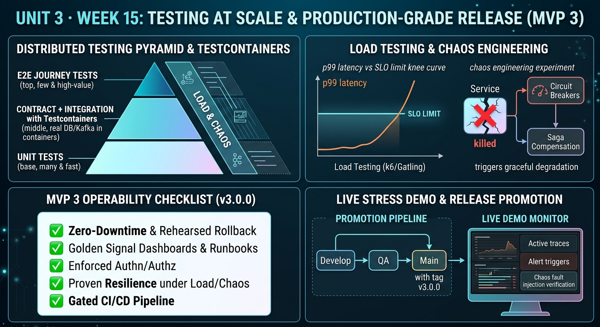

<!-- HU-STATUS TEMPLATE - do NOT remove the <!-- ... --> markers or the table headers.
     Your weekly grade is read AUTOMATICALLY from this file:
       15-week/hu-status/README.md  (inside YOUR fork). English. -->

# Weekly Status - Week 15

<!-- CONFIG-START - must match your profile repo (username/username) CONFIG -->
- FULL_NAME: Daniel Felipe Cerquera Idrobo
- GITHUB_USER: Pipecerquera
- TEAM: Barbersaas
- SPRINT_GOAL: Prepare release 3.0.0 for `main` and leave it defensible against the teacher's list M1–M9: open the release pull requests of my 10 repositories, close every grave security finding with evidence or a written decision, keep `main` from marking a plan as paid without the provider, and prove with tests and scans that each resource refuses a second user and that no secret is in any history.
<!-- CONFIG-END -->

> **Living record (week 2026-11-09 to 2026-11-15).** Updated on 2026-11-11. **Scope of this record (M5):**
> everything below comes from git and GitHub across the 30 code repositories, DOCS and this repository,
> plus the checks run on the Azure host on 2026-11-11 (listed under "Work outside GitHub"). The tests of
> the repositories I changed were run in full; my teammates' repositories were read and reviewed against
> the token contract, not run. **Not done this week, by decision:** the load test, the chaos experiment
> and Testcontainers (section 3). The system has still not been started from a clean folder.

## 1. User stories worked this week
| HU ID | Title | Status (todo/doing/done) | Evidence (PR or commit URL) |
|---|---|---|---|
| HU-000-079 | As the team, we want release 3.0.0 on `main` in my 10 repositories, with the trail of every commit | **done — merged on 2026-11-10; tag `v3.0.0` pending** | `release.3.0.0` cut from `main` and filled from `qa` with `git cherry-pick -x` (2026-11-09): identity-auth-db [#17](https://github.com/code-corhuila/barber-saas-identity-auth-db/pull/17), identity-auth-api [#37](https://github.com/code-corhuila/barber-saas-identity-auth-api/pull/37), identity-auth-app [#19](https://github.com/code-corhuila/barber-saas-identity-auth-app/pull/19), platform-admin-db [#12](https://github.com/code-corhuila/barber-saas-platform-admin-db/pull/12), platform-admin-api [#26](https://github.com/code-corhuila/barber-saas-platform-admin-api/pull/26), platform-admin-app [#17](https://github.com/code-corhuila/barber-saas-platform-admin-app/pull/17), api-gateway [#28](https://github.com/code-corhuila/barber-saas-api-gateway/pull/28), worker [#23](https://github.com/code-corhuila/barber-saas-worker/pull/23), front [#32](https://github.com/code-corhuila/barber-saas-front/pull/32), infra-postgres [#46](https://github.com/code-corhuila/barber-saas-infra-postgres/pull/46). Approved by the teacher and **merged to `main`** with rebase on 2026-11-10: identity-auth-db [#18](https://github.com/code-corhuila/barber-saas-identity-auth-db/pull/18), identity-auth-api [#38](https://github.com/code-corhuila/barber-saas-identity-auth-api/pull/38), identity-auth-app [#20](https://github.com/code-corhuila/barber-saas-identity-auth-app/pull/20), platform-admin-db [#13](https://github.com/code-corhuila/barber-saas-platform-admin-db/pull/13), platform-admin-api [#27](https://github.com/code-corhuila/barber-saas-platform-admin-api/pull/27), platform-admin-app [#18](https://github.com/code-corhuila/barber-saas-platform-admin-app/pull/18), api-gateway [#29](https://github.com/code-corhuila/barber-saas-api-gateway/pull/29), worker [#24](https://github.com/code-corhuila/barber-saas-worker/pull/24), front [#33](https://github.com/code-corhuila/barber-saas-front/pull/33), infra-postgres [#47](https://github.com/code-corhuila/barber-saas-infra-postgres/pull/47); `main` == `release.3.0.0` == `qa`. The fixes of 2026-11-11 to platform-admin-api go to `main` in [#34](https://github.com/code-corhuila/barber-saas-platform-admin-api/pull/34) (HU-000-090) |
| HU-000-080 | As a client, I want my phone registered once even when the app sends its token twice at the same time, so the registration never fails with a 500 | **done — 2026-11-09** | notifications-api [#26](https://github.com/code-corhuila/barber-saas-notifications-api/pull/26) to `develop`, [#27](https://github.com/code-corhuila/barber-saas-notifications-api/pull/27) to `qa` |
| HU-000-081 | As the team, we want the project audited against the teacher's list M1–M9, so no practice that lowers the grade is missed | **done — 2026-11-10, updated 2026-11-11** | [`m1-m9-audit.md`](m1-m9-audit.md): scope, rule, findings with severity first, and the update of 2026-11-11 |
| HU-000-082 | As the team, we want every security finding that is already fixed in code closed with its evidence, so no grave finding stays loose (M3) | **done — 2026-11-10** | Closed with a comment that maps each criterion to its PR, commit and test: [#155](https://github.com/code-corhuila/barber-saas-docs/issues/155) (P0), [#156](https://github.com/code-corhuila/barber-saas-docs/issues/156), [#165](https://github.com/code-corhuila/barber-saas-docs/issues/165), [#166](https://github.com/code-corhuila/barber-saas-docs/issues/166), [#168](https://github.com/code-corhuila/barber-saas-docs/issues/168). Also [#150](https://github.com/code-corhuila/barber-saas-docs/issues/150), the TB1 threat model, after DOCS [#179](https://github.com/code-corhuila/barber-saas-docs/pull/179) gave each of its rows a decision |
| HU-000-083 | As the SaaS operator, I want every token to name its audience, the worker to hold one short-lived token per called service with only its scopes, and the outbox with the reset codes guarded, so a leaked token is useless elsewhere (#158, #159, #160, #164) | **done — my part 2026-11-10; all four issues closed** | identity-auth-api [#39](https://github.com/code-corhuila/barber-saas-identity-auth-api/pull/39) · platform-admin-api [#28](https://github.com/code-corhuila/barber-saas-platform-admin-api/pull/28) · worker [#25](https://github.com/code-corhuila/barber-saas-worker/pull/25) · infra-postgres [#48](https://github.com/code-corhuila/barber-saas-infra-postgres/pull/48) · DOCS [#177](https://github.com/code-corhuila/barber-saas-docs/pull/177). To `qa`: [#40](https://github.com/code-corhuila/barber-saas-identity-auth-api/pull/40), [#29](https://github.com/code-corhuila/barber-saas-platform-admin-api/pull/29), [#26](https://github.com/code-corhuila/barber-saas-worker/pull/26), [#49](https://github.com/code-corhuila/barber-saas-infra-postgres/pull/49); to `release.3.0.0`: [#41](https://github.com/code-corhuila/barber-saas-identity-auth-api/pull/41), [#30](https://github.com/code-corhuila/barber-saas-platform-admin-api/pull/30), [#27](https://github.com/code-corhuila/barber-saas-worker/pull/27), [#50](https://github.com/code-corhuila/barber-saas-infra-postgres/pull/50). Carlos and Juan Pablo closed their parts on 2026-11-10; I reviewed their code against the contract on 2026-11-11 (HU-000-094) |
| HU-000-084 | As the `SUPER_ADMIN`, I want `main` never to mark a plan as paid without the provider's signed event (M8, #157) | **done for the code; the Wompi sandbox payment cannot be run** | `PAYMENTS_SIMULATOR=false` on `main`: infra-postgres [#51](https://github.com/code-corhuila/barber-saas-infra-postgres/pull/51), [#52](https://github.com/code-corhuila/barber-saas-infra-postgres/pull/52) to `qa`, [#53](https://github.com/code-corhuila/barber-saas-infra-postgres/pull/53) to `release.3.0.0`. Opening a Wompi account requires an active merchant account the team does not have; the demo host runs the simulator in its own env file only for the presentation, and every payment there is shown as simulated. Recorded in [#157](https://github.com/code-corhuila/barber-saas-docs/issues/157), which stays open as a P2 |
| HU-000-085 | As the team, we want a secret scan over code, documentation and the whole commit history (M2) | **done — 2026-11-10** | DOCS [#178](https://github.com/code-corhuila/barber-saas-docs/pull/178), `11-quality/secret-scan-2026-11-10.md`: gitleaks 8.30.0 over every branch of the 32 repositories; 0 real secrets, 54 false positives classified one by one |
| HU-000-086 | As the team, we want every planned item that 3.0.0 does not build recorded with a decision (M3) | **done — 2026-11-10** | DOCS [#178](https://github.com/code-corhuila/barber-saas-docs/pull/178), `15-project-control/declared-debt-3.0.0.md` |
| HU-000-087 | As a new developer, I want to start the whole platform from a clean folder with the README only (M4) | **doing — README done; the host was updated by its steps, not from a clean folder** | infra-postgres [#54](https://github.com/code-corhuila/barber-saas-infra-postgres/pull/54), [#55](https://github.com/code-corhuila/barber-saas-infra-postgres/pull/55) to `qa`, [#56](https://github.com/code-corhuila/barber-saas-infra-postgres/pull/56) to `release.3.0.0`; executable scripts [#57](https://github.com/code-corhuila/barber-saas-infra-postgres/pull/57), [#58](https://github.com/code-corhuila/barber-saas-infra-postgres/pull/58), [#59](https://github.com/code-corhuila/barber-saas-infra-postgres/pull/59). On 2026-11-11 the existing Azure host followed the README's update steps (backup, pull, `dev-keys.sh main 10080`, migrate, rebuild) without a manual fix (HU-000-091) |
| HU-000-088 | As the team, we want, for every resource with an owner, a test where a second user is refused, listed in one place (M1) | **done — 2026-11-10** | DOCS [#179](https://github.com/code-corhuila/barber-saas-docs/pull/179), `11-quality/cross-ownership-tests.md` · identity-auth-api [#42](https://github.com/code-corhuila/barber-saas-identity-auth-api/pull/42), [#43](https://github.com/code-corhuila/barber-saas-identity-auth-api/pull/43) to `qa`, [#44](https://github.com/code-corhuila/barber-saas-identity-auth-api/pull/44) to `release.3.0.0` |
| HU-000-089 | As a user of the app, I want notifications-api to accept the tokens identity-auth issues, so my inbox, my phone's push registration and the e-mailed codes work | **done — 2026-11-11; to `main` waiting for the teacher** | Found on the host: notifications-api answered 401 to every token with `aud` (PyJWT without an expected audience), so the inbox, `POST /api/v1/device-tokens` and every event delivered by the worker failed, including the verification codes. Fix: `aud` checked per route — `/api/**` only `barber-saas-app` (a service token is 401), `/internal/v1/events` only the worker's token for notifications with `events:deliver` and at most 7 days. notifications-api [#30](https://github.com/code-corhuila/barber-saas-notifications-api/pull/30) → `qa` [#31](https://github.com/code-corhuila/barber-saas-notifications-api/pull/31) → `release.3.0.0` [#32](https://github.com/code-corhuila/barber-saas-notifications-api/pull/32); 191 tests pass, 117 of them fail with the old verifier. Carlos's pull request to `main` ([#29](https://github.com/code-corhuila/barber-saas-notifications-api/pull/29)) carries it and waits for a new approval |
| HU-000-090 | As the SaaS operator, I want each internal operation of platform-admin-api to require its own scope and its outbox capped at 50, so a leaked worker token cannot relay or run jobs it was not given (#159, #160) | **done — 2026-11-11; to `main` waiting for the teacher** | Found on the host: the outbox, `trials/expire` and `subscriptions/notices` accepted any worker token. Scopes: [#31](https://github.com/code-corhuila/barber-saas-platform-admin-api/pull/31) → `qa` [#32](https://github.com/code-corhuila/barber-saas-platform-admin-api/pull/32) → `release.3.0.0` [#33](https://github.com/code-corhuila/barber-saas-platform-admin-api/pull/33). Cap of 50: [#35](https://github.com/code-corhuila/barber-saas-platform-admin-api/pull/35) → [#36](https://github.com/code-corhuila/barber-saas-platform-admin-api/pull/36) → [#37](https://github.com/code-corhuila/barber-saas-platform-admin-api/pull/37). To `main`: [#34](https://github.com/code-corhuila/barber-saas-platform-admin-api/pull/34), four commits re-applied with `cherry-pick -x`. 81 tests. On the host: own token 200, no scope 403, `limit=51` 400 |
| HU-000-091 | As the team, we want the Azure host on the release candidate and the main journey proven end to end before the presentation | **done — 2026-11-11** | Backup, `git pull` of the 21 repositories (21 of 21 equal to `origin/qa`), `dev-keys.sh main 10080` with the same RSA pair (nobody signed out), the weekly token cron added by hand, migrate and rebuild; 15 containers healthy. End-to-end script against https://barbersaas.chilecentral.cloudapp.azure.com: **31/31** — sign-up saga, verification, catalog, booking, double booking refused, the barber's appointment flow, rating, tenant isolation, suspension and reactivation, and every outbox event of the run delivered |
| HU-000-092 | As the team, we want the threat models of TB2a, TB2b and TB4 in DOCS and each of their rows with a decision (M3) | **doing — models merged; row decisions waiting for the teacher** | Merged with rebase after the teacher's approval: DOCS [#154](https://github.com/code-corhuila/barber-saas-docs/pull/154) (Juan Pablo), [#161](https://github.com/code-corhuila/barber-saas-docs/pull/161) (Carlos), [#162](https://github.com/code-corhuila/barber-saas-docs/pull/162) (Carolay); issues [#149](https://github.com/code-corhuila/barber-saas-docs/issues/149), [#151](https://github.com/code-corhuila/barber-saas-docs/issues/151), [#152](https://github.com/code-corhuila/barber-saas-docs/issues/152) closed. DOCS [#180](https://github.com/code-corhuila/barber-saas-docs/pull/180), `05-architecture/security/row-decisions-2026-11-11.md`: the 18 rows fixed with evidence, downgraded or accepted with the reason |
| HU-000-093 | As the worker's owner, I want the outbox contracts to say what the code does: at most 50 events per call | **doing — waiting for the teacher** | DOCS [#181](https://github.com/code-corhuila/barber-saas-docs/pull/181): `OutboxLimitParam` (1–50) and the `400` response in the four producer contracts; Redocly valid, the same 9 warnings as `main` |
| HU-000-094 | As the team, we want the release closed by everybody: my teammates' code reviewed against the contract and their last steps written down | **doing — waiting for Carlos and Juan Pablo** | Review of #158–#160 and #163–#164: both meet the contract. Gaps found: the `[3.0.0]` CHANGELOG of barbershop-api, schedule-api, appointment-api and loyalty-api, and the missing `release.3.0.0` of loyalty-api. Their final prompts cover those, the merge to `main` after approval and the `v3.0.0` tag only after each merge |
| HU-000-065 | As a student, I want to take the Huawei HCCDP-Solution Architectures course of the third cut and keep its evidence in this repository | **done — delivered on 2026-11-10** | Exam passed and certificate ICT20261111000006; chapters 13 and 14 ([`7f4f69b`](https://github.com/Pipecerquera/sistemas-distribuidos-2026-b-g2-daniel-cerquera/commit/7f4f69b), [`5eac942`](https://github.com/Pipecerquera/sistemas-distribuidos-2026-b-g2-daniel-cerquera/commit/5eac942)), the structure of the guide ([`fd2a72d`](https://github.com/Pipecerquera/sistemas-distribuidos-2026-b-g2-daniel-cerquera/commit/fd2a72d)), uploaded to Moodle at 17:15. Only the oral defense of 2026-11-19 is left |

## 2. My individual contribution
- **Release 3.0.0 to `main`** (2026-11-09/10): cut and filled `release.3.0.0` in my 10 repositories, then merged them to `main` after the teacher approved; `main` equals `qa`.
- **Audit against M1–M9** (2026-11-10, updated 2026-11-11): every practice checked against the repositories, written in the format the list asks for.
- **Security findings**: closed the five already fixed in code with evidence per criterion; issued audience and scope on every token; on 2026-11-11 found and fixed two gaps on the live host — notifications-api refusing every token with `aud` (it would have broken push, the inbox and the e-mailed codes in the presentation) and platform-admin-api relaying and running jobs without scopes — plus the outbox cap of 50 there.
- **Release candidate on the Azure host** (2026-11-11): updated with backup and the new tokens, and proven with the end-to-end script, 31/31.
- **Threat models**: merged my teammates' three models, closed their issues, and recorded a decision for each of their 18 rows.
- **Contracts**: the outbox limit of the four producers now matches the code.
- **Team release**: reviewed Carlos's and Juan Pablo's code against the contract and wrote their final prompts.
- **Money (M8), secrets (M2), declared debt (M3), manual (M4)**: simulated checkout closed on `main`; full-history scan; one decision per item; infra README rewritten.
- **Huawei certification**: chapters 13 and 14, exam passed, delivered.

## 3. Blockers and risks
Severity first (M9):
- **P2 — pull requests waiting for the teacher**: notifications-api [#29](https://github.com/code-corhuila/barber-saas-notifications-api/pull/29) and platform-admin-api [#34](https://github.com/code-corhuila/barber-saas-platform-admin-api/pull/34) to `main`, DOCS [#180](https://github.com/code-corhuila/barber-saas-docs/pull/180) and [#181](https://github.com/code-corhuila/barber-saas-docs/pull/181), and my teammates' CHANGELOG commits. The `v3.0.0` tags wait for those merges. The code on the host does not: it is the same as `qa`.
- **P2 — week 15 activities not done, by decision on 2026-11-11**: the **load test** against SLO-1/SLO-2, the **chaos experiment** (stopping a service) and **integration tests with Testcontainers**. The integration tests that exist use a real PostgreSQL or MongoDB given by environment variables, not Testcontainers. Not run before the presentation to keep the host stable; they stay for after the release.
- **P2 — contract tests in CI cannot run**: GitHub Actions of the organization are locked by billing since 2026-10-26; the tests and the Redocly lint run locally and their result goes in each pull request.
- **P2 — Wompi sandbox not possible** without an active merchant account (#157). `main` meets M8; the demo host uses the simulator.
- **P3 — a failed outbox event is not retried by itself**: it stays as a dead letter (backlog #111). Six events of the first end-to-end run of 2026-11-11, all of test accounts, stayed that way.
- **P3 — the platform has not been started from a clean folder** (M4).

## 4. Plan for next week
- 2026-11-12: presentation and demo on the Azure host.
- After each approval: merge to `main`, tag `v3.0.0` and the Release in my 12 repositories (my 10 plus infra-mongo and workflow, which did not change); move the host from `qa` to `main` (same code).
- Moodle: the release package of the cut, the sprints of weeks 11–16 and the final project.
- Week 16: final presentation, documentation and handover.
- 2026-11-19: oral defense of the Huawei certification.

## 5. Compliance self-check
- [x] Conventional Commits - `type(scope): summary` — e.g. `fix(auth): read the audience of each token by route instead of refusing every token that names one`, `fix(security): relay the outbox only with outbox:relay and run the daily jobs only with jobs:run`, `docs(api): cap the outbox limit at fifty in the four producer contracts`.
- [x] Per-environment HU branch + PR to that environment (hu-xxx-dev -> develop, ...) — fixes by branch → PR → `develop`; `hu-token-audience-qa`, `hu-worker-scopes-qa`, `hu-outbox-cap-qa` → `qa`; the `-release` ones → `release.3.0.0`; `hu-worker-scopes-main` → `main` through the teacher's review; DOCS by `docs/108-…` and `docs/109-…`.
- [x] Testable acceptance criteria — e.g. a user token without `aud: barber-saas-app` gets 401 on the inbox; a worker token without `outbox:relay` gets 403; `limit=51` gets 400.
- [x] Tests added/updated (unit / integration) — notifications-api: test tokens now signed as identity-auth signs them, plus the audience and scope cases (191 pass); platform-admin-api +3 (81); all green; the end-to-end script 31/31 on the host.
- [x] DDD / hexagonal boundaries respected (domain has no I/O) — the scope checks live in `Caller` and the use cases; the claims are read only in the HTTP adapters.
- [x] No secrets; config via environment variables — the new tokens were generated on the host into its ignored env file; nothing secret was printed or committed.
- **Verdict by rule (M6):** the week passes when no P0 is open and every open P1 has an owner and evidence in progress. **Met on 2026-11-11: no P0 or P1 is open.**

## 6. Evidence links
- Repo: https://github.com/Pipecerquera/sistemas-distribuidos-2026-b-g2-daniel-cerquera.git
- Audit M1–M9: [`15-week/hu-status/m1-m9-audit.md`](m1-m9-audit.md)
- Live host: https://barbersaas.chilecentral.cloudapp.azure.com
- Threat model row decisions: https://github.com/code-corhuila/barber-saas-docs/pull/180 · Cross-ownership tests (M1): https://github.com/code-corhuila/barber-saas-docs/blob/main/11-quality/cross-ownership-tests.md
- Token contract: https://github.com/code-corhuila/barber-saas-docs/blob/main/07-api/authentication.md · Secret scan: https://github.com/code-corhuila/barber-saas-docs/blob/main/11-quality/secret-scan-2026-11-10.md · Declared debt: https://github.com/code-corhuila/barber-saas-docs/blob/main/15-project-control/declared-debt-3.0.0.md
- This week's infographic: `15-week/hu-status/Week-15.jpg` (in this same folder)

<!-- FULL-EVIDENCE-START -->
### Complete evidence of the week, item by item (generated from git and GitHub, since 2026-11-07)

**Totals:** 61 pull requests opened · commits: 30 on `develop`, 30 re-applied on `qa`, 143 re-applied on `release.3.0.0`, 6 on `main` of DOCS, 10 in this repository · 30 comments, 0 reviews, 9 issues closed.

#### Every commit of mine on `develop`

| Commit | Date | Subject |
|---|---|---|
| [identity-auth-api `44a09b1`](https://github.com/code-corhuila/barber-saas-identity-auth-api/commit/44a09b1b170d5504052d1b70e11bc3f2524a2430) | 2026-11-10 | test(barbers): an owner token without a barbershop cannot add barbers |
| [identity-auth-api `df9f888`](https://github.com/code-corhuila/barber-saas-identity-auth-api/commit/df9f88880662aa7c8a4553a7a5c4463320324c71) | 2026-11-10 | docs(changelog): record the app audience and the outbox limits in 3.0.0 |
| [identity-auth-api `cd54124`](https://github.com/code-corhuila/barber-saas-identity-auth-api/commit/cd541246e8160a95070b1f921e4a2141decefd5c) | 2026-11-10 | feat(outbox): read at most fifty events and only with the worker's relay scope |
| [identity-auth-api `392168c`](https://github.com/code-corhuila/barber-saas-identity-auth-api/commit/392168c1d330053a886dc0c23915d6f1b3aa8d6d) | 2026-11-10 | feat(auth): name the app as the audience of every user token |
| [infra `1714e03`](https://github.com/code-corhuila/barber-saas-infra-postgres/commit/1714e0367a723799d8eff6ec5f1de3c516414a0f) | 2026-11-10 | docs(changelog): record the executable scripts in 3.0.0 |
| [infra `c52d453`](https://github.com/code-corhuila/barber-saas-infra-postgres/commit/c52d453c95c4b71ebf5e3dac317a736ecefb0cdc) | 2026-11-10 | fix(scripts): make clone-all, backup and dev-super-admin executable |
| [infra `f0ce530`](https://github.com/code-corhuila/barber-saas-infra-postgres/commit/f0ce530aac4ee4310d300b0a8034f54c48c43c4a) | 2026-11-10 | docs(readme): start the platform from a clean folder with the README only |
| [infra `b2d4682`](https://github.com/code-corhuila/barber-saas-infra-postgres/commit/b2d46827ed0bf694d2dfe5ff33be10dc2a77b27e) | 2026-11-10 | docs(changelog): record the closed simulated checkout on main in 3.0.0 |
| [infra `21c85fc`](https://github.com/code-corhuila/barber-saas-infra-postgres/commit/21c85fc4b089f3c6a8229ad7b80c38af7fcae61c) | 2026-11-10 | fix(env): close the simulated checkout on main |
| [infra `303bc01`](https://github.com/code-corhuila/barber-saas-infra-postgres/commit/303bc01c6b18496f3f0e6fc1944136ad5168beac) | 2026-11-10 | docs(changelog): record the token audience, scopes and weekly rotation in 3.0.0 |
| [infra `d39864c`](https://github.com/code-corhuila/barber-saas-infra-postgres/commit/d39864c1efeb4d612f02c0486862b798b9bc11a7) | 2026-11-10 | docs(deploy): renew the service tokens every week on the public host |
| [infra `7c36d03`](https://github.com/code-corhuila/barber-saas-infra-postgres/commit/7c36d0366b68e7b0b15682ee0a0f92f9ffde3f22) | 2026-11-10 | chore(env): name the worker's token per called service |
| [infra `a36c583`](https://github.com/code-corhuila/barber-saas-infra-postgres/commit/a36c583038a4bbfac6c024745c2c2ff9f9e1aba2) | 2026-11-10 | feat(scripts): issue one worker token per called service, seven days at most |
| [infra `7ba9395`](https://github.com/code-corhuila/barber-saas-infra-postgres/commit/7ba93953b6dafe0e1c642654d380bbc89e228872) | 2026-11-10 | feat(scripts): issue aud and scope in development tokens |
| [notifications-api `2b5e078`](https://github.com/code-corhuila/barber-saas-notifications-api/commit/2b5e0789dc6cb9872fb1f076462b068612f536d0) | 2026-11-11 | docs(changelog): record the audience and scope checks in 3.0.0 |
| [notifications-api `6e8ebf2`](https://github.com/code-corhuila/barber-saas-notifications-api/commit/6e8ebf279ef0ea018988506b17c3d853fd965565) | 2026-11-11 | fix(auth): read the audience of each token by route instead of refusing every token that names one |
| [notifications-api `e7a5dbf`](https://github.com/code-corhuila/barber-saas-notifications-api/commit/e7a5dbf6db0d6f37f69ce05f3ed2b1a9b430376c) | 2026-11-09 | docs(changelog): record the fix of the concurrent device token registration |
| [notifications-api `41ce3b5`](https://github.com/code-corhuila/barber-saas-notifications-api/commit/41ce3b50041a7d61961890628645b4ba636d3118) | 2026-11-09 | fix(persistence): retry transient write conflicts and report a token already stored |
| [notifications-api `76b1a72`](https://github.com/code-corhuila/barber-saas-notifications-api/commit/76b1a722b58ffdb9a086902f23fbc431a1544069) | 2026-11-09 | fix(application): read back a device token another request stored first |
| [notifications-api `6e613ce`](https://github.com/code-corhuila/barber-saas-notifications-api/commit/6e613cebb9509a54631f7fa3ffc81604edf3e025) | 2026-11-09 | test(persistence): specify one document and no error for a device signing in twice at once |
| [notifications-api `4283f5c`](https://github.com/code-corhuila/barber-saas-notifications-api/commit/4283f5c75f76dd0943d3c6f2479d44d0b27e5874) | 2026-11-09 | test(device-tokens): specify that a token stored by a concurrent sign-in is read back |
| [platform-admin-api `f4104a4`](https://github.com/code-corhuila/barber-saas-platform-admin-api/commit/f4104a45e35f95e1ea58150a352429429c6d2926) | 2026-11-11 | docs(changelog): record the outbox cap of fifty in 3.0.0 |
| [platform-admin-api `b7431f0`](https://github.com/code-corhuila/barber-saas-platform-admin-api/commit/b7431f0f3af6b6601d419cceea06fdefe657ab39) | 2026-11-11 | fix(outbox): read at most fifty pending events per call |
| [platform-admin-api `f9486e4`](https://github.com/code-corhuila/barber-saas-platform-admin-api/commit/f9486e4e5b076709cd3e83e2aa2a1b456f39ffac) | 2026-11-11 | docs(changelog): record the scopes of the outbox and the daily jobs in 3.0.0 |
| [platform-admin-api `ffd2029`](https://github.com/code-corhuila/barber-saas-platform-admin-api/commit/ffd2029bee239f564cfff99785c6a3189cf169c5) | 2026-11-11 | fix(security): relay the outbox only with outbox:relay and run the daily jobs only with jobs:run |
| [platform-admin-api `13cabab`](https://github.com/code-corhuila/barber-saas-platform-admin-api/commit/13cabab1dc811f72fc20a6ee4c8bab8a4b0285ec) | 2026-11-10 | docs(changelog): record the subscriptions:expire scope in 3.0.0 |
| [platform-admin-api `9d68a11`](https://github.com/code-corhuila/barber-saas-platform-admin-api/commit/9d68a115537b567b5011adebf26cfb4500c86b16) | 2026-11-10 | feat(security): suspend paid barbershops only with the subscriptions:expire scope |
| [worker `48a35a3`](https://github.com/code-corhuila/barber-saas-worker/commit/48a35a337a244ba1264d85d86bfde27baac4eb2e) | 2026-11-10 | docs(changelog): record the token per called service in 3.0.0 |
| [worker `a1f102c`](https://github.com/code-corhuila/barber-saas-worker/commit/a1f102c47d143bfa9115cfb278fe6567fd9a90ae) | 2026-11-10 | chore(deploy): pass one token per called service |
| [worker `da6dd22`](https://github.com/code-corhuila/barber-saas-worker/commit/da6dd228f5c3f3c535a72454d287cff2a32ccb7d) | 2026-11-10 | feat(worker): call each service with its own token |

#### Every commit I re-applied on `qa` with `cherry-pick -x`

| Commit | Date | Subject |
|---|---|---|
| [identity-auth-api `9d20096`](https://github.com/code-corhuila/barber-saas-identity-auth-api/commit/9d200961f4232e302b6e424a7d691d1c0774a56a) | 2026-11-10 | test(barbers): an owner token without a barbershop cannot add barbers |
| [identity-auth-api `c19c954`](https://github.com/code-corhuila/barber-saas-identity-auth-api/commit/c19c954cbaedd170485a47baf032dfb18af428f9) | 2026-11-10 | docs(changelog): record the app audience and the outbox limits in 3.0.0 |
| [identity-auth-api `eee88da`](https://github.com/code-corhuila/barber-saas-identity-auth-api/commit/eee88dad0c91fb63d8aa0ed3d02a2250f7b6bde9) | 2026-11-10 | feat(outbox): read at most fifty events and only with the worker's relay scope |
| [identity-auth-api `e5f4560`](https://github.com/code-corhuila/barber-saas-identity-auth-api/commit/e5f4560c0972cb4e1ebb60a56f6e4ffd71611550) | 2026-11-10 | feat(auth): name the app as the audience of every user token |
| [infra `2cfbc2c`](https://github.com/code-corhuila/barber-saas-infra-postgres/commit/2cfbc2cb51219acd0c0fc25a489c1b2443a6ec27) | 2026-11-10 | docs(changelog): record the executable scripts in 3.0.0 |
| [infra `002531f`](https://github.com/code-corhuila/barber-saas-infra-postgres/commit/002531fe9d169efae08ef9915ab8a866b6a5ff5e) | 2026-11-10 | fix(scripts): make clone-all, backup and dev-super-admin executable |
| [infra `045dd44`](https://github.com/code-corhuila/barber-saas-infra-postgres/commit/045dd44ec399be3a32e2b173830ab1ff2df61a8d) | 2026-11-10 | docs(readme): start the platform from a clean folder with the README only |
| [infra `085e7a8`](https://github.com/code-corhuila/barber-saas-infra-postgres/commit/085e7a82eaa743ea3426e7599c3b10d8bdccf2ed) | 2026-11-10 | docs(changelog): record the closed simulated checkout on main in 3.0.0 |
| [infra `522bf3e`](https://github.com/code-corhuila/barber-saas-infra-postgres/commit/522bf3e9874cd6668fdf5918964645acaeb30a3d) | 2026-11-10 | fix(env): close the simulated checkout on main |
| [infra `4c41b18`](https://github.com/code-corhuila/barber-saas-infra-postgres/commit/4c41b1853e4fc1f24007240b3daf25a017ea0c9e) | 2026-11-10 | docs(changelog): record the token audience, scopes and weekly rotation in 3.0.0 |
| [infra `d33a32d`](https://github.com/code-corhuila/barber-saas-infra-postgres/commit/d33a32d41fd0af7d557372af6b86f7e1d356f693) | 2026-11-10 | docs(deploy): renew the service tokens every week on the public host |
| [infra `edac692`](https://github.com/code-corhuila/barber-saas-infra-postgres/commit/edac69292c799c4f5c104f6cdbd5e7038465d4a1) | 2026-11-10 | chore(env): name the worker's token per called service |
| [infra `0c7b1c1`](https://github.com/code-corhuila/barber-saas-infra-postgres/commit/0c7b1c151dbbbe6f0c2e9b51dbcff41cac960a17) | 2026-11-10 | feat(scripts): issue one worker token per called service, seven days at most |
| [infra `9953e28`](https://github.com/code-corhuila/barber-saas-infra-postgres/commit/9953e28dcea9f6fc2175009d8479db9c01c32a56) | 2026-11-10 | feat(scripts): issue aud and scope in development tokens |
| [notifications-api `f6f899f`](https://github.com/code-corhuila/barber-saas-notifications-api/commit/f6f899ffebfa1091ee263fc1539edbc017db84b2) | 2026-11-11 | docs(changelog): record the audience and scope checks in 3.0.0 |
| [notifications-api `44bee82`](https://github.com/code-corhuila/barber-saas-notifications-api/commit/44bee8273b9999a793d6a2211a6bb825a7529173) | 2026-11-11 | fix(auth): read the audience of each token by route instead of refusing every token that names one |
| [notifications-api `c826963`](https://github.com/code-corhuila/barber-saas-notifications-api/commit/c8269639aa9405742892d4c7eb89487598aecc2a) | 2026-11-09 | docs(changelog): record the fix of the concurrent device token registration |
| [notifications-api `fbf6826`](https://github.com/code-corhuila/barber-saas-notifications-api/commit/fbf6826015801032181ed07883e517bf289f409e) | 2026-11-09 | fix(persistence): retry transient write conflicts and report a token already stored |
| [notifications-api `461dccb`](https://github.com/code-corhuila/barber-saas-notifications-api/commit/461dccb5328489c49abfd8e436f437569f5844cb) | 2026-11-09 | fix(application): read back a device token another request stored first |
| [notifications-api `8fb4a45`](https://github.com/code-corhuila/barber-saas-notifications-api/commit/8fb4a4548e4d12967d79ce6e3616d4c77f88e9c3) | 2026-11-09 | test(persistence): specify one document and no error for a device signing in twice at once |
| [notifications-api `7ab47fb`](https://github.com/code-corhuila/barber-saas-notifications-api/commit/7ab47fb421191f8389c3b89a4a8cfcb16817eb29) | 2026-11-09 | test(device-tokens): specify that a token stored by a concurrent sign-in is read back |
| [platform-admin-api `440935d`](https://github.com/code-corhuila/barber-saas-platform-admin-api/commit/440935d53ce2bfd304f61d5e9383b4ecc2e7792e) | 2026-11-11 | docs(changelog): record the outbox cap of fifty in 3.0.0 |
| [platform-admin-api `e9a1fc3`](https://github.com/code-corhuila/barber-saas-platform-admin-api/commit/e9a1fc35fa2d601822131b218519d2de79071d46) | 2026-11-11 | fix(outbox): read at most fifty pending events per call |
| [platform-admin-api `9c3467b`](https://github.com/code-corhuila/barber-saas-platform-admin-api/commit/9c3467b448e63785a6b276ef32358c510843b9cc) | 2026-11-11 | docs(changelog): record the scopes of the outbox and the daily jobs in 3.0.0 |
| [platform-admin-api `f627c34`](https://github.com/code-corhuila/barber-saas-platform-admin-api/commit/f627c34f25e7fdf168f7c15dadbc1c019f0c7fd7) | 2026-11-11 | fix(security): relay the outbox only with outbox:relay and run the daily jobs only with jobs:run |
| [platform-admin-api `e110c2c`](https://github.com/code-corhuila/barber-saas-platform-admin-api/commit/e110c2c15eecf49ffc65dd631bb24571fb6f0add) | 2026-11-10 | docs(changelog): record the subscriptions:expire scope in 3.0.0 |
| [platform-admin-api `1ad49f7`](https://github.com/code-corhuila/barber-saas-platform-admin-api/commit/1ad49f7f983cc7f784e113e8e8ff25576ab0b420) | 2026-11-10 | feat(security): suspend paid barbershops only with the subscriptions:expire scope |
| [worker `96060ca`](https://github.com/code-corhuila/barber-saas-worker/commit/96060ca73ba0c7775eaa160ce0cc4d08dbaf2557) | 2026-11-10 | docs(changelog): record the token per called service in 3.0.0 |
| [worker `95c32d6`](https://github.com/code-corhuila/barber-saas-worker/commit/95c32d6fe3307bbe7d46ad0194bfb8788fbb8b6f) | 2026-11-10 | chore(deploy): pass one token per called service |
| [worker `17e9498`](https://github.com/code-corhuila/barber-saas-worker/commit/17e94984312b498008a43373fe00293b7a12644b) | 2026-11-10 | feat(worker): call each service with its own token |

#### Every commit I re-applied on `release.3.0.0` with `cherry-pick -x`

| Commit | Date | Subject |
|---|---|---|
| [api-gateway `4a132a5`](https://github.com/code-corhuila/barber-saas-api-gateway/commit/4a132a5f6aea6f182beccd3c609c983bd1492638) | 2026-11-09 | docs(changelog): record the auth limit and the milliseconds in 3.0.0 |
| [api-gateway `64c4307`](https://github.com/code-corhuila/barber-saas-api-gateway/commit/64c4307aa8ee9b99cd08f6171c002fdb6026d53e) | 2026-11-09 | feat(security): limit all clients together on the auth routes |
| [api-gateway `28ec9e2`](https://github.com/code-corhuila/barber-saas-api-gateway/commit/28ec9e253362495680dc2946de24908ac93fd500) | 2026-11-09 | fix(log): write the access log duration in milliseconds |
| [api-gateway `a73ba4e`](https://github.com/code-corhuila/barber-saas-api-gateway/commit/a73ba4e5e5505a4f75df524f8d720a7ed0924e9a) | 2026-11-09 | docs(changelog): record release 3.0.0 |
| [api-gateway `e9149ce`](https://github.com/code-corhuila/barber-saas-api-gateway/commit/e9149ce47ad0d585b1cbc9c740395831af1483da) | 2026-11-09 | docs(readme): explain which correlation ids the gateway keeps |
| [api-gateway `5d5aaa8`](https://github.com/code-corhuila/barber-saas-api-gateway/commit/5d5aaa8a0f2fd19a9614dde178d09fef41299790) | 2026-11-09 | test(smoke): check that a malformed correlation id is replaced and the error body stays json |
| [api-gateway `54f0ff1`](https://github.com/code-corhuila/barber-saas-api-gateway/commit/54f0ff13ed4822f7a4023e111a2a0a61a44d701f) | 2026-11-09 | fix(nginx): keep the client's correlation id only when it is a uuid or 32 hex characters |
| [api-gateway `1dc3a10`](https://github.com/code-corhuila/barber-saas-api-gateway/commit/1dc3a104acbf484d31888610775b1d8b4f9833de) | 2026-11-09 | fix(security): take the real client from X-Forwarded-For behind Caddy |
| [api-gateway `0392298`](https://github.com/code-corhuila/barber-saas-api-gateway/commit/03922981509949376ad7971b50d67a4acb543787) | 2026-11-09 | test(smoke): rate-limit each client behind the same proxy on its own |
| [api-gateway `e026a23`](https://github.com/code-corhuila/barber-saas-api-gateway/commit/e026a239e57199d6c5837094178cbe1f03ecc732) | 2026-11-09 | feat(routes): route the simulated checkout without a token |
| [api-gateway `e1e416d`](https://github.com/code-corhuila/barber-saas-api-gateway/commit/e1e416d0a0a10e959bad5bf0a48a5c12b0f2241a) | 2026-11-09 | feat(routes): route the public reviews list of appointment without a token (author: JUANDAX233) |
| [api-gateway `8bb1a63`](https://github.com/code-corhuila/barber-saas-api-gateway/commit/8bb1a631f6b2b283549adb8fab03d6162ece3a1d) | 2026-11-09 | feat(routes): require a token for the user's own account |
| [api-gateway `9e649ee`](https://github.com/code-corhuila/barber-saas-api-gateway/commit/9e649ee935af3f2fd32f67a4dfb08588fae1773a) | 2026-11-09 | feat(routes): route the subscription, the payments and Wompi's events |
| [front `ab445ad`](https://github.com/code-corhuila/barber-saas-front/commit/ab445ad08e5f8d8bb35b8b7bee875636c6233462) | 2026-11-09 | docs(changelog): record release 3.0.0 |
| [front `94118da`](https://github.com/code-corhuila/barber-saas-front/commit/94118da61dd2bd964b1a2a0822f2ef4faaaf16eb) | 2026-11-09 | feat(android): brand the launcher icon and the splash screen with the BarberSaaS logo |
| [front `838ad22`](https://github.com/code-corhuila/barber-saas-front/commit/838ad22ab7ead1d7493b3eac086c484189e3c17e) | 2026-11-09 | feat(plan): open the simulated checkout through the gateway |
| [front `eb603d1`](https://github.com/code-corhuila/barber-saas-front/commit/eb603d17f5fbc50a0976d33235a09d9831998bf0) | 2026-11-09 | feat(plan): show the plan card on the profile and warn the owner before it ends |
| [front `8874991`](https://github.com/code-corhuila/barber-saas-front/commit/88749916111dfdb0bb91c0cbe65148cb1799da03) | 2026-11-09 | feat(plan): show the plan and the payments and pay a plan in Wompi's checkout |
| [front `c4f73c2`](https://github.com/code-corhuila/barber-saas-front/commit/c4f73c26ed6ff56e086d683fc0414181b129ae00) | 2026-11-09 | feat(plan): read the owner's subscription once per sign-in |
| [front `66dc2b7`](https://github.com/code-corhuila/barber-saas-front/commit/66dc2b7e7281695f867ffea6377a798f281774b9) | 2026-11-09 | feat(navigation): open the account screens from the profile |
| [front `82d91ea`](https://github.com/code-corhuila/barber-saas-front/commit/82d91eacd5b21bc93c6fdd91e082239ad085c183) | 2026-11-09 | feat(account): edit the profile and change the password |
| [front `93d2db1`](https://github.com/code-corhuila/barber-saas-front/commit/93d2db12889846a053bed7c97958bb68ec216f0c) | 2026-11-09 | feat(account): add the calls and formats of the account screens |
| [front `2a42152`](https://github.com/code-corhuila/barber-saas-front/commit/2a421524fc4fea1d9387de9cddcca6160877855d) | 2026-11-09 | feat(auth): revoke the refresh token when signing out |
| [front `2b639cb`](https://github.com/code-corhuila/barber-saas-front/commit/2b639cbaf74cb8bb6ab73206327ecc81f4f38004) | 2026-11-09 | feat(http): renew the session before every request |
| [front `901209c`](https://github.com/code-corhuila/barber-saas-front/commit/901209c293681fab95cb3e19c0401642e43aa48f) | 2026-11-09 | feat(session): renew the tokens before they expire and keep the barbershop binding |
| [identity-auth-api `fab1195`](https://github.com/code-corhuila/barber-saas-identity-auth-api/commit/fab11955c2fe45c116029eb8d62c8b521c7f63cf) | 2026-11-10 | test(barbers): an owner token without a barbershop cannot add barbers |
| [identity-auth-api `ef07071`](https://github.com/code-corhuila/barber-saas-identity-auth-api/commit/ef0707190b482137b24ba9de4aa8cdf760f4854e) | 2026-11-10 | docs(changelog): record the app audience and the outbox limits in 3.0.0 |
| [identity-auth-api `b058f91`](https://github.com/code-corhuila/barber-saas-identity-auth-api/commit/b058f914f10ba3470677e3ae79fef3d54a73622c) | 2026-11-10 | feat(outbox): read at most fifty events and only with the worker's relay scope |
| [identity-auth-api `04440de`](https://github.com/code-corhuila/barber-saas-identity-auth-api/commit/04440dee3b85b51a04107fef9beaabe9c405622c) | 2026-11-10 | feat(auth): name the app as the audience of every user token |
| [identity-auth-api `f5bbc36`](https://github.com/code-corhuila/barber-saas-identity-auth-api/commit/f5bbc363037840630f5ec4c30ae9244d390759d1) | 2026-11-09 | docs(changelog): record the audit log in 3.0.0 |
| [identity-auth-api `aa22e37`](https://github.com/code-corhuila/barber-saas-identity-auth-api/commit/aa22e370ff873b4b9f9683c86d99e6c2bbe7996d) | 2026-11-09 | feat(audit): write one audit line for password changes and new barbers |
| [identity-auth-api `8929801`](https://github.com/code-corhuila/barber-saas-identity-auth-api/commit/8929801236f11cd3b72ceea90eb80b35ae5a1280) | 2026-11-09 | docs(changelog): record the 422 for a taken sign-up in 3.0.0 |
| [identity-auth-api `d770482`](https://github.com/code-corhuila/barber-saas-identity-auth-api/commit/d77048215b23df63f45aee5b09208f47f538914d) | 2026-11-09 | docs(readme): state that a taken sign-up is a 422 |
| [identity-auth-api `6750829`](https://github.com/code-corhuila/barber-saas-identity-auth-api/commit/6750829d7a14cc550817a51d902883c97249ea4c) | 2026-11-09 | fix(auth): answer a taken sign-up with 422 so nobody waits for a code |
| [identity-auth-api `6bae4ae`](https://github.com/code-corhuila/barber-saas-identity-auth-api/commit/6bae4aeda14bac69df6e134d7514f54d796c5435) | 2026-11-09 | docs(changelog): record release 3.0.0 |
| [identity-auth-api `aea02b4`](https://github.com/code-corhuila/barber-saas-identity-auth-api/commit/aea02b49c1623de440efbc1bdbb7f47d43054b4f) | 2026-11-09 | docs(readme): state the sign-in lock, the token lifetime and the silent sign-up |
| [identity-auth-api `0411c93`](https://github.com/code-corhuila/barber-saas-identity-auth-api/commit/0411c93b6ea2a7f3471422c61913d3274fd01591) | 2026-11-09 | test(http): cover the sign-in lock, the 15-minute tokens and the sign-up that reveals no account |
| [identity-auth-api `42ad605`](https://github.com/code-corhuila/barber-saas-identity-auth-api/commit/42ad605736d76391b93a19b820f9c78b9b09254b) | 2026-11-09 | feat(http): answer a locked sign-in with 429 and issue 15-minute access tokens |
| [identity-auth-api `9cf63a3`](https://github.com/code-corhuila/barber-saas-identity-auth-api/commit/9cf63a322643379aeab1e4f2a5f2237c2533f38c) | 2026-11-09 | feat(security): keep the failed sign-ins in memory with a bounded size |
| [identity-auth-api `b956744`](https://github.com/code-corhuila/barber-saas-identity-auth-api/commit/b9567443b9fa25f5cd84252132fdc7c850136d85) | 2026-11-09 | feat(auth): lock an e-mail after ten failed sign-ins and answer a taken sign-up like a new one |
| [identity-auth-api `7ddbec8`](https://github.com/code-corhuila/barber-saas-identity-auth-api/commit/7ddbec830ab82bbe3eede361324f4b7868b3f22c) | 2026-11-09 | docs(readme): state the code attempt and request limits |
| [identity-auth-api `60bd60b`](https://github.com/code-corhuila/barber-saas-identity-auth-api/commit/60bd60b40f5a7c9b894291817b2356482388c961) | 2026-11-09 | feat(persistence): count the failed attempts of the codes in one statement |
| [identity-auth-api `e9f74d3`](https://github.com/code-corhuila/barber-saas-identity-auth-api/commit/e9f74d34c4a5876977a72203647382d0c35d3c42) | 2026-11-09 | feat(auth): retire a code after five wrong attempts and limit the reset requests |
| [identity-auth-api `f903bf2`](https://github.com/code-corhuila/barber-saas-identity-auth-api/commit/f903bf23e025ba55570b09132bbfb037d7e0f98e) | 2026-11-09 | docs(readme): describe e-mail verification, sessions and the profile |
| [identity-auth-api `f22bf47`](https://github.com/code-corhuila/barber-saas-identity-auth-api/commit/f22bf476bce5dc0bbaa65459b70ef166fbab5f1c) | 2026-11-09 | test(http): cover verification, sessions and the profile end to end |
| [identity-auth-api `5d7ad67`](https://github.com/code-corhuila/barber-saas-identity-auth-api/commit/5d7ad67a22f73fe65eb98625decc9405547fafa5) | 2026-11-09 | feat(http): serve e-mail verification, refresh, logout and the profile |
| [identity-auth-api `8dd19d7`](https://github.com/code-corhuila/barber-saas-identity-auth-api/commit/8dd19d7752ff68192359ffc48b8704be28acda8d) | 2026-11-09 | feat(persistence): store verification codes, verified users and single-use refresh tokens |
| [identity-auth-api `c1e803b`](https://github.com/code-corhuila/barber-saas-identity-auth-api/commit/c1e803b2cdc76ee56ba1be6ada843b5d5a9b37c0) | 2026-11-09 | feat(auth): verify the e-mail, rotate refresh tokens and edit the profile |
| [identity-auth-api `ca12542`](https://github.com/code-corhuila/barber-saas-identity-auth-api/commit/ca125423abfdb4f2f317ce74140261c24e1c2f1a) | 2026-11-09 | feat(domain): add the verified e-mail and the session and profile ports |
| [identity-auth-api `46cf8ea`](https://github.com/code-corhuila/barber-saas-identity-auth-api/commit/46cf8ea54786cec500db1287a0457abacff3af67) | 2026-11-09 | docs(readme): list the MVP 3 internal reads |
| [identity-auth-api `b5765ba`](https://github.com/code-corhuila/barber-saas-identity-auth-api/commit/b5765ba001486b9f483c31fd6a901dc4ae3ad1c4) | 2026-11-09 | feat(internal): read the owners and a user's contact for the MVP 3 notices |
| [identity-auth-api `1556078`](https://github.com/code-corhuila/barber-saas-identity-auth-api/commit/155607814d7b84e87ef74a2ee8511d196fde6527) | 2026-11-09 | feat(users): find the active owners of a barbershop |
| [identity-auth-app `9f819b3`](https://github.com/code-corhuila/barber-saas-identity-auth-app/commit/9f819b3a6aec080f7b7f9dc0d4f10b46f836c27c) | 2026-11-09 | docs(changelog): record release 3.0.0 |
| [identity-auth-app `d433e16`](https://github.com/code-corhuila/barber-saas-identity-auth-app/commit/d433e168fae6a3947197c37f38b6b5eb10cbef3d) | 2026-11-09 | feat(auth): reset a forgotten password with the e-mailed code |
| [identity-auth-app `3546505`](https://github.com/code-corhuila/barber-saas-identity-auth-app/commit/3546505509ef9ad3a3d6417114184930a8c5e2ed) | 2026-11-09 | feat(app): send new and unverified accounts to the code screen |
| [identity-auth-app `3fae5d4`](https://github.com/code-corhuila/barber-saas-identity-auth-app/commit/3fae5d4bcdda0096b9ef444b9caac466dc22435a) | 2026-11-09 | feat(pages): add the verify your e-mail screen |
| [identity-auth-app `b852b69`](https://github.com/code-corhuila/barber-saas-identity-auth-app/commit/b852b6915e142d346fdabb2ba01cce4de0b54dba) | 2026-11-09 | feat(auth): confirm and resend the e-mail verification code |
| [identity-auth-db `58b75d0`](https://github.com/code-corhuila/barber-saas-identity-auth-db/commit/58b75d07915515430e2b59c8591735571a28b200) | 2026-11-09 | docs(changelog): record release 3.0.0 |
| [identity-auth-db `e1ed7aa`](https://github.com/code-corhuila/barber-saas-identity-auth-db/commit/e1ed7aaf634c2e84a0ae68d4b00bc60fcf47c3c9) | 2026-11-09 | feat(alter): count the wrong attempts of the reset and verification codes |
| [identity-auth-db `a7555d5`](https://github.com/code-corhuila/barber-saas-identity-auth-db/commit/a7555d518537296f0aa248a9985f138be6c0ae2b) | 2026-11-09 | feat(dml): mark the accounts created before verification as verified |
| [identity-auth-db `7ba72ef`](https://github.com/code-corhuila/barber-saas-identity-auth-db/commit/7ba72eff842f470b9ce115a20eb25a098d435a53) | 2026-11-09 | feat(indexes): index the verification codes of a user by creation time |
| [identity-auth-db `2b3d1d5`](https://github.com/code-corhuila/barber-saas-identity-auth-db/commit/2b3d1d5cde3bb09918fe615ab988b3f344133a19) | 2026-11-09 | feat(alter): add app_user.email_verified_at and the code's foreign key |
| [identity-auth-db `73fff23`](https://github.com/code-corhuila/barber-saas-identity-auth-db/commit/73fff23601d4766ee88c99771d99952d4f0ac235) | 2026-11-09 | feat(tables): add email_verification_code |
| [infra `846dffe`](https://github.com/code-corhuila/barber-saas-infra-postgres/commit/846dffed440aabdb9f5f898a62b6935dbee8542a) | 2026-11-10 | docs(changelog): record the executable scripts in 3.0.0 |
| [infra `6ec5a60`](https://github.com/code-corhuila/barber-saas-infra-postgres/commit/6ec5a60421ac55572d6963595f940a5de34fd64b) | 2026-11-10 | fix(scripts): make clone-all, backup and dev-super-admin executable |
| [infra `fc47a0c`](https://github.com/code-corhuila/barber-saas-infra-postgres/commit/fc47a0c855bde5db7939b62c35834445427edabc) | 2026-11-10 | docs(readme): start the platform from a clean folder with the README only |
| [infra `f506f13`](https://github.com/code-corhuila/barber-saas-infra-postgres/commit/f506f1352e50de57a174f374940e27cf2a03435a) | 2026-11-10 | docs(changelog): record the closed simulated checkout on main in 3.0.0 |
| [infra `4a38442`](https://github.com/code-corhuila/barber-saas-infra-postgres/commit/4a38442803cda32053bb86a9bf45dd24932669ee) | 2026-11-10 | fix(env): close the simulated checkout on main |
| [infra `95e4cfd`](https://github.com/code-corhuila/barber-saas-infra-postgres/commit/95e4cfd91a193244ae58b0848acc27a855447300) | 2026-11-10 | docs(changelog): record the token audience, scopes and weekly rotation in 3.0.0 |
| [infra `9711589`](https://github.com/code-corhuila/barber-saas-infra-postgres/commit/971158999671a3238971c7ef667772accc139477) | 2026-11-10 | docs(deploy): renew the service tokens every week on the public host |
| [infra `4dceab2`](https://github.com/code-corhuila/barber-saas-infra-postgres/commit/4dceab27e8fdfcd1cc581eddf87e64a9af4c94a4) | 2026-11-10 | chore(env): name the worker's token per called service |
| [infra `76708b9`](https://github.com/code-corhuila/barber-saas-infra-postgres/commit/76708b98c1654180a98a5d0783579617719c8a6e) | 2026-11-10 | feat(scripts): issue one worker token per called service, seven days at most |
| [infra `708301d`](https://github.com/code-corhuila/barber-saas-infra-postgres/commit/708301d54921659db3b704ce0aed0208f157b1dc) | 2026-11-10 | feat(scripts): issue aud and scope in development tokens |
| [infra `75ce2c3`](https://github.com/code-corhuila/barber-saas-infra-postgres/commit/75ce2c39608a186bf8a35050be9485c337467ca7) | 2026-11-09 | docs(changelog): record the azure host in 3.0.0 |
| [infra `fb5e0aa`](https://github.com/code-corhuila/barber-saas-infra-postgres/commit/fb5e0aa541ceeb03778547dbb469bf288461de1f) | 2026-11-09 | feat(deploy): move the public host to azure and start the platform at boot |
| [infra `6a01baa`](https://github.com/code-corhuila/barber-saas-infra-postgres/commit/6a01baaac5bc047e0fa0f04184af49ed8173b6a2) | 2026-11-09 | docs(changelog): record the caddy timeout in 3.0.0 |
| [infra `2135916`](https://github.com/code-corhuila/barber-saas-infra-postgres/commit/213591614d0346b3b010c87e77d9fd6e9faf79e6) | 2026-11-09 | feat(security): close a request caddy waits on for more than 30 s |
| [infra `2e36e4e`](https://github.com/code-corhuila/barber-saas-infra-postgres/commit/2e36e4e3e67ec289037458c306f149703209dee6) | 2026-11-09 | docs(changelog): record release 3.0.0 |
| [infra `3d7a767`](https://github.com/code-corhuila/barber-saas-infra-postgres/commit/3d7a76791fe6b9d3dedf94e537c42e6aa4b7e81d) | 2026-11-09 | docs(deploy): create the Oracle VM with 2 OCPU and 12 GB and build two images at a time |
| [infra `e8485c5`](https://github.com/code-corhuila/barber-saas-infra-postgres/commit/e8485c521088f5248c2a646512285539eec90649) | 2026-11-09 | feat(env): set PAYMENTS_SIMULATOR per environment |
| [infra `bc81bb8`](https://github.com/code-corhuila/barber-saas-infra-postgres/commit/bc81bb821fecf18a910f6d47373a7c4043fe5837) | 2026-11-09 | docs(deploy): deploy main on an Oracle Cloud Always Free VM |
| [infra `5500eeb`](https://github.com/code-corhuila/barber-saas-infra-postgres/commit/5500eeb1d434095ce37888990e4afa2c24bcac75) | 2026-11-09 | feat(scripts): clone every repository and back up both databases |
| [infra `4f40d61`](https://github.com/code-corhuila/barber-saas-infra-postgres/commit/4f40d61c4a20a6d09774168152778a9c8cd28e4a) | 2026-11-09 | feat(public): serve the gateway over HTTPS with Caddy on the main host |
| [infra `bad3807`](https://github.com/code-corhuila/barber-saas-infra-postgres/commit/bad3807973111cf651146f322a51821da8dae562) | 2026-11-09 | feat(keys): issue the keys of any environment with a chosen token lifetime |
| [infra `8e4ad36`](https://github.com/code-corhuila/barber-saas-infra-postgres/commit/8e4ad369f214e2709304395880437f6561db6fbf) | 2026-11-09 | fix(dev-super-admin): create the SUPER_ADMIN with a verified e-mail |
| [infra `1200936`](https://github.com/code-corhuila/barber-saas-infra-postgres/commit/1200936b9f3d534a1c44e801d97170911736bf67) | 2026-11-09 | feat(dev-keys): issue service tokens for appointment-api and notifications-api |
| [notifications-api `409db6a`](https://github.com/code-corhuila/barber-saas-notifications-api/commit/409db6a404dcee2e38b82e3d94269f0f4f5d0f2a) | 2026-11-11 | docs(changelog): record the audience and scope checks in 3.0.0 |
| [notifications-api `17d5d46`](https://github.com/code-corhuila/barber-saas-notifications-api/commit/17d5d46bf1c2a826418a4d4019bdcada11767c19) | 2026-11-11 | fix(auth): read the audience of each token by route instead of refusing every token that names one |
| [platform-admin-api `7ba2384`](https://github.com/code-corhuila/barber-saas-platform-admin-api/commit/7ba2384379db96cf9a06897ef4168d241eb0398a) | 2026-11-11 | docs(changelog): record the outbox cap of fifty in 3.0.0 |
| [platform-admin-api `ef527c1`](https://github.com/code-corhuila/barber-saas-platform-admin-api/commit/ef527c1e464f20f8b2b16069d22342907df7d1c9) | 2026-11-11 | fix(outbox): read at most fifty pending events per call |
| [platform-admin-api `3af720b`](https://github.com/code-corhuila/barber-saas-platform-admin-api/commit/3af720bbd706a2a46b358d726672c8c2696979e6) | 2026-11-11 | docs(changelog): record the scopes of the outbox and the daily jobs in 3.0.0 |
| [platform-admin-api `9fe9d14`](https://github.com/code-corhuila/barber-saas-platform-admin-api/commit/9fe9d14e96c6e4b27444df716ea967913f1bde24) | 2026-11-11 | fix(security): relay the outbox only with outbox:relay and run the daily jobs only with jobs:run |
| [platform-admin-api `2e44d73`](https://github.com/code-corhuila/barber-saas-platform-admin-api/commit/2e44d732ad2ce36963236d10b068296c2773f60f) | 2026-11-10 | docs(changelog): record the subscriptions:expire scope in 3.0.0 |
| [platform-admin-api `5c71832`](https://github.com/code-corhuila/barber-saas-platform-admin-api/commit/5c718326ba9fd69303b998d256bbda2110e9c8bd) | 2026-11-10 | feat(security): suspend paid barbershops only with the subscriptions:expire scope |
| [platform-admin-api `c9ce9ae`](https://github.com/code-corhuila/barber-saas-platform-admin-api/commit/c9ce9ae834bd58ced7d4bdf5aaafeabe7452be60) | 2026-11-09 | docs(changelog): record release 3.0.0 |
| [platform-admin-api `19593db`](https://github.com/code-corhuila/barber-saas-platform-admin-api/commit/19593dbee04462e1763bf2e337a8eef88cad8cc9) | 2026-11-09 | feat(metrics): add the platform-wide metrics of FR-023 |
| [platform-admin-api `fac3d27`](https://github.com/code-corhuila/barber-saas-platform-admin-api/commit/fac3d27645f90b2d7cbdecadcb00adc6e64f2a65) | 2026-11-09 | feat(subscriptions): name the plan in PlanExpiringSoon |
| [platform-admin-api `df729a3`](https://github.com/code-corhuila/barber-saas-platform-admin-api/commit/df729a302d2c20b11bc167dcb4c250eeba4a0d6c) | 2026-11-09 | docs(payments): explain PAYMENTS_SIMULATOR and pass it from the environment |
| [platform-admin-api `5af4fa8`](https://github.com/code-corhuila/barber-saas-platform-admin-api/commit/5af4fa82854f447d1ce38cc136703e26f49a0b46) | 2026-11-09 | fix(payments): open the simulated checkout only when PAYMENTS_SIMULATOR is true |
| [platform-admin-api `251c36d`](https://github.com/code-corhuila/barber-saas-platform-admin-api/commit/251c36d1c6a64d330e3d92ac6460fffcbffb3195) | 2026-11-09 | feat(payments): start no payment when no checkout is configured |
| [platform-admin-api `d02eecc`](https://github.com/code-corhuila/barber-saas-platform-admin-api/commit/d02eecc34800c6dfdb1818b6cd7d1ab613d869b4) | 2026-11-09 | test(http): approve and decline a payment in the simulated checkout |
| [platform-admin-api `5c32cba`](https://github.com/code-corhuila/barber-saas-platform-admin-api/commit/5c32cba03a162233247ffb4fb308c65a78a46879) | 2026-11-09 | feat(payments): simulate the checkout while no Wompi key is set |
| [platform-admin-api `6c238da`](https://github.com/code-corhuila/barber-saas-platform-admin-api/commit/6c238daa4cfa35eee76181d7779ecc002e5d4cef) | 2026-11-09 | feat(payments): read a payment by its reference for a checkout page |
| [platform-admin-api `ecc4ca4`](https://github.com/code-corhuila/barber-saas-platform-admin-api/commit/ecc4ca456a0cb76e95d077c78b0459d163398097) | 2026-11-09 | test(http): cover the notices, the trial expiry event and the relay |
| [platform-admin-api `d05b7b7`](https://github.com/code-corhuila/barber-saas-platform-admin-api/commit/d05b7b7a7d675a46e4190459a945bd16333b4ec0) | 2026-11-09 | feat(internal): serve the subscription jobs and the outbox relay to the worker |
| [platform-admin-api `f02aaf8`](https://github.com/code-corhuila/barber-saas-platform-admin-api/commit/f02aaf805ffbbb513db1737f824ee25195c387fd) | 2026-11-09 | feat(http-out): read the owners of a barbershop from identity-auth |
| [platform-admin-api `8f710ff`](https://github.com/code-corhuila/barber-saas-platform-admin-api/commit/8f710ff448e910110d260358df0390a9fd4b07f3) | 2026-11-09 | feat(persistence): store the outbox and the subscription notices |
| [platform-admin-api `494a4c7`](https://github.com/code-corhuila/barber-saas-platform-admin-api/commit/494a4c79972a2514567f5c864fda96dc50272b27) | 2026-11-09 | feat(outbox): relay platform-admin's events to the worker |
| [platform-admin-api `7772f5e`](https://github.com/code-corhuila/barber-saas-platform-admin-api/commit/7772f5e415ac32a115aed34bf55d0f111b855665) | 2026-11-09 | feat(subscriptions): suspend ended paid months and announce the end of a trial or month |
| [platform-admin-api `97a7a9a`](https://github.com/code-corhuila/barber-saas-platform-admin-api/commit/97a7a9a7d0025e40f671cbb5dd8dcac283f8ff1d) | 2026-11-09 | feat(outbox): add the outbox and owners ports |
| [platform-admin-api `8bcca7b`](https://github.com/code-corhuila/barber-saas-platform-admin-api/commit/8bcca7bf3105acb62dd9728e00cb50dcaf6bcacb) | 2026-11-09 | docs(readme): describe the subscription and the plan payments |
| [platform-admin-api `f76b996`](https://github.com/code-corhuila/barber-saas-platform-admin-api/commit/f76b9961d493b1aac54ac033b240c8e277220df9) | 2026-11-09 | test(http): pay a plan end to end with a signed Wompi event |
| [platform-admin-api `3c8ac51`](https://github.com/code-corhuila/barber-saas-platform-admin-api/commit/3c8ac51c10970369561170beb11bcfe914e2742c) | 2026-11-09 | feat(app): wire the payments and the Wompi sandbox settings |
| [platform-admin-api `cb64322`](https://github.com/code-corhuila/barber-saas-platform-admin-api/commit/cb64322d65db769d58b8a6a00c64dbda9badb4bf) | 2026-11-09 | feat(http): serve the subscription, the payments and Wompi's events |
| [platform-admin-api `eee2fa2`](https://github.com/code-corhuila/barber-saas-platform-admin-api/commit/eee2fa291d0c1e8ddd7c629641aab48ab17d59fa) | 2026-11-09 | feat(wompi): sign the checkout and check the event checksum |
| [platform-admin-api `d2b0319`](https://github.com/code-corhuila/barber-saas-platform-admin-api/commit/d2b0319b8bb5551ef90c9ee5e6c6b2c0d1143e7e) | 2026-11-09 | feat(persistence): store payments in platform_admin.payment and in memory |
| [platform-admin-api `f3c4dfb`](https://github.com/code-corhuila/barber-saas-platform-admin-api/commit/f3c4dfb1ad4d5594a10491cdfc4c667fa123e7af) | 2026-11-09 | feat(payments): start a plan payment and apply the provider's result |
| [platform-admin-api `84d03f5`](https://github.com/code-corhuila/barber-saas-platform-admin-api/commit/84d03f5e42207b3b5ca75c66c4ae5fb03bffd818) | 2026-11-09 | feat(payments): add the payment and its ports |
| [platform-admin-api `6c85067`](https://github.com/code-corhuila/barber-saas-platform-admin-api/commit/6c85067336b1c83e958a0a38dab0ca30c6909b03) | 2026-11-09 | feat(barbershops): read activeBarbers from barbershop-api 1.5.0 |
| [platform-admin-api `0b5f3ec`](https://github.com/code-corhuila/barber-saas-platform-admin-api/commit/0b5f3ec604302ff87153da69350d79ae4163aab7) | 2026-11-09 | feat(internal): serve GET /internal/v1/plans/{id} to barbershop-api |
| [platform-admin-api `8a7f7a2`](https://github.com/code-corhuila/barber-saas-platform-admin-api/commit/8a7f7a23b3e47db5dcb90f4a7337bd297eb0574e) | 2026-11-09 | feat(plans): let barbershop-api read a plan for the barber limit |
| [platform-admin-app `24b8e05`](https://github.com/code-corhuila/barber-saas-platform-admin-app/commit/24b8e05c94c69aafb5543cd81bd8737e027674c5) | 2026-11-09 | docs(changelog): record release 3.0.0 |
| [platform-admin-app `df5e06e`](https://github.com/code-corhuila/barber-saas-platform-admin-app/commit/df5e06e5440dae48eedf26ed22b5393ff1ba0d3f) | 2026-11-09 | feat(platform): add the summary of the platform |
| [platform-admin-app `a67592d`](https://github.com/code-corhuila/barber-saas-platform-admin-app/commit/a67592d6e9db12c3e9c1084151288e9e0bad3068) | 2026-11-09 | feat(payments): add the payments section of the platform |
| [platform-admin-app `c6602a4`](https://github.com/code-corhuila/barber-saas-platform-admin-app/commit/c6602a49c415b41e79aa235e1c3bdaa59cec3392) | 2026-11-09 | feat(payments): read every plan payment |
| [platform-admin-db `e2f5d31`](https://github.com/code-corhuila/barber-saas-platform-admin-db/commit/e2f5d31b0b739651ecde78cb900683e3ac3212c9) | 2026-11-09 | docs(changelog): record release 3.0.0 |
| [platform-admin-db `9b2d7c1`](https://github.com/code-corhuila/barber-saas-platform-admin-db/commit/9b2d7c19ab6713d2f1bd870892a0a93dc67f4d8b) | 2026-11-09 | feat(indexes): index payments and the pending outbox |
| [platform-admin-db `ab99837`](https://github.com/code-corhuila/barber-saas-platform-admin-db/commit/ab998374403b9e18c3476117e71db70f8a772ff6) | 2026-11-09 | feat(alter): reference the plan of each payment |
| [platform-admin-db `6519262`](https://github.com/code-corhuila/barber-saas-platform-admin-db/commit/6519262a451ba376d9448e7b4776924c970da06d) | 2026-11-09 | feat(tables): add outbox_event and register the new tables |
| [platform-admin-db `1b25877`](https://github.com/code-corhuila/barber-saas-platform-admin-db/commit/1b2587714606ee1bc30239e975ab5657e66e2061) | 2026-11-09 | feat(tables): add subscription_notice |
| [platform-admin-db `5b82024`](https://github.com/code-corhuila/barber-saas-platform-admin-db/commit/5b820242999aba090bab83391490fcebfd5a4f9f) | 2026-11-09 | feat(tables): add payment |
| [worker `1b4b157`](https://github.com/code-corhuila/barber-saas-worker/commit/1b4b1576d41c8a61c27012e2a455a1db0010e31b) | 2026-11-10 | docs(changelog): record the token per called service in 3.0.0 |
| [worker `e65236a`](https://github.com/code-corhuila/barber-saas-worker/commit/e65236a7828ef20df24f5afbdb916676ad193c60) | 2026-11-10 | chore(deploy): pass one token per called service |
| [worker `177a8c5`](https://github.com/code-corhuila/barber-saas-worker/commit/177a8c5ab691c7f45d7eb1470af4d0c5ad20c51c) | 2026-11-10 | feat(worker): call each service with its own token |
| [worker `1c732dc`](https://github.com/code-corhuila/barber-saas-worker/commit/1c732dc9e792eafe9eda0e8d13400b1d4e016fa2) | 2026-11-09 | docs(changelog): record release 3.0.0 |
| [worker `7bab7c9`](https://github.com/code-corhuila/barber-saas-worker/commit/7bab7c9f9732a138a9b5a5bc013fc272f8630523) | 2026-11-09 | feat(routing): deliver AppointmentCompleted to finance-inventory-api |
| [worker `754ed74`](https://github.com/code-corhuila/barber-saas-worker/commit/754ed74f9fdf2f09324702302e1351d2f6f78cdd) | 2026-11-09 | chore(deploy): turn on the one-hour reminder every 300 seconds |
| [worker `42c6c55`](https://github.com/code-corhuila/barber-saas-worker/commit/42c6c558160cdd4cc4d8d1d3735e4a55a551fc1a) | 2026-11-09 | feat(app): run the subscription jobs and relay platform-admin's outbox |
| [worker `ed6c89f`](https://github.com/code-corhuila/barber-saas-worker/commit/ed6c89ff4a63ae56ce47a2aa4c40fd971929e613) | 2026-11-09 | feat(app): wire the one-hour reminder and platform-admin as a producer |
| [worker `fb853df`](https://github.com/code-corhuila/barber-saas-worker/commit/fb853df061f52f4d8142166026220b9ef48f670b) | 2026-11-09 | feat(jobs): add a job that calls a service every few minutes |
| [worker `b248c1b`](https://github.com/code-corhuila/barber-saas-worker/commit/b248c1bfee530792446a8f0fd735d4d14dfe0f81) | 2026-11-09 | fix(daily-call): keep the query of a call path when adding the limit |
| [worker `cd4ce5a`](https://github.com/code-corhuila/barber-saas-worker/commit/cd4ce5ad21a1bb85c0ae9e8a559e5040942f5514) | 2026-11-09 | feat(routing): deliver the MVP 3 events to notifications |
| [worker `dedde75`](https://github.com/code-corhuila/barber-saas-worker/commit/dedde759e141d1af5fa19dbf3757df81e8ce6509) | 2026-11-09 | fix(relay): deliver each event with the correlation id of its request |

#### Every commit of mine on `main` of DOCS

| Commit | Date | Subject |
|---|---|---|
| [`2cf9d77`](https://github.com/code-corhuila/barber-saas-docs/commit/2cf9d7753c4584b7e9e2da78e7d2933345253084) | 2026-11-10 | docs(security): give every row of the tb1 threat model its decision |
| [`51a5594`](https://github.com/code-corhuila/barber-saas-docs/commit/51a5594f94599268d32d8e59940a30677ac28596) | 2026-11-10 | docs(quality): list the cross-ownership test of every owned resource |
| [`99c2117`](https://github.com/code-corhuila/barber-saas-docs/commit/99c2117823553bb2073159c3f099fd7a80b0c9f6) | 2026-11-10 | docs(project-control): declare the debt of release 3.0.0 with a decision per item |
| [`d91cdcc`](https://github.com/code-corhuila/barber-saas-docs/commit/d91cdccc4719c167e8b1271f7ce1d2a20a5ab85b) | 2026-11-10 | docs(quality): record the full-history secret scan of 2026-11-10 |
| [`eb1988b`](https://github.com/code-corhuila/barber-saas-docs/commit/eb1988b8d66efea6e577798e36ece3f102d43d42) | 2026-11-10 | docs(deployment): service tokens live seven days and rotate every week |
| [`6533c07`](https://github.com/code-corhuila/barber-saas-docs/commit/6533c07a86251af82dad4126fab6bd3f4e196fdd) | 2026-11-10 | docs(api): state the aud and scope claims and the worker's token per called service |

#### Every commit of mine in this repository

| Commit | Date | Subject |
|---|---|---|
| [`fd2a72d`](https://github.com/Pipecerquera/sistemas-distribuidos-2026-b-g2-daniel-cerquera/commit/fd2a72d7328ee4e0d91225c91b841c88327c5102) | 2026-11-10 | docs(certification): add certificate.pdf and name the lab evidence as the guide requires |
| [`bc2b540`](https://github.com/Pipecerquera/sistemas-distribuidos-2026-b-g2-daniel-cerquera/commit/bc2b540cbd34704704eca7f0ea10d859b60adb17) | 2026-11-10 | docs(certification): add the architecture design note, its two decisions and the target diagram |
| [`ebf056d`](https://github.com/Pipecerquera/sistemas-distribuidos-2026-b-g2-daniel-cerquera/commit/ebf056dbf37236eda8c5cfa33e29a966e8ff2914) | 2026-11-10 | docs(certification): add the skills summary |
| [`baea978`](https://github.com/Pipecerquera/sistemas-distribuidos-2026-b-g2-daniel-cerquera/commit/baea9788e7d759031237c626f8c9fdd056eca361) | 2026-11-10 | docs(certification): record that the blocked labs were reported to the teacher |
| [`f7ff8dc`](https://github.com/Pipecerquera/sistemas-distribuidos-2026-b-g2-daniel-cerquera/commit/f7ff8dcac2c9e1baa4975dc953f2b72f9817975f) | 2026-11-10 | docs(certification): add the certificate of completion and the blocked access to the labs |
| [`53d964e`](https://github.com/Pipecerquera/sistemas-distribuidos-2026-b-g2-daniel-cerquera/commit/53d964e3a24036d5205af05f0f24f620a7bd405b) | 2026-11-10 | docs(certification): add the course exam result and its study day |
| [`a36b87c`](https://github.com/Pipecerquera/sistemas-distribuidos-2026-b-g2-daniel-cerquera/commit/a36b87c2032799712bf19647daf7438f5e659b2c) | 2026-11-10 | docs(week-15): record the release pull requests and the m1-m9 follow-ups |
| [`0db170b`](https://github.com/Pipecerquera/sistemas-distribuidos-2026-b-g2-daniel-cerquera/commit/0db170b8bcc5a56030a0c1f9514fdda5316ed119) | 2026-11-10 | docs(week-15): add the audit against the teacher's list m1-m9 |
| [`5eac942`](https://github.com/Pipecerquera/sistemas-distribuidos-2026-b-g2-daniel-cerquera/commit/5eac94215116f56598887d3bff7caa4d13df4a09) | 2026-11-09 | docs(certification): add chapter 14 evidence |
| [`7f4f69b`](https://github.com/Pipecerquera/sistemas-distribuidos-2026-b-g2-daniel-cerquera/commit/7f4f69b8d087e4adffebb5692273d476aaf5e5ee) | 2026-11-08 | docs(certification): add chapter 13 evidence |

#### Every pull request I opened

| Pull request | Opened | State | Title |
|---|---|---|---|
| [notifications-api #26](https://github.com/code-corhuila/barber-saas-notifications-api/pull/26) | 2026-11-09 | merged | fix(device-tokens): answer the same device token twice at once without a 500 |
| [notifications-api #27](https://github.com/code-corhuila/barber-saas-notifications-api/pull/27) | 2026-11-09 | merged | fix(device-tokens): promote the concurrent registration fix to qa |
| [identity-auth-db #17](https://github.com/code-corhuila/barber-saas-identity-auth-db/pull/17) | 2026-11-09 | merged | chore(release): fill release 3.0.0 from qa with cherry-pick -x |
| [identity-auth-db #18](https://github.com/code-corhuila/barber-saas-identity-auth-db/pull/18) | 2026-11-09 | merged | release: 3.0.0 — MVP 3 (corte 3) |
| [identity-auth-app #19](https://github.com/code-corhuila/barber-saas-identity-auth-app/pull/19) | 2026-11-09 | merged | chore(release): fill release 3.0.0 from qa with cherry-pick -x |
| [identity-auth-api #37](https://github.com/code-corhuila/barber-saas-identity-auth-api/pull/37) | 2026-11-09 | merged | chore(release): fill release 3.0.0 from qa with cherry-pick -x |
| [platform-admin-db #12](https://github.com/code-corhuila/barber-saas-platform-admin-db/pull/12) | 2026-11-09 | merged | chore(release): fill release 3.0.0 from qa with cherry-pick -x |
| [platform-admin-api #26](https://github.com/code-corhuila/barber-saas-platform-admin-api/pull/26) | 2026-11-09 | merged | chore(release): fill release 3.0.0 from qa with cherry-pick -x |
| [platform-admin-app #17](https://github.com/code-corhuila/barber-saas-platform-admin-app/pull/17) | 2026-11-09 | merged | chore(release): fill release 3.0.0 from qa with cherry-pick -x |
| [api-gateway #28](https://github.com/code-corhuila/barber-saas-api-gateway/pull/28) | 2026-11-09 | merged | chore(release): fill release 3.0.0 from qa with cherry-pick -x |
| [worker #23](https://github.com/code-corhuila/barber-saas-worker/pull/23) | 2026-11-09 | merged | chore(release): fill release 3.0.0 from qa with cherry-pick -x |
| [front #32](https://github.com/code-corhuila/barber-saas-front/pull/32) | 2026-11-09 | merged | chore(release): fill release 3.0.0 from qa with cherry-pick -x |
| [infra-postgres #46](https://github.com/code-corhuila/barber-saas-infra-postgres/pull/46) | 2026-11-09 | merged | chore(release): fill release 3.0.0 from qa with cherry-pick -x |
| [identity-auth-app #20](https://github.com/code-corhuila/barber-saas-identity-auth-app/pull/20) | 2026-11-09 | merged | release: 3.0.0 — MVP 3 (corte 3) |
| [identity-auth-api #38](https://github.com/code-corhuila/barber-saas-identity-auth-api/pull/38) | 2026-11-09 | merged | release: 3.0.0 — MVP 3 (corte 3) |
| [platform-admin-db #13](https://github.com/code-corhuila/barber-saas-platform-admin-db/pull/13) | 2026-11-09 | merged | release: 3.0.0 — MVP 3 (corte 3) |
| [platform-admin-api #27](https://github.com/code-corhuila/barber-saas-platform-admin-api/pull/27) | 2026-11-09 | merged | release: 3.0.0 — MVP 3 (corte 3) |
| [platform-admin-app #18](https://github.com/code-corhuila/barber-saas-platform-admin-app/pull/18) | 2026-11-09 | merged | release: 3.0.0 — MVP 3 (corte 3) |
| [api-gateway #29](https://github.com/code-corhuila/barber-saas-api-gateway/pull/29) | 2026-11-09 | merged | release: 3.0.0 — MVP 3 (corte 3) |
| [worker #24](https://github.com/code-corhuila/barber-saas-worker/pull/24) | 2026-11-09 | merged | release: 3.0.0 — MVP 3 (corte 3) |
| [front #33](https://github.com/code-corhuila/barber-saas-front/pull/33) | 2026-11-09 | merged | release: 3.0.0 — MVP 3 (corte 3) |
| [infra-postgres #47](https://github.com/code-corhuila/barber-saas-infra-postgres/pull/47) | 2026-11-09 | merged | release: 3.0.0 — MVP 3 (corte 3) |
| [identity-auth-api #39](https://github.com/code-corhuila/barber-saas-identity-auth-api/pull/39) | 2026-11-10 | merged | feat(auth): app audience in user tokens and a guarded outbox |
| [platform-admin-api #28](https://github.com/code-corhuila/barber-saas-platform-admin-api/pull/28) | 2026-11-10 | merged | feat(security): suspend paid barbershops only with the subscriptions:expire scope |
| [worker #25](https://github.com/code-corhuila/barber-saas-worker/pull/25) | 2026-11-10 | merged | feat(worker): call each service with its own token |
| [infra-postgres #48](https://github.com/code-corhuila/barber-saas-infra-postgres/pull/48) | 2026-11-10 | merged | feat(scripts): service tokens with aud and scope, seven days at most |
| [docs #177](https://github.com/code-corhuila/barber-saas-docs/pull/177) | 2026-11-10 | merged | docs(api): aud and scope claims, worker token per called service, seven-day service tokens |
| [identity-auth-api #40](https://github.com/code-corhuila/barber-saas-identity-auth-api/pull/40) | 2026-11-10 | merged | chore(release): promote the token audience and scope follow-ups to qa |
| [platform-admin-api #29](https://github.com/code-corhuila/barber-saas-platform-admin-api/pull/29) | 2026-11-10 | merged | chore(release): promote the token audience and scope follow-ups to qa |
| [worker #26](https://github.com/code-corhuila/barber-saas-worker/pull/26) | 2026-11-10 | merged | chore(release): promote the token audience and scope follow-ups to qa |
| [infra-postgres #49](https://github.com/code-corhuila/barber-saas-infra-postgres/pull/49) | 2026-11-10 | merged | chore(release): promote the token audience and scope follow-ups to qa |
| [identity-auth-api #41](https://github.com/code-corhuila/barber-saas-identity-auth-api/pull/41) | 2026-11-10 | merged | chore(release): add the token audience and scope follow-ups to release 3.0.0 |
| [platform-admin-api #30](https://github.com/code-corhuila/barber-saas-platform-admin-api/pull/30) | 2026-11-10 | merged | chore(release): add the token audience and scope follow-ups to release 3.0.0 |
| [worker #27](https://github.com/code-corhuila/barber-saas-worker/pull/27) | 2026-11-10 | merged | chore(release): add the token audience and scope follow-ups to release 3.0.0 |
| [infra-postgres #50](https://github.com/code-corhuila/barber-saas-infra-postgres/pull/50) | 2026-11-10 | merged | chore(release): add the token audience and scope follow-ups to release 3.0.0 |
| [infra-postgres #51](https://github.com/code-corhuila/barber-saas-infra-postgres/pull/51) | 2026-11-10 | merged | fix(env): close the simulated checkout on main |
| [infra-postgres #52](https://github.com/code-corhuila/barber-saas-infra-postgres/pull/52) | 2026-11-10 | merged | chore(release): promote the closed simulated checkout on main to qa |
| [infra-postgres #53](https://github.com/code-corhuila/barber-saas-infra-postgres/pull/53) | 2026-11-10 | merged | chore(release): add the closed simulated checkout on main to release 3.0.0 |
| [docs #178](https://github.com/code-corhuila/barber-saas-docs/pull/178) | 2026-11-10 | merged | docs: full-history secret scan and the declared debt of 3.0.0 |
| [infra-postgres #54](https://github.com/code-corhuila/barber-saas-infra-postgres/pull/54) | 2026-11-10 | merged | docs(readme): start the platform from a clean folder with the README only |
| [identity-auth-api #42](https://github.com/code-corhuila/barber-saas-identity-auth-api/pull/42) | 2026-11-10 | merged | test(barbers): an owner token without a barbershop cannot add barbers |
| [identity-auth-api #43](https://github.com/code-corhuila/barber-saas-identity-auth-api/pull/43) | 2026-11-10 | merged | chore(release): promote the test of an owner token without a barbershop to qa |
| [infra-postgres #55](https://github.com/code-corhuila/barber-saas-infra-postgres/pull/55) | 2026-11-10 | merged | chore(release): promote the README that starts the platform from a clean folder to qa |
| [identity-auth-api #44](https://github.com/code-corhuila/barber-saas-identity-auth-api/pull/44) | 2026-11-10 | merged | chore(release): add the test of an owner token without a barbershop to release 3.0.0 |
| [infra-postgres #56](https://github.com/code-corhuila/barber-saas-infra-postgres/pull/56) | 2026-11-10 | merged | chore(release): add the README that starts the platform from a clean folder to release 3.0.0 |
| [docs #179](https://github.com/code-corhuila/barber-saas-docs/pull/179) | 2026-11-10 | merged | docs: cross-ownership tests per resource and the tb1 decisions |
| [infra-postgres #57](https://github.com/code-corhuila/barber-saas-infra-postgres/pull/57) | 2026-11-10 | merged | fix(scripts): make clone-all, backup and dev-super-admin executable |
| [infra-postgres #58](https://github.com/code-corhuila/barber-saas-infra-postgres/pull/58) | 2026-11-10 | merged | chore(release): promote the executable mode of clone-all, backup and dev-super-admin to qa |
| [infra-postgres #59](https://github.com/code-corhuila/barber-saas-infra-postgres/pull/59) | 2026-11-10 | merged | chore(release): add the executable mode of clone-all, backup and dev-super-admin to release 3.0.0 |
| [notifications-api #30](https://github.com/code-corhuila/barber-saas-notifications-api/pull/30) | 2026-11-11 | merged | fix(auth): read the audience of each token by route instead of refusing every token that names one |
| [notifications-api #31](https://github.com/code-corhuila/barber-saas-notifications-api/pull/31) | 2026-11-11 | merged | chore(qa): promote the audience and scope checks to qa |
| [notifications-api #32](https://github.com/code-corhuila/barber-saas-notifications-api/pull/32) | 2026-11-11 | merged | chore(release): add the audience and scope checks to release 3.0.0 |
| [platform-admin-api #31](https://github.com/code-corhuila/barber-saas-platform-admin-api/pull/31) | 2026-11-11 | merged | fix(security): relay the outbox only with outbox:relay and run the daily jobs only with jobs:run |
| [platform-admin-api #32](https://github.com/code-corhuila/barber-saas-platform-admin-api/pull/32) | 2026-11-11 | merged | chore(qa): promote the scopes of the outbox and the daily jobs to qa |
| [platform-admin-api #33](https://github.com/code-corhuila/barber-saas-platform-admin-api/pull/33) | 2026-11-11 | merged | chore(release): add the scopes of the outbox and the daily jobs to release 3.0.0 |
| [platform-admin-api #34](https://github.com/code-corhuila/barber-saas-platform-admin-api/pull/34) | 2026-11-11 | open | fix(security): require the worker scopes and cap the outbox at fifty (release 3.0.0) |
| [docs #180](https://github.com/code-corhuila/barber-saas-docs/pull/180) | 2026-11-11 | open | docs(security): give every row of the tb2a, tb2b and tb4 threat models its decision |
| [platform-admin-api #35](https://github.com/code-corhuila/barber-saas-platform-admin-api/pull/35) | 2026-11-11 | merged | fix(outbox): read at most fifty pending events per call |
| [platform-admin-api #36](https://github.com/code-corhuila/barber-saas-platform-admin-api/pull/36) | 2026-11-11 | merged | chore(qa): promote the outbox cap of fifty to qa |
| [platform-admin-api #37](https://github.com/code-corhuila/barber-saas-platform-admin-api/pull/37) | 2026-11-11 | merged | chore(release): add the outbox cap of fifty to release 3.0.0 |
| [docs #181](https://github.com/code-corhuila/barber-saas-docs/pull/181) | 2026-11-11 | open | docs(api): cap the outbox limit at fifty in the four producer contracts |

#### Every comment and review I wrote on GitHub

| Where | Date | Kind | About |
|---|---|---|---|
| [docs #155](https://github.com/code-corhuila/barber-saas-docs/issues/155#issuecomment-6771984616) | 2026-11-10 | comment | [security] Sign-in keeps working during a distributed login flood |
| [docs #156](https://github.com/code-corhuila/barber-saas-docs/issues/156#issuecomment-6771985730) | 2026-11-10 | comment | [security] A stolen access token stops working within 15 minutes |
| [docs #166](https://github.com/code-corhuila/barber-saas-docs/issues/166#issuecomment-6771986934) | 2026-11-10 | comment | [security] Only a barbershop owner can create barbers through identity-auth-api |
| [docs #168](https://github.com/code-corhuila/barber-saas-docs/issues/168#issuecomment-6771988330) | 2026-11-10 | comment | [security] Audit log for password changes and barber creation in identity-auth-api |
| [docs #168](https://github.com/code-corhuila/barber-saas-docs/issues/168#issuecomment-6771992690) | 2026-11-10 | comment | [security] Audit log for password changes and barber creation in identity-auth-api |
| [docs #165](https://github.com/code-corhuila/barber-saas-docs/issues/165#issuecomment-6772234458) | 2026-11-10 | comment | [security] The public barber list does not expose the barber's account id |
| [docs #160](https://github.com/code-corhuila/barber-saas-docs/issues/160#issuecomment-6772386333) | 2026-11-10 | comment | [security] Outbox reads are capped and the reset code never travels readable |
| [identity-auth-api #38](https://github.com/code-corhuila/barber-saas-identity-auth-api/pull/38#issuecomment-6772978111) | 2026-11-10 | comment | release: 3.0.0 — MVP 3 (corte 3) |
| [platform-admin-api #27](https://github.com/code-corhuila/barber-saas-platform-admin-api/pull/27#issuecomment-6772979024) | 2026-11-10 | comment | release: 3.0.0 — MVP 3 (corte 3) |
| [worker #24](https://github.com/code-corhuila/barber-saas-worker/pull/24#issuecomment-6772979972) | 2026-11-10 | comment | release: 3.0.0 — MVP 3 (corte 3) |
| [infra-postgres #47](https://github.com/code-corhuila/barber-saas-infra-postgres/pull/47#issuecomment-6772981243) | 2026-11-10 | comment | release: 3.0.0 — MVP 3 (corte 3) |
| [docs #160](https://github.com/code-corhuila/barber-saas-docs/issues/160#issuecomment-6772991620) | 2026-11-10 | comment | [security] Outbox reads are capped and the reset code never travels readable |
| [docs #159](https://github.com/code-corhuila/barber-saas-docs/issues/159#issuecomment-6772992461) | 2026-11-10 | comment | [security] Each worker internal operation requires its own scope |
| [docs #158](https://github.com/code-corhuila/barber-saas-docs/issues/158#issuecomment-6772993587) | 2026-11-10 | comment | [security] loyalty-api accepts events only from a short-lived worker token meant for it |
| [docs #164](https://github.com/code-corhuila/barber-saas-docs/issues/164#issuecomment-6772994383) | 2026-11-10 | comment | [security] barbershop-api and schedule-api split user and service tokens by route |
| [infra-postgres #47](https://github.com/code-corhuila/barber-saas-infra-postgres/pull/47#issuecomment-6773550335) | 2026-11-10 | comment | release: 3.0.0 — MVP 3 (corte 3) |
| [docs #157](https://github.com/code-corhuila/barber-saas-docs/issues/157#issuecomment-6773557873) | 2026-11-10 | comment | [security] The payment simulator cannot activate a plan on main |
| [identity-auth-api #38](https://github.com/code-corhuila/barber-saas-identity-auth-api/pull/38#issuecomment-6775684150) | 2026-11-10 | comment | release: 3.0.0 — MVP 3 (corte 3) |
| [infra-postgres #47](https://github.com/code-corhuila/barber-saas-infra-postgres/pull/47#issuecomment-6775685205) | 2026-11-10 | comment | release: 3.0.0 — MVP 3 (corte 3) |
| [docs #166](https://github.com/code-corhuila/barber-saas-docs/issues/166#issuecomment-6775685999) | 2026-11-10 | comment | [security] Only a barbershop owner can create barbers through identity-auth-api |
| [docs #168](https://github.com/code-corhuila/barber-saas-docs/issues/168#issuecomment-6775686584) | 2026-11-10 | comment | [security] Audit log for password changes and barber creation in identity-auth-api |
| [docs #150](https://github.com/code-corhuila/barber-saas-docs/issues/150#issuecomment-6775932133) | 2026-11-10 | comment | Threat model: Internet → edge (Caddy + api-gateway) — @Pipecerquera |
| [infra-postgres #47](https://github.com/code-corhuila/barber-saas-infra-postgres/pull/47#issuecomment-6776169806) | 2026-11-10 | comment | release: 3.0.0 — MVP 3 (corte 3) |
| [notifications-api #29](https://github.com/code-corhuila/barber-saas-notifications-api/pull/29#issuecomment-6801406840) | 2026-11-11 | comment | release: 3.0.0 — MVP 3 (corte 3) |
| [docs #149](https://github.com/code-corhuila/barber-saas-docs/issues/149#issuecomment-6801953381) | 2026-11-11 | comment | Threat model: barber-saas-worker → domain /internal endpoints (outbox relay) — @JUANDAX233 |
| [docs #152](https://github.com/code-corhuila/barber-saas-docs/issues/152#issuecomment-6801954671) | 2026-11-11 | comment | Threat model: api-gateway → barbershop-api / schedule-api — @carlosleal16 |
| [docs #151](https://github.com/code-corhuila/barber-saas-docs/issues/151#issuecomment-6801955809) | 2026-11-11 | comment | Threat model: api-gateway → identity-auth-api (public /api/v1/auth/ endpoints) — @carolayarraut |
| [docs #157](https://github.com/code-corhuila/barber-saas-docs/issues/157#issuecomment-6802038694) | 2026-11-11 | comment | [security] The payment simulator cannot activate a plan on main |
| [platform-admin-api #34](https://github.com/code-corhuila/barber-saas-platform-admin-api/pull/34#issuecomment-6802112180) | 2026-11-11 | comment | fix(security): require the worker scopes and cap the outbox at fifty (release 3.0.0) |
| [docs #180](https://github.com/code-corhuila/barber-saas-docs/pull/180#issuecomment-6802146934) | 2026-11-11 | comment | docs(security): give every row of the tb2a, tb2b and tb4 threat models its decision |

#### Every issue I closed

| Issue | Date | Title |
|---|---|---|
| [docs #155](https://github.com/code-corhuila/barber-saas-docs/issues/155) | 2026-11-10 | [security] Sign-in keeps working during a distributed login flood |
| [docs #156](https://github.com/code-corhuila/barber-saas-docs/issues/156) | 2026-11-10 | [security] A stolen access token stops working within 15 minutes |
| [docs #166](https://github.com/code-corhuila/barber-saas-docs/issues/166) | 2026-11-10 | [security] Only a barbershop owner can create barbers through identity-auth-api |
| [docs #168](https://github.com/code-corhuila/barber-saas-docs/issues/168) | 2026-11-10 | [security] Audit log for password changes and barber creation in identity-auth-api |
| [docs #165](https://github.com/code-corhuila/barber-saas-docs/issues/165) | 2026-11-10 | [security] The public barber list does not expose the barber's account id |
| [docs #150](https://github.com/code-corhuila/barber-saas-docs/issues/150) | 2026-11-10 | Threat model: Internet → edge (Caddy + api-gateway) — @Pipecerquera |
| [docs #149](https://github.com/code-corhuila/barber-saas-docs/issues/149) | 2026-11-11 | Threat model: barber-saas-worker → domain /internal endpoints (outbox relay) — @JUANDAX233 |
| [docs #152](https://github.com/code-corhuila/barber-saas-docs/issues/152) | 2026-11-11 | Threat model: api-gateway → barbershop-api / schedule-api — @carlosleal16 |
| [docs #151](https://github.com/code-corhuila/barber-saas-docs/issues/151) | 2026-11-11 | Threat model: api-gateway → identity-auth-api (public /api/v1/auth/ endpoints) — @carolayarraut |

#### Work outside GitHub

| Date | Work | Evidence |
|---|---|---|
| 2026-11-08 | Huawei chapter 13 | [`certification/`](../../certification/) |
| 2026-11-09 | Huawei chapter 14 | [`certification/`](../../certification/) |
| 2026-11-09 | Dry run of the promotion of the 10 repositories to `release.3.0.0` on temporary copies | No cherry-pick conflict; each tree equal to `qa` (HU-000-079) |
| 2026-11-10 | Audit against M1–M9: tests, configuration, seeds and open issues of the 32 repositories | [`m1-m9-audit.md`](m1-m9-audit.md) (HU-000-081) |
| 2026-11-10 | Full-history secret scan with gitleaks 8.30.0 (checksum verified) and manual classification of the 54 findings | DOCS `11-quality/secret-scan-2026-11-10.md` (HU-000-085) |
| 2026-11-10 | `mvn verify` of identity-auth-api and platform-admin-api, `pytest` of the worker, and a run of `dev-keys.sh` on a temporary copy with a throwaway key, decoding the issued tokens | 111, 78 and 33 tests green; `aud` and `scope` correct; more than 10080 minutes refused (HU-000-083) |
| 2026-11-10 | Prompts for Carlos and Juan Pablo with the token contract and the promotion steps | `_ecosistema/handoffs/PROMPT-SEC-*.md` (outside git) |
| 2026-11-10 | Merge of my 10 pull requests to `main` with rebase, after the teacher's approval (22:09–22:10 UTC) | `main` == `release.3.0.0` == `qa` in my 10 repositories (HU-000-079) |
| 2026-11-10 | Huawei HCCDP: exam passed, certificate ICT20261111000006, delivery uploaded to Moodle at 17:15 | [`certification/`](../../certification/) (HU-000-065) |
| 2026-11-11 | Review of the security code of Carlos (#163, #164) and Juan Pablo (#158–#160) against the token contract of DOCS #177 | Both meet it; only gaps found: CHANGELOG sections and the missing `release.3.0.0` of loyalty-api (HU-000-094) |
| 2026-11-11 | Final prompts for Carlos and Juan Pablo: CHANGELOG, release of loyalty-api, merge to `main` and `v3.0.0` tag only after each merge | `_ecosistema/handoffs/PROMPT-FINAL-3.0.0-*.md` (outside git) (HU-000-094) |
| 2026-11-11 | Azure host updated to the release candidate: backup, `git pull` of the 21 repositories, `dev-keys.sh main 10080` (same RSA pair, so nobody signed out), weekly token cron, rebuild of 11 images | 21 of 21 repositories equal to `origin/qa`; 15 containers healthy (HU-000-091) |
| 2026-11-11 | Check of every worker token on the host: own token, token without `aud` and token meant for another service, against the four outboxes | 200 / 403 / 403 on the four producers after the fixes (HU-000-090, HU-000-091) |
| 2026-11-11 | End-to-end script against the host, adjusted to pause the worker while it reads the codes, because identity-auth clears the code once published (#160) | First run 30/31 (found the notifications 401), last run **31/31 ALL OK** (HU-000-091) |
| 2026-11-11 | `pytest` of notifications-api and `mvn clean test` of platform-admin-api | 191 passed (117 fail with the old verifier); 81 tests, 0 failures (HU-000-089, HU-000-090) |
| 2026-11-11 | Merge with rebase of my teammates' threat models after the teacher's approval: DOCS #154 (Juan Pablo), #161 (Carlos), #162 (Carolay) | Issues #149, #151, #152 closed with a comment (HU-000-092) |
| 2026-11-11 | Redocly lint of the four producer contracts before and after the outbox limit change | Valid; 9 warnings before and after (HU-000-093) |
<!-- FULL-EVIDENCE-END -->

