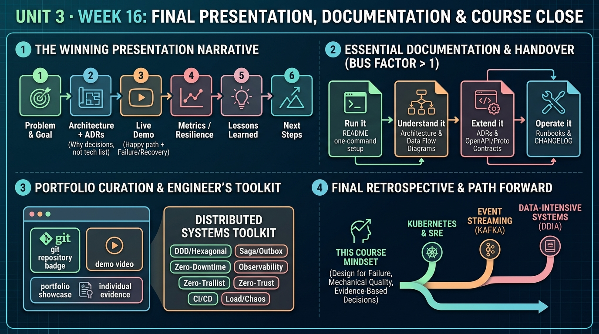

<!-- HU-STATUS TEMPLATE - do NOT remove the <!-- ... --> markers or the table headers.
     Your weekly grade is read AUTOMATICALLY from this file:
       16-week/hu-status/README.md  (inside YOUR fork). English. -->

# Weekly Status - Week 16

<!-- CONFIG-START - must match your profile repo (username/username) CONFIG -->
- FULL_NAME: Daniel Felipe Cerquera Idrobo
- GITHUB_USER: Pipecerquera
- TEAM: Barbersaas
- SPRINT_GOAL: Close the course: write the final retrospective, check that every repository can be run and changed by someone other than its owner (bus factor > 1), curate my portfolio (repository, README, diagram, ADRs, demo and my contribution) and note the next steps. No code is built this week; the system stays at its `v3.0.0` Releases.
<!-- CONFIG-END -->

> **Course close (week 2026-11-16 to 2026-11-22).** The final presentation and the documentation set
> (README, architecture diagrams, ADRs, OpenAPI contracts, runbooks, CHANGELOG) were done and delivered on
> 2026-11-12 and are recorded in [week 15](../../15-week/hu-status/README.md) (HU-000-096 and HU-000-098).
> This week closes the course: the retrospective, the handover check, the portfolio and the next steps.

## 1. User stories worked this week
| HU ID | Title | Status (todo/doing/done) | Evidence (PR or commit URL) |
|---|---|---|---|
| HU-000-099 | As the team, we want a final retrospective of the course, with what worked, what did not and what we would change | **done — 2026-11-18** | Section "Final retrospective" below, built from what weeks 11 to 15 recorded |
| HU-000-100 | As the team, we want the handover checked, so every repository can be run and changed by someone other than its owner (bus factor > 1) | **done — 2026-11-18** | Section "Handover" below; `handover.md` inside `c3-project` (owner, runbook, contract and members with commits per repository) |
| HU-000-101 | As a student, I want my portfolio curated: repository, README, diagram, ADRs, demo and my contribution in one place | **done — 2026-11-18** | Section "BarberSaaS" of my profile README: https://github.com/Pipecerquera/Pipecerquera |
| HU-000-102 | As the team, we want the next steps of BarberSaaS written down from the declared debt, so whoever continues knows where to start | **done — 2026-11-18** | Section 4 below |

### Final retrospective
**What worked**
- **Real microservices, not a monolith split on paper.** 31 repositories, one owner each, one schema and one database user per domain, and one gateway. It held up: on 2026-11-12, with `loyalty-api` stopped under traffic, only its own route answered 503 (in 2.0 s, with a `traceId`) while the catalog kept answering 200 in 13 ms ([`failure-path.md`](../../15-week/hu-status/failure-path.md)).
- **Events through an outbox instead of direct calls.** With `notifications-api` down, sign-up still answered 201 and the verification e-mail was delivered 7 s after the service returned.
- **Promotion with a trail.** Every change went `hu-*` → `develop` → `qa` → `release.3.0.0` → `main` with `git cherry-pick -x`, so each commit on `main` names its origin. `main` == latest tag in the 21 runtime repositories.
- **Testing on the real host before presenting.** The end-to-end script on Azure (31/31 on 2026-11-11) found two defects no unit test had shown: notifications-api refusing every token that named an audience, and platform-admin-api running internal jobs without checking scopes.
- **Writing decisions down.** 21 ADRs, a decision for each of the 18 threat-model rows, and a declared-debt list for 3.0.0 made the review against the teacher's list M1–M9 a check, not a guess.

**What did not work**
- **CI stopped on 2026-10-26.** The organization's GitHub Actions were locked by billing, so contract tests and lint ran only locally and their result was pasted into each pull request.
- **The reviewer bot went down on release day.** Four release pull requests were merged as admin without a review on GitHub. This was declared in week 15 and the protection was turned back on.
- **Work concentrated late.** Security findings, scopes and the clean start all landed in weeks 14 and 15, right before the release.
- **Uneven bus factor.** Only 13 of the 31 repositories have commits from two or more members.
- **Payments only simulated.** The Wompi sandbox needs an active merchant account the team does not have (#157).

**What I would change**
- Run the end-to-end script on a shared host from the first cut, not the last week.
- Pair on every repository at least once per cut, so no one learns a service from its runbook only.
- Keep CI independent of one billing account (a self-hosted runner or local hooks from day one).
- Plan the load test and Testcontainers as stories with dates, not as activities at the end.

### Handover
- **Documented for everyone:** every repository has a README with build, test and start steps; every service has a runbook (health, logs, common failures, recovery) and an OpenAPI contract; there is also an incident guide, an observability guide and the Azure deployment guide. All of it is packed in `c3-project` (`documentation/`) and lives in DOCS at tag `v3.0.0`.
- **Proven by a cold start:** on 2026-11-12 the whole system was started from the `v3.0.0` source zips in an empty folder by following only the infra README: 13 containers healthy in 167 s.
- **Owners and second members** (from `handover.md`, GitHub contributors API on 2026-11-12):
  - **Single member with commits (18 repositories):** they rely on the runbook, the contract and the README.
  - **Two or more members (13 repositories):** api-gateway, front, infra-postgres, DOCS, appointment-api, appointment-app, appointment-db, finance-inventory-api, finance-inventory-db, loyalty-api, notifications-api, notifications-db and schedule-app.
- **Verdict:** bus factor > 1 is met **by documentation and the cold start**, not by commits in every repository. That gap is stated in the retrospective.

## 2. My individual contribution
- **Retrospective:** wrote it from the evidence recorded in weeks 11 to 15, not from memory.
- **Handover check:** went through the 31 repositories of `handover.md` and counted which have a second member with commits and which rely on documentation only.
- **Portfolio:** added the BarberSaaS section to my profile README: what the system is, a container diagram, the links to the code and the infra README, the ADRs, the final presentation and the failure path, and my contribution. I own 12 of the 31 repositories: identity-auth (API, database and app), platform-admin (API, database and app), api-gateway, front, workflow, worker, infra-postgres and infra-mongo.
- **Next steps:** listed below from the declared debt of 3.0.0.

## 3. Blockers and risks
Severity first:
- **P2 — repositories with a single member with commits (18 of 31):** covered by README, runbook and contract, and by the cold start of 2026-11-12. Nobody else has changed their code yet.
- **P2 — still open from week 15, unchanged:** CI locked by billing; Wompi sandbox not possible (#157); no load test and no Testcontainers.
- **P3 — DOCS is private by the course rule:** the portfolio names the ADRs but does not link them; the public links are the code, the presentation and the failure path.
- **P3 — the Azure host is stopped between sessions** to save credit, so the live demo link only answers when it is started.

## 4. Plan for next week
End of the course. Next steps for BarberSaaS, taken from `15-project-control/declared-debt-3.0.0.md` and the open issues:
- **Real payments:** connect the Wompi sandbox when a merchant account exists (#157). The code on `main` already refuses to mark a plan as paid without a signed event.
- **Retry for failed outbox events:** today a failed outbox event stays as a dead letter (#111).
- **Load test** against SLO-1 and SLO-2, and **integration tests with Testcontainers**.
- **CI back on:** restore GitHub Actions so contract tests and lint run on every pull request.
- **Raise the bus factor:** a second member on each of the 18 single-member repositories.

## 5. Compliance self-check
- [x] Conventional Commits - `type(scope): summary` — `docs(week-16): ...` in this repository.
- [ ] Per-environment HU branch + PR to that environment (hu-xxx-dev -> develop, ...) — not applicable: no code change. This repository is the personal record, outside the HU branch flow.
- [x] Testable acceptance criteria — each story points to a section or a page anyone can open: the retrospective, the handover table and the profile README.
- [ ] Tests added/updated (unit / integration) — not applicable: no code change.
- [ ] DDD / hexagonal boundaries respected (domain has no I/O) — not applicable: no code change.
- [x] No secrets; config via environment variables — the portfolio and this record contain no secret or host credential.

## 6. Evidence links
- Repo: https://github.com/Pipecerquera/sistemas-distribuidos-2026-b-g2-daniel-cerquera.git
- Portfolio: https://github.com/Pipecerquera/Pipecerquera
- Final project and release of the cut: [week 15](../../15-week/hu-status/README.md) (HU-000-095 to HU-000-098) · [final presentation](../../15-week/hu-status/BarberSaaS-Sustentacion-Final.pdf) · [failure path](../../15-week/hu-status/failure-path.md)
- Releases: https://github.com/code-corhuila/barber-saas-docs/releases/tag/v3.0.0
- This week's infographic: `16-week/hu-status/Week-16.jpg` (in this same folder)

### Complete evidence of the week, item by item (checked against git and GitHub, 2026-11-16 to 2026-11-18)
- Commits, pull requests, reviews, comments and issues in the BarberSaaS repositories of `code-corhuila` (the 30 code repositories and DOCS): **none**. The repositories stay at their `v3.0.0` Releases.
- This repository: `a0034a4` (week 16 infographic and evidence check) and the commit that adds this course close.
- Profile repository `Pipecerquera/Pipecerquera`: the commit that adds the BarberSaaS portfolio section (HU-000-101).

