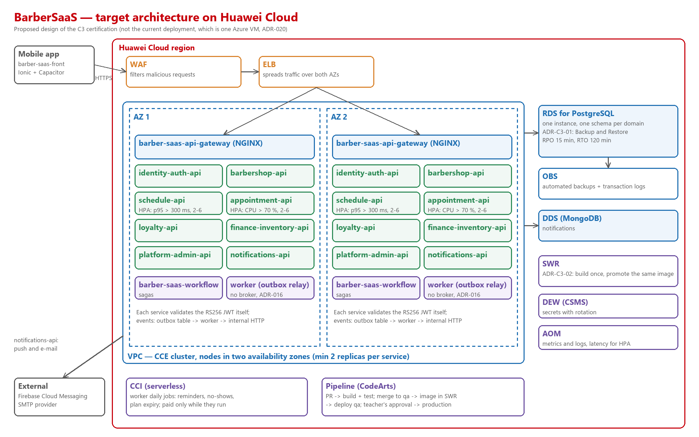

# Architecture design note — Barbersaas

## 1. Target architecture

| Component in the diagram | Defined in (file of your team's -docs) |
|---|---|
| Mobile app (`barber-saas-front`, Ionic and Capacitor) | `05-architecture/decisions/records/ADR-013-hybrid-mobile-interface.md` |
| ELB with WAF in front, then `barber-saas-api-gateway` (NGINX), the only entry | `05-architecture/overview.md` §4.2, `05-architecture/deployment.md` §3 |
| `identity-auth-api`, `barbershop-api`, `schedule-api`, `appointment-api`, `loyalty-api`, `finance-inventory-api`, `platform-admin-api` (Java) and `notifications-api` (Python), on CCE in two AZs | `05-architecture/overview.md` §4.1 |
| `barber-saas-workflow` (owner sign-up saga), on CCE | `05-architecture/overview.md` §4.2, `05-architecture/decisions/records/ADR-009-saga-state-store.md` |
| `barber-saas-worker`: the outbox relay on CCE; the daily jobs on CCI | `05-architecture/overview.md` §4.2, `05-architecture/decisions/records/ADR-016-event-transport-worker-relay.md` |
| RDS for PostgreSQL: one instance with one schema per domain, backups and transaction logs to OBS | `05-architecture/decisions/records/ADR-011-single-instance-per-engine.md`, `06-data/models.md` |
| DDS (MongoDB) for `notifications` | `05-architecture/decisions/records/ADR-006-database-engine-per-domain.md`, `06-data/models.md` |
| No broker: an outbox table per service and the worker that relays the events over internal HTTP | `05-architecture/decisions/records/ADR-016-event-transport-worker-relay.md` |
| SWR (images), DEW CSMS (secrets), AOM (metrics and logs) | `05-architecture/deployment.md` §4, §6 and §7 |
| Firebase Cloud Messaging and the SMTP provider (outside Huawei Cloud) | `05-architecture/overview.md` §2 |

When a client opens BarberSaaS and asks for an appointment, the request comes in from the internet through the ELB,
protected by WAF, and reaches the API gateway, which sends it to the right service. `schedule-api` checks the barber's
availability and, once a date and time are chosen, `appointment-api` validates the booking and stores it in PostgreSQL,
writing its event to the outbox table in the same transaction. Then the worker relays the events to the services that
need them, without constant direct calls between them: `AppointmentCreated` goes to `loyalty-api`, and when the
barbershop confirms the appointment, `AppointmentConfirmed` reaches `notifications-api`, which tells the client the
result by push and e-mail. MongoDB runs on DDS because I prefer to leave its administration, availability and
maintenance to a managed service instead of operating it inside CCE, and WAF adds a layer of protection against
malicious requests before they reach the gateway.

## 2. Five principles

| Principle | Current weakness | Evidence in -docs | Design decision | Huawei Cloud service |
|---|---|---|---|---|
| Reliability | The whole application depends on one virtual machine: if it fails, every service and both databases stop | `05-architecture/decisions/records/ADR-020-hosting-azure-for-students.md` | Spread the services over two availability zones, with at least two replicas per service | CCE (CCE cluster with nodes in two AZs) |
| Security | The secrets of qa and main live in the file `env/main.env` on the virtual machine's disk, with no secrets manager | `05-architecture/decisions/records/ADR-020-hosting-azure-for-students.md` (Secrets) | Keep the secrets in a secrets manager that controls who reads them and rotates them | DEW (CSMS) |
| Performance efficiency | `schedule-api` already caused failed bookings when it slowed down, and the latencies are not measured yet | `15-project-control/declared-debt-3.0.0.md` (OBS-02) | Measure the latency of every service and scale automatically when the demand grows | CCE autoscaling (HPA) and AOM |
| Cost | The platform runs on a student credit of USD 100, and every service runs all day even when there is little traffic | `05-architecture/decisions/records/ADR-020-hosting-azure-for-students.md` | Run the daily jobs of the worker (reminders, no-shows, plan expiry) as short jobs paid only while they run; the event relay of the worker keeps running as it does today | CCI (serverless containers) |
| Operations | Images are built on the virtual machine with no registry, so a rollback rebuilds from source | `05-architecture/decisions/records/ADR-020-hosting-azure-for-students.md` (the first build on the VM took about 6 minutes) | Build each image once, store it with a tag, and deploy that same image to qa and to production | SWR |

If I could implement only one of these five improvements first, I would choose reliability: moving BarberSaaS from one
virtual machine to CCE in two availability zones. This is the priority because today the whole application depends on a
single virtual machine, and if it fails, every service stops. Spreading the services over different zones removes that
single point of failure and makes the platform more available. This migration is also the base for the autoscaling of
section 3 and for managing the resources according to the demand. Even though it means higher costs and changes in the
infrastructure, keeping the service running should be our first priority.

## 3. Scalability

| Service | Scaling metric | Threshold (number and unit) | Min instances | Max instances |
|---|---|---|---|---|
| `schedule-api` | p95 latency of the availability queries | above 300 ms for 5 minutes | 2 | 6 |
| `appointment-api` | Average CPU use of its replicas | above 70 % for 3 minutes | 2 | 6 |

`schedule-api` scales on latency because it was the slow service in the drill of week 11: when it answered in
3 seconds, bookings failed, and the target for these queries is under 300 ms. `appointment-api` scales on CPU because it
creates the bookings and has to absorb the peaks of the busiest days. Both keep at least 2 replicas, one per availability
zone, so they stay up if a zone fails, and they stop at 6 replicas to keep the cost under control during the peaks.

## 4. Disaster recovery

- Critical data store: the PostgreSQL instance of the platform, above all its `appointment` schema (the clients' appointments) and its `loyalty` schema (stamps, coupons and the processed events). Losing recent bookings means a barbershop loses appointments its clients already made.
- RTO: 120 minutes
- RPO: 15 minutes
- DR pattern (chapter 11): Backup and Restore (backup-based disaster recovery)
- Why the pattern meets those numbers: automated RDS backups plus a copy of the transaction logs to OBS every 15 minutes mean that a failure loses at most the last 15 minutes of bookings. Restoring PostgreSQL on a new instance, starting the microservices and checking that the app works fits within 2 hours, at a much lower cost than keeping a second database running all the time.

## 5. Automated deployment

| Stage | Trigger | Tool or service | File in your team's repositories |
|---|---|---|---|
| Build | Every pull request to `develop` and `qa` | CodeArts Build (today GitHub Actions, `mvn -B verify`) | `barber-saas-appointment-api/.github/workflows/ci.yml` |
| Test | Together with the build, on every pull request to `develop` and `qa` | CodeArts Build (today GitHub Actions); Liquibase applies, rolls back and applies again each schema change | `barber-saas-appointment-api/.github/workflows/ci.yml`, `barber-saas-appointment-db/.github/workflows/db-ci.yml` |
| Image | Merge into `qa` | SWR (one image per service, with a tag) | `barber-saas-appointment-api/deploy/Dockerfile`, `barber-saas-worker/.github/workflows/ci.yml` |
| Deploy to qa | Automatic, after the image is pushed | CCE | `barber-saas-infra-postgres/compose.yml`, `barber-saas-infra-postgres/env/qa.env.example`, `barber-saas-infra-postgres/scripts/up.sh` |
| Deploy to production | Manual, after the teacher approves the pull request to `main` | CCE, with the same image tested in qa | `barber-saas-infra-postgres/env/main.env.example`, `barber-saas-infra-postgres/scripts/migrate.sh`, `barber-saas-infra-postgres/deploy/azure/README.md` |
| Rollback | Automatic when the health check fails after a deployment (the image); the schema only by hand | CCE goes back to the previous image in SWR; Liquibase rollback after a backup | `barber-saas-infra-postgres/scripts/up.sh`, `barber-saas-appointment-db/05_rollbacks/` |

Each change is checked on every pull request, so errors are found early. The image is built once, when the change
reaches `qa`, and that same image goes to production, so what was tested is what runs. Production keeps a manual step:
the teacher approves the pull request to `main` before anything is published. The rollback of the image is automatic
when the health check fails, which shortens the time the app is down; the rehearsal of week 14 already brought one
service back in about 40 seconds. A schema change is never rolled back automatically: the data is backed up first and
the Liquibase rollback is run by hand.

## 6. Decisions

- [ADR-C3-01](ADR-C3-01.md): protect the PostgreSQL instance with Backup and Restore (RPO 15 minutes, RTO 120 minutes)
  instead of a primary/standby pair, to meet the recovery targets at a lower cost.
- [ADR-C3-02](ADR-C3-02.md): build each image once, store it in SWR with a tag and promote that same image from qa to
  production, so what was tested is what runs and a rollback does not rebuild.
